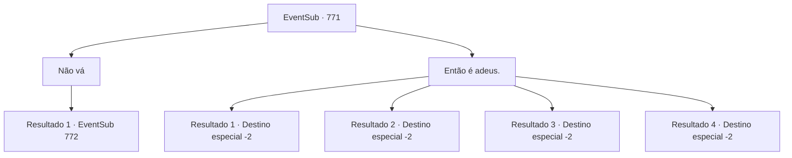

# Eventos secundários · 771

[Índice da tabela](index.md) · [Índice geral](../index.md)

ID: `pt:EventSub:771` · Fonte: `EventSub4` · Versão: 1.2.47.

Mapeamento estático dos arquivos; a disponibilidade e a execução dependem do estado da run.

## Texto do evento

*Sem texto no arquivo.*

## Dados de entrada

```json
{
  "id": 771,
  "grade": 1,
  "subEvent": "",
  "required": ""
}
```

## Mapa das escolhas



## Escolhas e resultados

### Escolha 1

Não vá

Requisitos e outros campos da escolha:

```json
{
  "required": "5_750_1|24_1_1"
}
```

#### Resultado 1.1

Desta vez, você impede Lei. Lei se aproxima lentamente de você e te abraça. 

 "Eu adoraria ficar, mas... eu preciso voltar. Preciso restaurar a glória do meu clã com Shao."

 Um breve silêncio preenche o ar. A luz brilhante da lua ilumina você e Lei. Lei olha nos seus olhos, sorri calorosamente e continua. 

 "Eu prometo que voltarei, assim que meu trabalho lá estiver concluído. Você vai me esperar?"


Continuação registrada: [Evento 772](0772.md) na mesma tabela.

```json
{
  "required": "",
  "chance": "1",
  "nextEvent": 772,
  "type": 2,
  "reward": ""
}
```

### Escolha 2

Então é adeus.

Requisitos e outros campos da escolha:

```json
{
  "required": ""
}
```

#### Resultado 2.1

Você se despede de Lei. Lei se inclina em gratidão mais uma vez. Quando ele levanta a cabeça, você percebe que seus olhos estão marejados. 

 "Ah, quase me esqueci... Aqui, por favor, aceite isto. Um símbolo de gratidão, por tudo."

 É um vestido de estilo oriental que exala uma aura luxuosa. A imagem de um dragão está lindamente bordada na seda alabastrina, como se estivesse nadando em um mar de nuvens. Ele lhe entrega com as mãos trêmulas, depois se afasta apressadamente.

Continuação registrada: [Destino especial `-2`](../destinos-especiais.md).

```json
{
  "required": "5_724_1|5_750_1",
  "chance": "1",
  "nextEvent": -2,
  "type": 2,
  "reward": "3_324_1|12_11_-1|14_11_3|14_11_5"
}
```

#### Resultado 2.2

Você se despede de Lei.   Lei se curva em gratidão mais uma vez.   Quando ele levanta a cabeça, você percebe que seus olhos estão marejados.   

 "Ah, quase me esqueci... Aqui, por favor, aceite isto. Um símbolo de gratidão, por tudo."

   É um vestido de estilo oriental que exala uma aura luxuosa.   Uma imagem de um dragão está lindamente bordada na seda alabastro, como se estivesse nadando em um mar de nuvens.   Ele lhe entrega com as mãos trêmulas, depois se afasta apressadamente.

Continuação registrada: [Destino especial `-2`](../destinos-especiais.md).

```json
{
  "required": "18_724_1|5_750_1",
  "chance": "1",
  "nextEvent": -2,
  "type": 2,
  "reward": "3_324_1|12_11_-1|14_11_5"
}
```

#### Resultado 2.3

Você se despede de Lei. Lei se inclina em gratidão mais uma vez. 

 "Ah, certo. Aqui, um símbolo de gratidão, por tudo."

 Ele lhe entrega um vestido de seda cuidadosamente dobrado. Uma imagem de um dragão está lindamente bordada na seda alabastrina, como se estivesse nadando em um mar de nuvens. 

 "Isso é chamado de Manto do Dragão. É tradição do nosso clã usá-lo quando você está prestes a entrar em uma luta importante. Eu quero que você o tenha."

 Você recebe o Manto do Dragão com gratidão e se despede. Lei se afasta, acenando com a mão até que você não possa mais vê-lo.

Continuação registrada: [Destino especial `-2`](../destinos-especiais.md).

```json
{
  "required": "5_724_1|18_750_1",
  "chance": "1",
  "nextEvent": -2,
  "type": 2,
  "reward": "3_324_1|12_11_-1|14_11_3|14_11_5"
}
```

#### Resultado 2.4

Você se despede de Lei. Lei se inclina em gratidão mais uma vez. 

 "Ah, certo. Aqui, um símbolo de gratidão, por tudo."

 Ele lhe entrega um vestido de seda cuidadosamente dobrado. Uma imagem de um dragão está lindamente bordada na seda alabastrina, como se estivesse nadando em um mar de nuvens. 

 "Isso é chamado de Manto do Dragão. É tradição do nosso clã usá-lo quando você está prestes a entrar em uma luta importante. Eu quero que você o tenha."

 Você recebe o Manto do Dragão com gratidão e se despede. Lei se afasta, acenando com a mão até que você não possa mais vê-lo.

Continuação registrada: [Destino especial `-2`](../destinos-especiais.md).

```json
{
  "required": "18_724_1|18_750_1",
  "chance": "1",
  "nextEvent": -2,
  "type": 2,
  "reward": "3_324_1|12_11_-1|14_11_5"
}
```

## Referências que chegam a este evento

- [Evento 769 · escolha 1 · resultado 1](0769.md#escolha-1)
- [Evento 770 · escolha 2 · resultado 1](0770.md#escolha-2)
