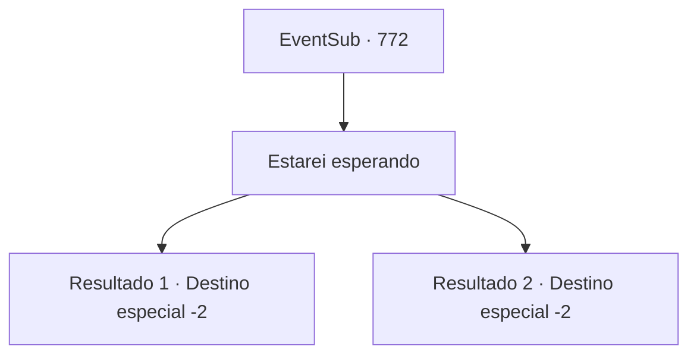

# Eventos secundários · 772

[Índice da tabela](index.md) · [Índice geral](../index.md)

ID: `pt:EventSub:772` · Fonte: `EventSub4` · Versão: 1.2.47.

Mapeamento estático dos arquivos; a disponibilidade e a execução dependem do estado da run.

## Texto do evento

*Sem texto no arquivo.*

## Dados de entrada

```json
{
  "id": 772,
  "grade": 1,
  "subEvent": "",
  "required": ""
}
```

## Mapa das escolhas



## Escolhas e resultados

### Escolha 1

Estarei esperando

Requisitos e outros campos da escolha:

```json
{
  "required": ""
}
```

#### Resultado 1.1

Lei vira a cabeça para olhar para você. Em seus olhos brilhantes, você vê um reflexo do seu próprio rosto. Lei fala, segurando suas mãos firmemente. 

 "Não vou demorar. Voltarei o mais rápido possível. Ah, certo... Aqui, um símbolo de gratidão, por tudo."

 Ela lhe entrega um vestido de seda cuidadosamente dobrado. Uma imagem de um dragão está lindamente bordada na seda alabastrina, como se estivesse nadando em um mar de nuvens. 

 "Isso se chama Manto do Dragão. É tradição do nosso clã usá-lo quando você está prestes a entrar em uma luta importante. Quero que você o tenha."

 Você recebe o Manto do Dragão com gratidão e a abraça uma última vez, antes de finalmente se despedir. Lei se afasta, acenando com a mão até que você não possa mais vê-la.

Continuação registrada: [Destino especial `-2`](../destinos-especiais.md).

```json
{
  "required": "5_724_1",
  "chance": "1",
  "nextEvent": -2,
  "type": 2,
  "reward": "3_324_1|14_11_3|14_11_5|14_11_4|12_11_-1|5_760_1"
}
```

#### Resultado 1.2

Lei vira a cabeça para olhar para você. Em seus olhos brilhantes, você vê um reflexo do seu próprio rosto. Lei fala, segurando suas mãos firmemente. 

 "Não vou demorar. Voltarei o mais rápido possível. Ah, certo... Aqui, um símbolo de gratidão, por tudo."

 Ela lhe entrega um vestido de seda cuidadosamente dobrado. Uma imagem de um dragão está lindamente bordada na seda alabastrina, como se estivesse nadando em um mar de nuvens. 

 "Isso se chama Manto do Dragão. É tradição do nosso clã usá-lo quando você está prestes a entrar em uma luta importante. Quero que você o tenha."

 Você recebe o Manto do Dragão com gratidão e a abraça uma última vez, antes de finalmente se despedir. Lei se afasta, acenando com a mão até que você não possa mais vê-la.

Continuação registrada: [Destino especial `-2`](../destinos-especiais.md).

```json
{
  "required": "18_724_1",
  "chance": "1",
  "nextEvent": -2,
  "type": 2,
  "reward": "3_324_1|14_11_5|14_11_4|12_11_-1|5_760_1"
}
```

## Referências que chegam a este evento

- [Evento 770 · escolha 1 · resultado 1](0770.md#escolha-1)
- [Evento 771 · escolha 1 · resultado 1](0771.md#escolha-1)
