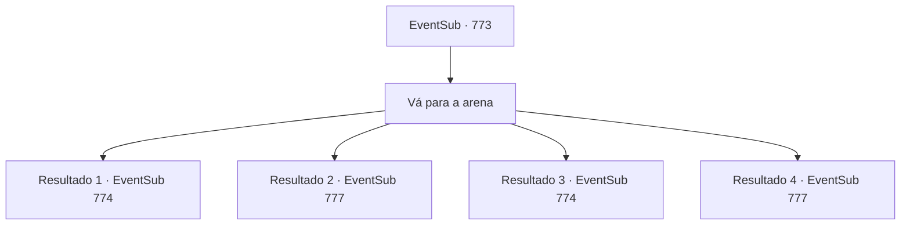

# Eventos secundários · 773

[Índice da tabela](index.md) · [Índice geral](../index.md)

ID: `pt:EventSub:773` · Fonte: `EventSub4` · Versão: 1.2.47.

Mapeamento estático dos arquivos; a disponibilidade e a execução dependem do estado da run.

## Texto do evento

*Sem texto no arquivo.*

## Dados de entrada

```json
{
  "id": 773,
  "grade": 1,
  "subEvent": "",
  "required": ""
}
```

## Mapa das escolhas



## Escolhas e resultados

### Escolha 1

Vá para a arena

Requisitos e outros campos da escolha:

```json
{
  "required": ""
}
```

#### Resultado 1.1

Você se dirige à arena, onde o Torneio Battra está sendo realizado. Lá você encontra Lei. Você percebe que ele está com uma expressão abatida - mas assim que ele te vê, faz o melhor para forçar um sorriso. 

 "Desejo-lhe sorte, Sohyeop."

 Lei te anima, então se dirige às câmaras dos competidores. 

 Após alguns minutos de preparação, você sobe ao palco. Os assentos da plateia estão lotados - o lugar está cheio de espectadores animados, mostrando sua expectativa para a luta que está prestes a acontecer. Seu primeiro oponente é um cavaleiro vestido com uma armadura completa. 

 "O nome é Sparkles, companheiro aventureiro! Venho do grande Reino de Lothar. Vamos ter uma luta honrada e justa."

 Aplausos e gritos altos enchem a arena enquanto a batalha começa.

Continuação registrada: [Evento 774](0774.md) na mesma tabela.

```json
{
  "required": "5_751_1|18_763_1",
  "chance": "1",
  "nextEvent": 774,
  "type": 2,
  "reward": "6_0_180",
  "place": 11
}
```

#### Resultado 1.2

Você se dirige à arena, onde o Torneio Battra está sendo realizado. Lá você encontra Lei. Você percebe que ele está com uma expressão abatida - mas assim que ele te vê, faz o melhor para forçar um sorriso. 

 "Sohyeop. Desejo profundamente vê-lo na plateia."

 Lei se dirige às câmaras dos competidores. Você sai para ocupar seu assento. O lugar está lotado de espectadores ansiosos, que aguardam com entusiasmo a próxima luta. 

 À medida que a noite chega, a maioria das lutas chega ao fim, e a luta final está prestes a começar. 

 "Lei Ryu do Clã Ryu! E Sir Sparkles, do Reino de Lothar!"

 Os dois se cumprimentam respeitosamente de suas próprias maneiras únicas. A batalha começa. Lei, assim que a luta começa, começa a encurralar Sparkles com golpes rápidos. Como o combatente experiente que é, Sparkles luta de volta habilmente. Mas eventualmente sua resistência atinge o limite. Sparkles recua e acidentalmente solta a arma. Lei é declarado o vencedor. 

 "O novo Mestre de Batalha é... Lei Ryu!!"

 Aplausos estrondosos explodem da multidão. <link=shake>

 "WOOOOOOOOO!!!"

</link> É como se a cidade inteira estivesse tremendo. Lei responde ao público fazendo a saudação oriental. Você o observa enquanto ele se mantém triunfante, aplaudindo apaixonadamente.

Continuação registrada: [Evento 777](0777.md) na mesma tabela.

```json
{
  "required": "5_751_1|5_763_1",
  "chance": "1",
  "nextEvent": 777,
  "type": 2,
  "reward": ""
}
```

#### Resultado 1.3

Você e Lei se dirigem à arena, onde o Torneio Battra está sendo realizado. Você percebe que ele está com uma expressão abatida - mas assim que sente seu olhar sobre ele, faz o melhor para forçar um sorriso. 

 "Desejo-lhe sorte, Sohyeop."

 Lei te anima, então se dirige às câmaras dos competidores. 

 Após alguns minutos de preparação, você sobe ao palco. As arquibancadas estão lotadas - o lugar está cheio de espectadores animados, mostrando sua expectativa para a luta que está prestes a acontecer. Seu primeiro oponente é um cavaleiro vestido com uma armadura completa. 

 "O nome é Sparkles, companheiro aventureiro! Venho do grande Reino de Lothar. Vamos ter uma luta honrada e justa."

 Gritos e aplausos altos enchem a arena enquanto a batalha começa.

Continuação registrada: [Evento 774](0774.md) na mesma tabela.

```json
{
  "required": "18_751_1|18_763_1",
  "chance": "1",
  "nextEvent": 774,
  "type": 2,
  "reward": "6_0_180",
  "place": 11
}
```

#### Resultado 1.4

Você e Lei se dirigem à arena, onde o Torneio Battra está sendo realizado. Você percebe que ele está com uma expressão abatida - mas assim que sente seu olhar sobre ele, faz o melhor para forçar um sorriso.. 

 "Sohyeop. Desejo profundamente vê-lo na plateia."

 Lei se dirige às câmaras dos competidores. Você sai para ocupar seu assento. O lugar está lotado de espectadores ansiosos, que aguardam com entusiasmo a próxima luta. 

 À medida que a noite chega, a maioria das lutas chega ao fim, e a luta final está prestes a começar. 

 "Lei Ryu do Clã Ryu! E Sir Sparkles, do Reino de Lothar!"

 Os dois se cumprimentam respeitosamente de suas próprias maneiras únicas. A batalha começa. Lei, assim que a luta começa, começa a encurralar Sparkles com golpes rápidos. Como o combatente experiente que é, Sparkles luta de volta habilmente. Mas eventualmente sua resistência atinge o limite. Sparkles recua e acidentalmente solta a arma. Lei é declarado o vencedor. 

 "O novo Mestre de Batalha é... Lei Ryu!!"

 Aplausos estrondosos explodem da multidão. <link=shake>

 "WOOOOOOOOO!!!"

</link> É como se a cidade inteira estivesse tremendo. Lei responde ao público fazendo a saudação oriental. Você o observa enquanto ele se mantém triunfante, aplaudindo apaixonadamente.

Continuação registrada: [Evento 777](0777.md) na mesma tabela.

```json
{
  "required": "18_751_1|5_763_1",
  "chance": "1",
  "nextEvent": 777,
  "type": 2,
  "reward": ""
}
```

## Referências que chegam a este evento

- [Evento 756 · escolha 2 · resultado 1](0756.md#escolha-2)
- [Evento 761 · escolha 1 · resultado 1](0761.md#escolha-1)
- [Evento 761 · escolha 1 · resultado 2](0761.md#escolha-1)
