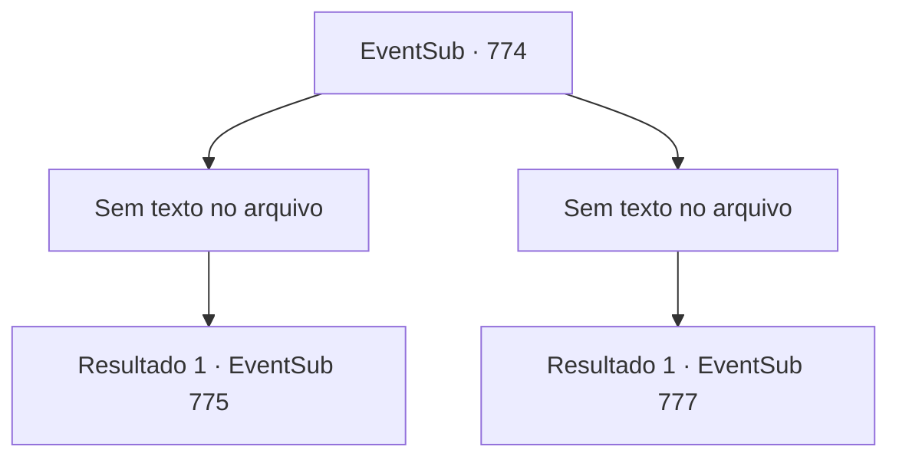

# Eventos secundários · 774

[Índice da tabela](index.md) · [Índice geral](../index.md)

ID: `pt:EventSub:774` · Fonte: `EventSub4` · Versão: 1.2.47.

Mapeamento estático dos arquivos; a disponibilidade e a execução dependem do estado da run.

## Texto do evento

*Sem texto no arquivo.*

## Dados de entrada

```json
{
  "id": 774,
  "grade": 1,
  "subEvent": "",
  "required": ""
}
```

## Mapa das escolhas



## Escolhas e resultados

### Escolha 1

*Sem texto no arquivo; o papel dessa opção depende da interface do jogo.*

Requisitos e outros campos da escolha:

```json
{
  "required": ""
}
```

#### Resultado 1.1

<link=shake>

 "WOOOOOOOOO!!!"

</link> Aplausos enchem a arena quando a luta termina. Nessa batalha feroz, você sai vitorioso, mas tem que admitir que foi por pouco. Você levanta o punho no ar para responder aos aplausos enquanto desce do palco. 

 As lutas continuam. Após algumas rodadas, Lei aparece no palco. Sua esgrima brilha intensamente, mesmo entre outros competidores capazes. A batalha logo termina com a vitória de Lei. Logo é revelado que seu próximo oponente não é um humano, mas um golem. De acordo com as regras, quando um participante não aparece no dia da luta, é assim que as vagas são preenchidas. Quando você entra no palco, o golem começa a brilhar e se levanta.

Continuação registrada: [Evento 775](0775.md) na mesma tabela.

```json
{
  "required": "",
  "chance": "1",
  "nextEvent": 775,
  "type": 2,
  "reward": "6_0_43",
  "place": 11
}
```

### Escolha 2

*Sem texto no arquivo; o papel dessa opção depende da interface do jogo.*

Requisitos e outros campos da escolha:

```json
{
  "required": ""
}
```

#### Resultado 2.1

<link=shake>

 "WOOOOOOOOO!!!"

</link> Aplausos enchem a arena enquanto a luta termina. Sir Sparkles emerge vitorioso. Ele levanta o punho no ar para responder aos aplausos. Você o encara por alguns segundos antes de descer do palco. Lei corre até você e te conforta. 

 "Você lutou bem, Sohyeop."

 Você concorda com a cabeça e caminha até os assentos dos espectadores. 

 À medida que a noite chega, a maioria das lutas chega ao fim, e a luta final está prestes a começar. 

 "Lei Ryu do Clã Ryu! E Sir Sparkles, do Reino de Lothar!"

 Os dois se cumprimentam respeitosamente de suas próprias maneiras únicas. A batalha começa. Lei, assim que a luta começa, começa a encurralar Sparkles com golpes rápidos. Como o combatente experiente que é, Sparkles luta de volta habilmente. Mas eventualmente sua resistência atinge o limite. Sparkles recua e acidentalmente solta a arma. Lei é declarado o vencedor. 

 "O novo Mestre de Batalha é... Lei Ryu!!"

 Aplausos estrondosos explodem da multidão. <link=shake>

 "WOOOOOOOOO!!!"

</link> É como se a cidade inteira estivesse tremendo. Lei responde ao público fazendo a saudação oriental. Você o observa enquanto ele se mantém triunfante, aplaudindo apaixonadamente.

Continuação registrada: [Evento 777](0777.md) na mesma tabela.

```json
{
  "required": "",
  "chance": "1",
  "nextEvent": 777,
  "type": 2,
  "reward": "5_724_1"
}
```

## Referências que chegam a este evento

- [Evento 773 · escolha 1 · resultado 1](0773.md#escolha-1)
- [Evento 773 · escolha 1 · resultado 3](0773.md#escolha-1)
