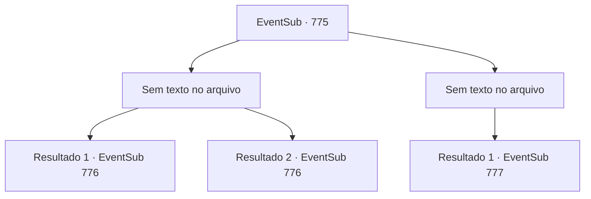

# Eventos secundários · 775

[Índice da tabela](index.md) · [Índice geral](../index.md)

ID: `pt:EventSub:775` · Fonte: `EventSub4` · Versão: 1.2.47.

Mapeamento estático dos arquivos; a disponibilidade e a execução dependem do estado da run.

## Texto do evento

*Sem texto no arquivo.*

## Dados de entrada

```json
{
  "id": 775,
  "grade": 1,
  "subEvent": "",
  "required": ""
}
```

## Mapa das escolhas



## Escolhas e resultados

### Escolha 1

*Sem texto no arquivo; o papel dessa opção depende da interface do jogo.*

Requisitos e outros campos da escolha:

```json
{
  "required": ""
}
```

#### Resultado 1.1

Você derrota o golem de ferro. Uma ovação ainda mais alta vem da plateia. Você acena em resposta a isso, então se dirige para as câmaras dos competidores. 

 Logo, você se prepara e entra na arena. A empolgação do público está no auge. Eles estão gritando seu nome e o nome do seu oponente repetidamente. Usando a torcida como combustível, você se prepara para lutar. Seu oponente, que estava no palco antes de você, ri e fala. 

 "Eu sempre quis uma revanche, Sohyeop."

 Lei se aproxima de você confortavelmente e faz a saudação oriental. Então, ele puxa sua espada, seus olhos fixos nos seus.

Continuação registrada: [Evento 776](0776.md) na mesma tabela.

```json
{
  "required": "5_743_1",
  "chance": "1",
  "nextEvent": 776,
  "type": 2,
  "reward": "6_3_182",
  "place": 11
}
```

#### Resultado 1.2

Você derrota o golem de ferro. Uma ovação ainda mais alta vem da plateia. Você acena em resposta a isso, então se dirige para as câmaras dos competidores. 

 Logo, você se prepara e entra na arena. A empolgação do público está no auge. Eles estão gritando seu nome e o nome do seu oponente repetidamente. Usando a torcida como combustível, você se prepara para lutar. Seu oponente, que estava no palco antes de você, ri e fala. 

 "Eu sempre quis uma revanche, Sohyeop."

 Lei se aproxima de você confortavelmente e faz a saudação oriental. Então, ele puxa sua espada, seus olhos fixos nos seus.

Continuação registrada: [Evento 776](0776.md) na mesma tabela.

```json
{
  "required": "18_743_1",
  "chance": "1",
  "nextEvent": 776,
  "type": 2,
  "reward": "6_0_182",
  "place": 11
}
```

### Escolha 2

*Sem texto no arquivo; o papel dessa opção depende da interface do jogo.*

Requisitos e outros campos da escolha:

```json
{
  "required": ""
}
```

#### Resultado 2.1

O golem de ferro te soca com tanta força que você é jogado ao chão. Você é declarado o perdedor. Infelizmente, você desce do palco. 

 À medida que a noite chega, a maioria das lutas chega ao fim, e a luta final está prestes a começar. 

 "Lei Ryu do Clã Ryu! Sanson, o Matador de Trolls!"

 A batalha começa. Lei, assim que a luta começa, começa a encurralar Sanson com golpes rápidos. Nenhuma vez Sanson consegue acertar um golpe em Lei. Os golpes de Lei logo o deixam caído no chão. 

 "O novo Mestre da Batalha é... Lei Ryu!!"

 Aplausos estrondosos explodem da multidão. <link=shake>

 "WOOOOOOOOO!!!"

</link> É como se a cidade inteira estivesse tremendo. Lei responde ao público fazendo a saudação oriental. Você olha para ele enquanto ele fica triunfante, aplaudindo apaixonadamente.

Continuação registrada: [Evento 777](0777.md) na mesma tabela.

```json
{
  "required": "",
  "chance": "1",
  "nextEvent": 777,
  "type": 2,
  "reward": "5_724_1"
}
```

## Referências que chegam a este evento

- [Evento 774 · escolha 1 · resultado 1](0774.md#escolha-1)
