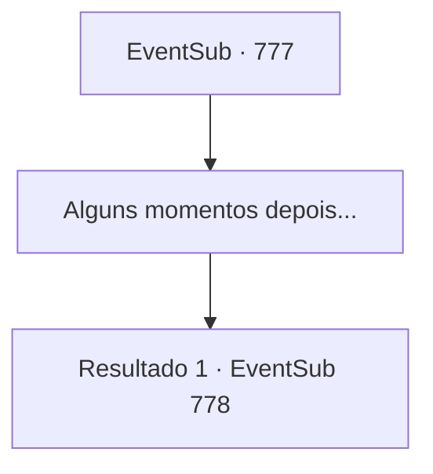

# Eventos secundários · 777

[Índice da tabela](index.md) · [Índice geral](../index.md)

ID: `pt:EventSub:777` · Fonte: `EventSub4` · Versão: 1.2.47.

Mapeamento estático dos arquivos; a disponibilidade e a execução dependem do estado da run.

## Texto do evento

*Sem texto no arquivo.*

## Dados de entrada

```json
{
  "id": 777,
  "grade": 1,
  "subEvent": "",
  "required": ""
}
```

## Mapa das escolhas



## Escolhas e resultados

### Escolha 1

Alguns momentos depois...

Requisitos e outros campos da escolha:

```json
{
  "required": ""
}
```

#### Resultado 1.1

Você está convidado para o jantar naquela noite, tendo a chance de se misturar com outros competidores e os patronos do torneio. Poucos momentos depois, após o banquete estar quase no fim, você finalmente consegue a tão esperada solidão. Você sai para a rua com a barriga cheia. Embora o torneio em si tenha acabado, o clima festivo ainda não morreu. Provavelmente porque é o último dia. Esta seria uma noite longa e animada para a cidade. Então, você vê Lei vindo em sua direção. 

 "Sohyeop. Um momento, por favor."

 Lei te leva a uma colina, com uma ótima vista de toda a cidade. Lei olha para a lua brilhante por um momento, depois se vira para você. 

 "Estou pensando em voltar, Sohyeop. De volta para minha casa no Oriente. Lá, restaurarei a honra e a glória do meu grande clã com Shao e serei reconhecido como um guerreiro oficial. Não posso te agradecer o suficiente por toda a ajuda que você me deu até agora."


Continuação registrada: [Evento 778](0778.md) na mesma tabela.

```json
{
  "required": "",
  "chance": "1",
  "nextEvent": 778,
  "type": 2,
  "reward": ""
}
```

## Referências que chegam a este evento

- [Evento 773 · escolha 1 · resultado 2](0773.md#escolha-1)
- [Evento 773 · escolha 1 · resultado 4](0773.md#escolha-1)
- [Evento 774 · escolha 2 · resultado 1](0774.md#escolha-2)
- [Evento 775 · escolha 2 · resultado 1](0775.md#escolha-2)
- [Evento 776 · escolha 1 · resultado 1](0776.md#escolha-1)
- [Evento 776 · escolha 2 · resultado 1](0776.md#escolha-2)
