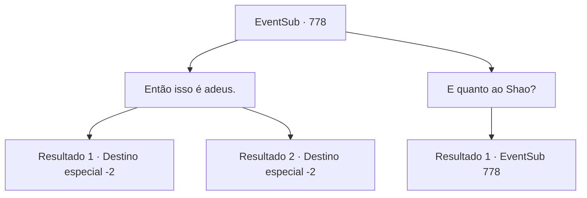

# Eventos secundários · 778

[Índice da tabela](index.md) · [Índice geral](../index.md)

ID: `pt:EventSub:778` · Fonte: `EventSub4` · Versão: 1.2.47.

Mapeamento estático dos arquivos; a disponibilidade e a execução dependem do estado da run.

## Texto do evento

*Sem texto no arquivo.*

## Dados de entrada

```json
{
  "id": 778,
  "grade": 1,
  "subEvent": "",
  "required": ""
}
```

## Mapa das escolhas



## Escolhas e resultados

### Escolha 1

Então isso é adeus.

Requisitos e outros campos da escolha:

```json
{
  "required": ""
}
```

#### Resultado 1.1

Você se despede de Lei.   Lei se curva em gratidão mais uma vez.   

 "Ah, certo. Aqui, um símbolo de gratidão, por tudo."

   Ele lhe entrega um vestido de seda cuidadosamente dobrado.   Uma imagem de um dragão está lindamente bordada na seda alabastro, como se estivesse nadando em um mar de nuvens.   

 "Isso é chamado de Manto do Dragão. É tradição do nosso clã usá-lo quando você está prestes a entrar em uma luta importante. Eu quero que você o tenha."

   Você recebe o Manto do Dragão com gratidão e se despede.   Lei se afasta, acenando com a mão até que você não possa mais vê-lo.

Continuação registrada: [Destino especial `-2`](../destinos-especiais.md).

```json
{
  "required": "5_724_1",
  "chance": "1",
  "nextEvent": -2,
  "type": 2,
  "reward": "3_324_1|12_11_-1|14_11_17"
}
```

#### Resultado 1.2

Você se despede de Lei. Lei se inclina em gratidão mais uma vez. 

 "Ah, certo. Aqui, um símbolo de gratidão, por tudo."

 Ele lhe entrega um vestido de seda cuidadosamente dobrado. Uma imagem de um dragão está lindamente bordada na seda alabastrina, como se estivesse nadando em um mar de nuvens. 

 "Isso é chamado de Manto do Dragão. É tradição do nosso clã usá-lo quando você está prestes a entrar em uma luta importante. Eu quero que você o tenha."

 Você recebe o Manto do Dragão com gratidão e se despede. Lei se afasta, acenando com a mão até que você não possa mais vê-lo.

Continuação registrada: [Destino especial `-2`](../destinos-especiais.md).

```json
{
  "required": "18_724_1",
  "chance": "1",
  "nextEvent": -2,
  "type": 2,
  "reward": "3_324_1|12_11_-1|14_11_17"
}
```

### Escolha 2

E quanto ao Shao?

Requisitos e outros campos da escolha:

```json
{
  "required": "5_751_1|5_756_0"
}
```

#### Resultado 2.1

Você pergunta a ele o que exatamente aconteceu com Shao. O rosto de Lei fica sombrio. 

 "Ela provavelmente... não, certamente, nunca mais será capaz de segurar uma espada novamente."

 Lei para por aí. Aparentemente, ela não quer falar sobre isso.

Continuação registrada: [Evento 778](0778.md) na mesma tabela.

```json
{
  "required": "",
  "chance": "1",
  "nextEvent": 778,
  "type": 2,
  "reward": "5_756_9"
}
```

## Referências que chegam a este evento

- [Evento 756 · escolha 2 · resultado 3](0756.md#escolha-2)
- [Evento 777 · escolha 1 · resultado 1](0777.md#escolha-1)
- [Evento 778 · escolha 2 · resultado 1](0778.md#escolha-2)
