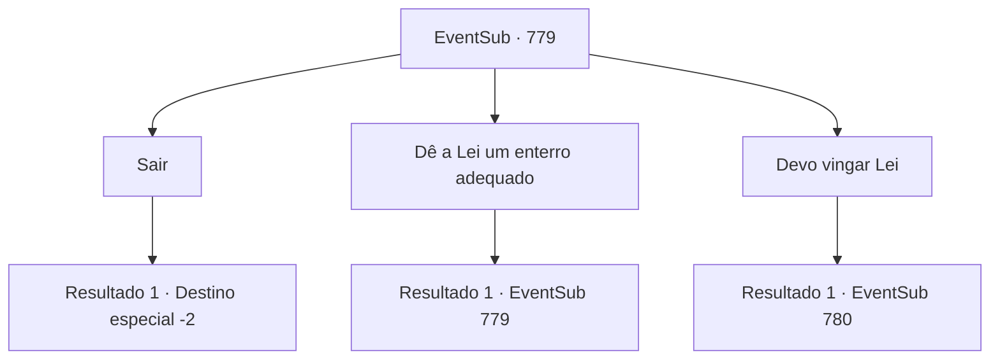

# Eventos secundários · 779

[Índice da tabela](index.md) · [Índice geral](../index.md)

ID: `pt:EventSub:779` · Fonte: `EventSub4` · Versão: 1.2.47.

Mapeamento estático dos arquivos; a disponibilidade e a execução dependem do estado da run.

## Texto do evento

*Sem texto no arquivo.*

## Dados de entrada

```json
{
  "id": 779,
  "grade": 1,
  "subEvent": "",
  "required": ""
}
```

## Mapa das escolhas



## Escolhas e resultados

### Escolha 1

Sair

Requisitos e outros campos da escolha:

```json
{
  "required": ""
}
```

#### Resultado 1.1

Você lamenta silenciosamente a morte de Lei. A chuva estava ficando mais forte. Você decide descer a colina.

Continuação registrada: [Destino especial `-2`](../destinos-especiais.md).

```json
{
  "required": "",
  "chance": "1",
  "nextEvent": -2,
  "type": 2,
  "reward": "12_11_-1|14_11_0|14_11_6"
}
```

### Escolha 2

Dê a Lei um enterro adequado

Requisitos e outros campos da escolha:

```json
{
  "required": "8_38_1|5_754_1"
}
```

#### Resultado 2.1

Você encontra um local no chão exposto ao sol e começa a cavar. Ainda está chovendo, mas você consegue transformar o solo escorregadio em uma cova adequada. Você prossegue cuidadosamente a colocar o corpo de Lei no buraco e enterrá-lo.

Continuação registrada: [Evento 779](0779.md) na mesma tabela.

```json
{
  "required": "",
  "chance": "1",
  "nextEvent": 779,
  "type": 2,
  "reward": "0_3_1|5_754_2"
}
```

### Escolha 3

Devo vingar Lei

Requisitos e outros campos da escolha:

```json
{
  "required": ""
}
```

#### Resultado 3.1

Você promete a si mesmo vingar a morte de Lei. Com esse objetivo singular em mente, você questiona todos que pode sobre o paradeiro de Shao. Então, você ouve de um velho que alguém que corresponde à sua descrição de Shao foi para o porto local. Você corre para o porto sem hesitação. Lá, você avista um navio construído em estilo oriental. Shao está embarcando no navio no momento, junto com os Red Drakes. Você se joga no navio, conseguindo alcançá-lo. 

 "*suspiro*... Você é tenaz, vou te dar isso. Pelo menos me surpreendeu por ainda estar vivo."

 Notando você, Shao comenta de forma condescendente e gesticula em sua direção com o queixo. Os Red Drakes imediatamente respondem sacando suas armas e cercando você.

Continuação registrada: [Evento 780](0780.md) na mesma tabela.

```json
{
  "required": "",
  "chance": "1",
  "nextEvent": 780,
  "type": 2,
  "reward": "6_0_179",
  "place": 4
}
```

## Referências que chegam a este evento

- [Evento 759 · escolha 2 · resultado 1](0759.md#escolha-2)
- [Evento 779 · escolha 2 · resultado 1](0779.md#escolha-2)
