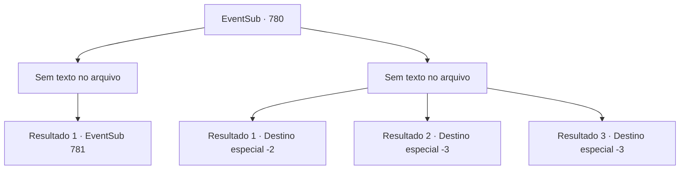

# Eventos secundários · 780

[Índice da tabela](index.md) · [Índice geral](../index.md)

ID: `pt:EventSub:780` · Fonte: `EventSub4` · Versão: 1.2.47.

Mapeamento estático dos arquivos; a disponibilidade e a execução dependem do estado da run.

## Texto do evento

*Sem texto no arquivo.*

## Dados de entrada

```json
{
  "id": 780,
  "grade": 1,
  "subEvent": "",
  "required": ""
}
```

## Mapa das escolhas



## Escolhas e resultados

### Escolha 1

*Sem texto no arquivo; o papel dessa opção depende da interface do jogo.*

Requisitos e outros campos da escolha:

```json
{
  "required": ""
}
```

#### Resultado 1.1

Você molha o convés com o sangue dos Dragões Vermelhos caídos. Shao estala a língua, preparando sua própria espada. 

 "Tsc. Afastem-se, todos vocês. Eu mesma farei isso... Vou lidar com cada um de vocês quando voltarmos."

 Ela ataca tão rápido com sua espada que você brevemente a confunde com um relâmpago.

Continuação registrada: [Evento 781](0781.md) na mesma tabela.

```json
{
  "required": "",
  "chance": "1",
  "nextEvent": 781,
  "type": 2,
  "reward": "6_0_183",
  "place": 4
}
```

### Escolha 2

*Sem texto no arquivo; o papel dessa opção depende da interface do jogo.*

Requisitos e outros campos da escolha:

```json
{
  "required": ""
}
```

#### Resultado 2.1

Impulsionado pela raiva, você veio aqui para vingar Lei, mas antes mesmo de alcançar Shao, você é contido pelos guarda-costas dela. Shao ri, olhando para você como se fosse algum tipo de verme. 

 "Pena... Você não pode ter tudo o que quer neste mundo, garoto. Aqui, um pouco de água fria vai te despertar."

 Shao agarra seu pescoço enquanto você fica imóvel no convés, levando-o até a borda do navio. Ela então te joga ao mar. Água fria e salgada enche seu nariz e boca. Sua consciência se desvanece. 

 Você sente algo batendo em suas bochechas quando acorda, depois de ter desmaiado por alguns momentos. Só depois de se livrar da água do mar com uma série de tosses é que você vê onde está. Você está em algum tipo de cabana, com um pescador enrugado sentado ao seu lado. 

 "Você está bem?"

 Depois de mostrar seu agradecimento, você sai para verificar o porto. O navio de Shao já desapareceu além do horizonte, sem sinal.

Continuação registrada: [Destino especial `-2`](../destinos-especiais.md).

```json
{
  "required": "1_0_2|1_1_2",
  "chance": "1",
  "nextEvent": -2,
  "type": 2,
  "reward": "0_0_-1|0_1_-1|12_11_-1|14_11_0|14_11_6"
}
```

#### Resultado 2.2

Impulsionado pela raiva, você veio aqui para vingar Lei, mas antes mesmo de alcançar Shao, você é contido pelos guarda-costas dela. Shao ri, olhando para você como se fosse algum tipo de verme. 

 "Pena... Você não pode ter tudo o que quer neste mundo, garoto. Aqui, um pouco de água fria vai te despertar."

 Shao agarra seu pescoço enquanto você permanece imóvel no convés, levando-o até a borda do navio. Ela então o joga ao mar. Água fria e salgada enche seu nariz e boca. Sua consciência se esvai.

Continuação registrada: [Destino especial `-3`](../destinos-especiais.md).

```json
{
  "required": "2_0_2",
  "chance": "1",
  "nextEvent": -3,
  "type": 2,
  "reward": "0_0_-1|0_1_-1"
}
```

#### Resultado 2.3

Impulsionado pela raiva, você veio aqui para vingar Lei, mas antes mesmo de alcançar Shao, você é contido pelos guarda-costas dela. Shao ri, olhando para você como se fosse algum tipo de verme. 

 "Pena... Você não pode ter tudo o que quer neste mundo, garoto. Aqui, um pouco de água fria vai te despertar."

 Shao agarra seu pescoço enquanto você permanece imóvel no convés, levando-o até a borda do navio. Ela então o joga ao mar. Água fria e salgada enche seu nariz e boca. Sua consciência se esvai.

Continuação registrada: [Destino especial `-3`](../destinos-especiais.md).

```json
{
  "required": "2_1_2",
  "chance": "1",
  "nextEvent": -3,
  "type": 2,
  "reward": "0_0_-1|0_1_-1"
}
```

## Referências que chegam a este evento

- [Evento 779 · escolha 3 · resultado 1](0779.md#escolha-3)
