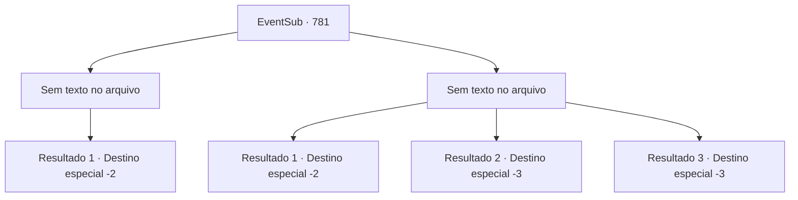

# Eventos secundários · 781

[Índice da tabela](index.md) · [Índice geral](../index.md)

ID: `pt:EventSub:781` · Fonte: `EventSub4` · Versão: 1.2.47.

Mapeamento estático dos arquivos; a disponibilidade e a execução dependem do estado da run.

## Texto do evento

*Sem texto no arquivo.*

## Dados de entrada

```json
{
  "id": 781,
  "grade": 1,
  "subEvent": "",
  "required": ""
}
```

## Mapa das escolhas



## Escolhas e resultados

### Escolha 1

*Sem texto no arquivo; o papel dessa opção depende da interface do jogo.*

Requisitos e outros campos da escolha:

```json
{
  "required": ""
}
```

#### Resultado 1.1


 "Argh...! I- ISSO NÃO PODE SER...!"

 O rosto de Shao se distorce de dor e frustração. Ela é levada aos joelhos. Ela tenta se levantar novamente, usando sua espada como bengala, mas você tira a espada de suas mãos e corta seu pescoço com ela. Os poucos Dracos Vermelhos restantes, tendo perdido seu senhor, perderam tanto a vontade quanto a coragem de lutar também. Você decide ficar com a espada de Shao para si enquanto deixa a cena horrível.

Continuação registrada: [Destino especial `-2`](../destinos-especiais.md).

```json
{
  "required": "",
  "chance": "1",
  "nextEvent": -2,
  "type": 2,
  "reward": "3_323_1|12_11_-1|14_11_9"
}
```

### Escolha 2

*Sem texto no arquivo; o papel dessa opção depende da interface do jogo.*

Requisitos e outros campos da escolha:

```json
{
  "required": ""
}
```

#### Resultado 2.1

Impulsionado pela raiva, você veio aqui para vingar Lei. Mas Shao consegue te parar. Shao ri, olhando para você como se fosse algum tipo de verme. 

 "Pena... Você não pode ter tudo o que quer neste mundo, garoto. Aqui, um pouco de água fria vai te despertar."

 Shao agarra seu pescoço enquanto você fica imóvel no convés, levando-o até a borda do navio. Ela então te joga ao mar. Água fria e salgada enche seu nariz e boca. Sua consciência se esvai. 

 Você sente algo batendo em suas bochechas quando acorda, depois de ter desmaiado por alguns momentos. Só depois de se livrar da água do mar com uma série de tosses é que você vê onde está. Você está em algum tipo de cabana, com um pescador enrugado sentado ao seu lado. 

 "Você está bem?"

 Depois de mostrar a ele seu agradecimento, você sai para verificar o porto. O navio de Shao já desapareceu além do horizonte, em lugar nenhum para ser visto.

Continuação registrada: [Destino especial `-2`](../destinos-especiais.md).

```json
{
  "required": "1_0_2|1_1_2",
  "chance": "1",
  "nextEvent": -2,
  "type": 2,
  "reward": "0_0_-1|0_1_-1|12_11_-1|14_11_0|14_11_6"
}
```

#### Resultado 2.2

Impulsionado pela raiva, você veio aqui para vingar Lei. Mas Shao consegue te parar. Shao ri, olhando para você como se fosse algum tipo de verme. 

 "Pena... Você não pode ter tudo o que quer neste mundo, garoto. Aqui, um pouco de água fria vai te despertar."

 Shao agarra seu pescoço enquanto você fica imóvel no convés, levando-o até a borda do navio. Ela então te joga ao mar. Água fria e salgada enche seu nariz e boca. Sua consciência se esvai.

Continuação registrada: [Destino especial `-3`](../destinos-especiais.md).

```json
{
  "required": "2_0_2",
  "chance": "1",
  "nextEvent": -3,
  "type": 2,
  "reward": "0_0_-1|0_1_-1"
}
```

#### Resultado 2.3

Impulsionado pela raiva, você veio aqui para vingar Lei. Mas Shao consegue te parar. Shao ri, olhando para você como se fosse algum tipo de verme. 

 "Pena... Você não pode ter tudo o que quer neste mundo, garoto. Aqui, um pouco de água fria vai te despertar."

 Shao agarra seu pescoço enquanto você fica imóvel no convés, levando-o até a borda do navio. Ela então te joga ao mar. Água fria e salgada enche seu nariz e boca. Sua consciência se esvai.

Continuação registrada: [Destino especial `-3`](../destinos-especiais.md).

```json
{
  "required": "2_1_2",
  "chance": "1",
  "nextEvent": -3,
  "type": 2,
  "reward": "0_0_-1|0_1_-1"
}
```

## Referências que chegam a este evento

- [Evento 780 · escolha 1 · resultado 1](0780.md#escolha-1)
