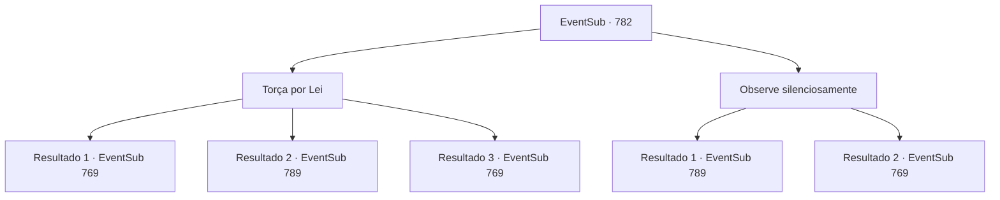

# Eventos secundários · 782

[Índice da tabela](index.md) · [Índice geral](../index.md)

ID: `pt:EventSub:782` · Fonte: `EventSub4` · Versão: 1.2.47.

Mapeamento estático dos arquivos; a disponibilidade e a execução dependem do estado da run.

## Texto do evento

*Sem texto no arquivo.*

## Dados de entrada

```json
{
  "id": 782,
  "grade": 1,
  "subEvent": "",
  "required": ""
}
```

## Mapa das escolhas



## Escolhas e resultados

### Escolha 1

Torça por Lei

Requisitos e outros campos da escolha:

```json
{
  "required": ""
}
```

#### Resultado 1.1

O duelo entre Lei e Shao é feroz, com Shao liderando por uma pequena margem. Você decide se levantar do seu assento e gritar algum incentivo para Lei. 

 'LEI! VOCÊ CONSEGUE!!' 

 Como se estivesse respondendo à sua voz, Lei começa seu contra-ataque. Evitando os ataques de Shao e aproveitando-se habilmente de seus erros, Lei finalmente faz a espada dela voar. <link=shake>

 "WOOOOOOOOO!!!"

</link> O nome de Lei ecoa pela arena. A cidade inteira parece tremer com a celebração. 

 "O novo Mestre de Batalha é... Lei do Clã Ryu!"

 O Sultão de Gladio e o Sumo Sacerdote de Batt levantam seus braços no ar, declarando sua vitória. Lei faz sua saudação oriental para responder ao público. Você fica ali por mais alguns minutos aplaudindo, depois desce do palco.

Continuação registrada: [Evento 769](0769.md) na mesma tabela.

```json
{
  "required": "18_743_1",
  "chance": "1|0_12_1",
  "nextEvent": 769,
  "type": 0,
  "reward": "5_724_1"
}
```

#### Resultado 1.2

O duelo de Lei e Shao é feroz, com Shao liderando por uma pequena margem. Você decide se levantar do seu assento e gritar algum incentivo para Lei. 

 'LEI! VOCÊ CONSEGUE!!' 

 Mas suas palavras de incentivo não chegam a Lei. Infelizmente, Lei é derrotado, incapaz de virar a maré da batalha.  <link=shake>

 "WOOOOOOOOO!!!"

</link> O nome de Shao ecoa pela arena. A cidade inteira parece estar tremendo com a celebração. Em vez de saudar o público, Shao mostra respeito a Lei. Lei olha para ele sem expressão por alguns segundos antes de fazer o mesmo e se afastar. 

 "O novo Mestre de Batalha é... Shao do Clã Ryu!"

 O Sultão de Gladio e o Sumo Sacerdote de Batt levantam seus braços no ar, declarando sua vitória. Lei faz sua saudação oriental para responder ao público. Você fica ali por mais alguns minutos aplaudindo, depois desce do palco.

Continuação registrada: [Evento 789](0789.md) na mesma tabela.

```json
{
  "required": "18_743_1",
  "chance": "15",
  "nextEvent": 789,
  "type": 1,
  "reward": "5_757_1"
}
```

#### Resultado 1.3

O duelo entre Lei e Shao é feroz, com Shao liderando por uma pequena margem. Você não consegue evitar levantar-se do seu assento e gritar algum incentivo para Lei. 

 'LEI! VOCÊ CONSEGUE!!' 

 Como se estivesse respondendo à sua voz, Lei começa seu contra-ataque. Evitando os ataques de Shao e aproveitando-se habilmente de seus erros, Lei finalmente faz a espada dela voar. <link=shake>

 "WOOOOOOOOO!!!"

</link> O nome de Lei ecoa pela arena. A cidade inteira parece tremer com a celebração. 

 "O novo Mestre de Batalha é... Lei do Clã Ryu!"

 O Sultão de Gladio e o Sumo Sacerdote de Batt levantam seus braços no ar, declarando sua vitória. Lei faz sua saudação oriental para responder ao público. Você fica ali por mais alguns minutos aplaudindo, depois desce do palco.

Continuação registrada: [Evento 769](0769.md) na mesma tabela.

```json
{
  "required": "5_743_1",
  "chance": "1",
  "nextEvent": 769,
  "type": 2,
  "reward": "5_724_1"
}
```

### Escolha 2

Observe silenciosamente

Requisitos e outros campos da escolha:

```json
{
  "required": ""
}
```

#### Resultado 2.1

O duelo de Lei e Shao é feroz, com Shao liderando por uma pequena margem. A liderança não era tão grande no início, mas à medida que a partida avançava, ela se ampliava. Infelizmente, Lei é derrotado, incapaz de mudar o rumo da batalha. <link=shake>

 "WOOOOOOOOO!!!"

</link> O nome de Shao ecoa pela arena. A cidade inteira parece tremer com a celebração. Em vez de saudar o público, Shao mostra respeito a Lei. Lei olha para isso sem expressão por alguns segundos antes de fazer o mesmo e se afastar. 

 "O novo Mestre da Batalha é... Shao do Clã Ryu!"

 O Sultão de Gladio e o Sumo Sacerdote de Batt levantam seus braços no ar, declarando sua vitória. Lei embainha sua espada e sai da arena.

Continuação registrada: [Evento 789](0789.md) na mesma tabela.

```json
{
  "required": "18_743_1",
  "chance": "1",
  "nextEvent": 789,
  "type": 2,
  "reward": "5_757_1"
}
```

#### Resultado 2.2

O duelo entre Lei e Shao é feroz, com Lei liderando por uma pequena margem. A vantagem não era tão grande no início, mas à medida que a partida avançava, ela se ampliava. Lei habilmente aumenta o ritmo da batalha, fazendo ataques mais rápidos. Evitando os ataques de Shao e aproveitando-se acentuadamente de seus erros, Lei finalmente faz sua espada voar. <link=shake>

 "WOOOOOOOOO!!!"

</link> O nome de Lei ecoa pela arena. A cidade inteira parece tremer com a celebração. 

 "O novo Mestre de Batalha é... Lei do Clã Ryu!"

 O Sultão de Gladio e o Sumo Sacerdote de Batt levantam seus braços no ar, declarando sua vitória. Lei faz sua saudação oriental para responder ao público. Você fica lá por mais alguns minutos aplaudindo, depois desce do palco.

Continuação registrada: [Evento 769](0769.md) na mesma tabela.

```json
{
  "required": "5_743_1",
  "chance": "1",
  "nextEvent": 769,
  "type": 2,
  "reward": "5_724_1"
}
```

## Referências que chegam a este evento

- [Evento 749 · escolha 1 · resultado 3](0749.md#escolha-1)
- [Evento 764 · escolha 2 · resultado 1](0764.md#escolha-2)
- [Evento 764 · escolha 2 · resultado 2](0764.md#escolha-2)
- [Evento 766 · escolha 2 · resultado 1](0766.md#escolha-2)
