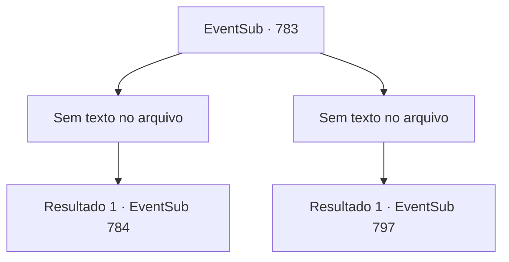

# Eventos secundários · 783

[Índice da tabela](index.md) · [Índice geral](../index.md)

ID: `pt:EventSub:783` · Fonte: `EventSub4` · Versão: 1.2.47.

Mapeamento estático dos arquivos; a disponibilidade e a execução dependem do estado da run.

## Texto do evento

*Sem texto no arquivo.*

## Dados de entrada

```json
{
  "id": 783,
  "grade": 1,
  "subEvent": "",
  "required": ""
}
```

## Mapa das escolhas



## Escolhas e resultados

### Escolha 1

*Sem texto no arquivo; o papel dessa opção depende da interface do jogo.*

Requisitos e outros campos da escolha:

```json
{
  "required": ""
}
```

#### Resultado 1.1

<link=shake>

 "WOOOOOOOOO!!!"

</link> Aplausos enchem a arena enquanto a luta termina. Nessa batalha feroz, você sai vitorioso, mas tem que admitir que foi por pouco. Você levanta o punho no ar para responder aos aplausos enquanto desce do palco. 

 As lutas continuam. No entanto, Lei não aparece para sua luta. Em seu lugar, o golem de ferro entra para preencher a vaga. Shao também está competindo, destruindo a linha de competidores com uma habilidade avassaladora. 

 Você é o próximo. Desta vez, seu oponente é chamado 'Sanson'. Ele começa a cambalear, como se estivesse se recuperando de uma ressaca. Ele finalmente consegue sacar sua espada e grita. 

 "Caramba, minha cabeça... VENHA ATÉ MIM!"


Continuação registrada: [Evento 784](0784.md) na mesma tabela.

```json
{
  "required": "",
  "chance": "1",
  "nextEvent": 784,
  "type": 2,
  "reward": "6_2_62",
  "place": 11
}
```

### Escolha 2

*Sem texto no arquivo; o papel dessa opção depende da interface do jogo.*

Requisitos e outros campos da escolha:

```json
{
  "required": ""
}
```

#### Resultado 2.1

<link=shake>

 "WOOOOOOOOO!!!"

</link> Aplausos enchem a arena enquanto a luta termina. Sir Sparkles emerge vitorioso. Ele levanta o punho no ar para responder aos aplausos. Você o encara por alguns segundos antes de descer do palco. 

 As lutas continuam. No entanto, Lei não aparece em sua luta. Em seu lugar, o golem de ferro entra para preencher o espaço vazio. Shao também está competindo, rompendo a linha de competidores com uma habilidade avassaladora. 

 À medida que a noite chega, a maioria das lutas chega ao fim, e a luta final está prestes a começar. 

 "Shao Ryu do Clã Ryu! E Sir Sparkles, do Reino de Lothar!"

 Os dois se cumprimentam respeitosamente de suas próprias maneiras únicas. A batalha começa. Shao, assim que a luta começa, começa a encurralar Sparkles com golpes rápidos. Como o combatente experiente que é, Sparkles luta de volta habilmente. Mas eventualmente sua resistência atinge o limite. Sparkles recua e acidentalmente solta a arma. Shao é declarado o vencedor. 

 "O novo Mestre de Batalha é... Shao Ryu!!"

 Aplausos estrondosos explodem da multidão. <link=shake>

 "WOOOOOOOOO!!!"

</link> É como se a cidade inteira estivesse tremendo. Shao cumprimenta formalmente o público, depois desce do palco.

Continuação registrada: [Evento 797](0797.md) na mesma tabela.

```json
{
  "required": "",
  "chance": "1",
  "nextEvent": 797,
  "type": 2,
  "reward": "5_757_1"
}
```

## Referências que chegam a este evento

- [Evento 756 · escolha 2 · resultado 2](0756.md#escolha-2)
