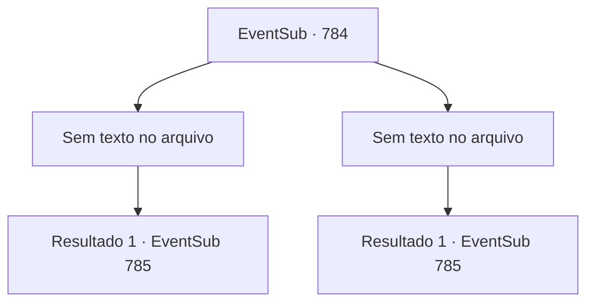

# Eventos secundários · 784

[Índice da tabela](index.md) · [Índice geral](../index.md)

ID: `pt:EventSub:784` · Fonte: `EventSub4` · Versão: 1.2.47.

Mapeamento estático dos arquivos; a disponibilidade e a execução dependem do estado da run.

## Texto do evento

*Sem texto no arquivo.*

## Dados de entrada

```json
{
  "id": 784,
  "grade": 1,
  "subEvent": "",
  "required": ""
}
```

## Mapa das escolhas



## Escolhas e resultados

### Escolha 1

*Sem texto no arquivo; o papel dessa opção depende da interface do jogo.*

Requisitos e outros campos da escolha:

```json
{
  "required": ""
}
```

#### Resultado 1.1

Você troca alguns golpes com Sanson, e logo ele cai no chão, vomitando. 

 "*urrrrrp*...! Ooh... M- MALDIÇÃO..."

 Ele tenta se levantar, mas seu corpo apenas se contorce, nada mais. Sanson é carregado para fora do palco, e você é automaticamente declarado o vencedor. O público vaia em desapontamento. Você desce do palco. 

 À medida que a noite chega, a maioria das lutas chega ao fim, e a luta final está prestes a começar. 

 "Shao Ryu do Clã Ryu! E o aventureiro, {1}!"

 Shao coloca um sorriso relaxado, cumprimentando você respeitosamente.

Continuação registrada: [Evento 785](0785.md) na mesma tabela.

```json
{
  "required": "",
  "chance": "1",
  "nextEvent": 785,
  "type": 2,
  "reward": ""
}
```

### Escolha 2

*Sem texto no arquivo; o papel dessa opção depende da interface do jogo.*

Requisitos e outros campos da escolha:

```json
{
  "required": ""
}
```

#### Resultado 2.1

Você troca alguns golpes com Sanson, e logo ele cai no chão, vomitando. 

 "*urrrrrp*...! Ooh... M- MALDIÇÃO..."

 Ele tenta se levantar, mas seu corpo apenas se contorce, nada mais. Sanson é carregado para fora do palco, e você é automaticamente declarado o vencedor. A plateia vaia em desapontamento. Você desce do palco. 

 Quando a noite chega, a maioria das lutas chega ao fim, e a luta final está prestes a começar. 

 "Shao Ryu do Clã Ryu! E o aventureiro, {1}!"

 Shao coloca um sorriso relaxado, cumprimentando você respeitosamente.

Continuação registrada: [Evento 785](0785.md) na mesma tabela.

```json
{
  "required": "",
  "chance": "1",
  "nextEvent": 785,
  "type": 2,
  "reward": ""
}
```

## Referências que chegam a este evento

- [Evento 783 · escolha 1 · resultado 1](0783.md#escolha-1)
