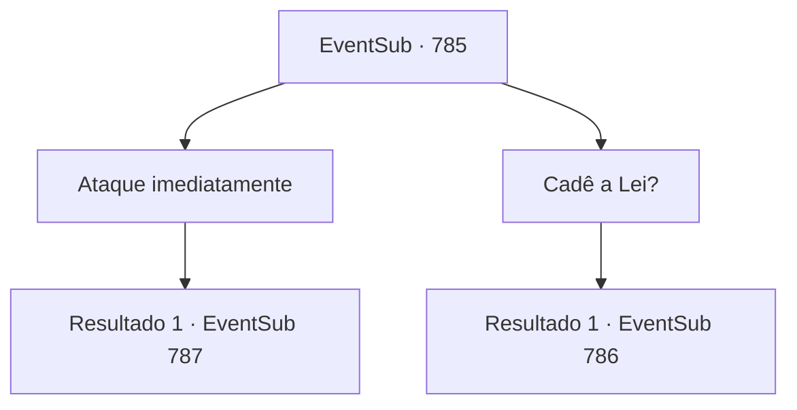

# Eventos secundários · 785

[Índice da tabela](index.md) · [Índice geral](../index.md)

ID: `pt:EventSub:785` · Fonte: `EventSub4` · Versão: 1.2.47.

Mapeamento estático dos arquivos; a disponibilidade e a execução dependem do estado da run.

## Texto do evento

*Sem texto no arquivo.*

## Dados de entrada

```json
{
  "id": 785,
  "grade": 1,
  "subEvent": "",
  "required": ""
}
```

## Mapa das escolhas



## Escolhas e resultados

### Escolha 1

Ataque imediatamente

Requisitos e outros campos da escolha:

```json
{
  "required": ""
}
```

#### Resultado 1.1

Você ataca Shao imediatamente. Ela rapidamente defende seu ataque e comenta. 

 "Tsk... Nem um traço de formalidade. Não se preocupe, vou te ensinar algumas maneiras."

 Shao começa a balançar sua espada ferozmente.

Continuação registrada: [Evento 787](0787.md) na mesma tabela.

```json
{
  "required": "",
  "chance": "1",
  "nextEvent": 787,
  "type": 2,
  "reward": "6_0_183",
  "place": 11
}
```

### Escolha 2

Cadê a Lei?

Requisitos e outros campos da escolha:

```json
{
  "required": ""
}
```

#### Resultado 2.1

O lábio de Shao se contrai em resposta. 

 "Você está perguntando para a pessoa errada. Por que você não... vai olhar você mesmo?!"

 Assim que ela termina, tira algo das mangas e joga em você.

Continuação registrada: [Evento 786](0786.md) na mesma tabela.

```json
{
  "required": "",
  "chance": "1",
  "nextEvent": 786,
  "type": 2,
  "reward": ""
}
```

## Referências que chegam a este evento

- [Evento 784 · escolha 1 · resultado 1](0784.md#escolha-1)
- [Evento 784 · escolha 2 · resultado 1](0784.md#escolha-2)
