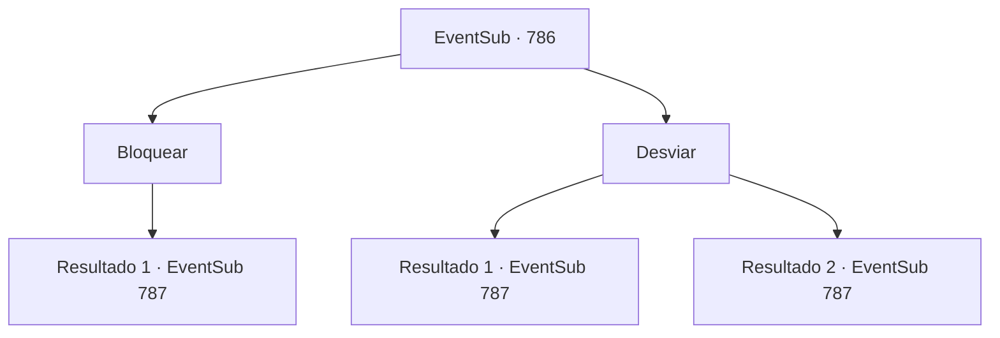

# Eventos secundários · 786

[Índice da tabela](index.md) · [Índice geral](../index.md)

ID: `pt:EventSub:786` · Fonte: `EventSub4` · Versão: 1.2.47.

Mapeamento estático dos arquivos; a disponibilidade e a execução dependem do estado da run.

## Texto do evento

*Sem texto no arquivo.*

## Dados de entrada

```json
{
  "id": 786,
  "grade": 1,
  "subEvent": "",
  "required": ""
}
```

## Mapa das escolhas



## Escolhas e resultados

### Escolha 1

Bloquear

Requisitos e outros campos da escolha:

```json
{
  "required": "20_9_1"
}
```

#### Resultado 1.1

Você desvia o projétil de Shao. Você percebe que é um par de agulhas invisíveis, com as pontas cobertas por um líquido misterioso. A próxima coisa que você vê vindo em sua direção é a espada de Shao.

Continuação registrada: [Evento 787](0787.md) na mesma tabela.

```json
{
  "required": "",
  "chance": "1",
  "nextEvent": 787,
  "type": 2,
  "reward": "6_0_183",
  "place": 11
}
```

### Escolha 2

Desviar 

Requisitos e outros campos da escolha:

```json
{
  "required": ""
}
```

#### Resultado 2.1

Você desvia do projétil de Shao. Você percebe que é um par de agulhas invisíveis, com as pontas cobertas por um líquido misterioso. A próxima coisa que você vê vindo em sua direção é a espada de Shao.

Continuação registrada: [Evento 787](0787.md) na mesma tabela.

```json
{
  "required": "",
  "chance": "1|0_6_1",
  "nextEvent": 787,
  "type": 0,
  "reward": "6_0_183",
  "place": 11
}
```

#### Resultado 2.2

Você tenta desviar do projétil de Shao. Mas é mais rápido que seus reflexos. Ele corta o ar e se crava em sua carne. É um par de agulhas invisíveis, pontas cobertas de líquido misterioso. Sua visão começa a embaçar. A próxima coisa que você vê vindo em sua direção é a espada de Shao.

Continuação registrada: [Evento 787](0787.md) na mesma tabela.

```json
{
  "required": "",
  "chance": "16",
  "nextEvent": 787,
  "type": 1,
  "reward": "6_3_183",
  "place": 11
}
```

## Referências que chegam a este evento

- [Evento 785 · escolha 2 · resultado 1](0785.md#escolha-2)
