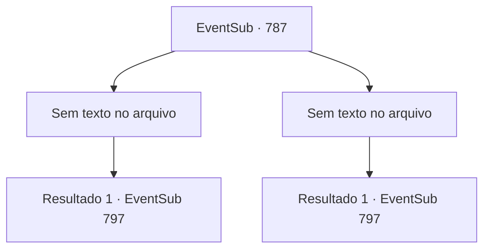

# Eventos secundários · 787

[Índice da tabela](index.md) · [Índice geral](../index.md)

ID: `pt:EventSub:787` · Fonte: `EventSub4` · Versão: 1.2.47.

Mapeamento estático dos arquivos; a disponibilidade e a execução dependem do estado da run.

## Texto do evento

*Sem texto no arquivo.*

## Dados de entrada

```json
{
  "id": 787,
  "grade": 1,
  "subEvent": "",
  "required": ""
}
```

## Mapa das escolhas



## Escolhas e resultados

### Escolha 1

*Sem texto no arquivo; o papel dessa opção depende da interface do jogo.*

Requisitos e outros campos da escolha:

```json
{
  "required": ""
}
```

#### Resultado 1.1

A espada de Shao voa pelo ar e cai no chão. <link=shake>

 "WOOOOOOOOO!!!"

</link> Uma trovoada de aplausos explode da multidão. É como se a cidade inteira estivesse tremendo com a celebração. Shao range os dentes desesperadamente, mas nem isso pode impedir que você seja declarado o vencedor. 

 "O novo Mestre de Batalha é... {1}!!"

 Junto com o título vem um prêmio em dinheiro considerável, e você é coberto com aplausos e adoração da multidão. Você acena para responder aos seus favores. Shao nem sequer olha para trás e sai imediatamente da arena.

Continuação registrada: [Evento 797](0797.md) na mesma tabela.

```json
{
  "required": "",
  "chance": "1",
  "nextEvent": 797,
  "type": 2,
  "reward": "1_4_300|5_724_2|5_755_1"
}
```

### Escolha 2

*Sem texto no arquivo; o papel dessa opção depende da interface do jogo.*

Requisitos e outros campos da escolha:

```json
{
  "required": ""
}
```

#### Resultado 2.1

Você simplesmente não pode vencer Shao em batalha. Seus ataques ferozes te jogam no chão. Antes mesmo de perceber, a espada de Shao está apontada diretamente para sua garganta. Uma explosão de aplausos troveja da multidão. <link=shake>

 "WOOOOOOOOO!!!"

</link> Shao é declarada a vencedora. 

 "A nova Mestre de Batalha é... Shao Ryu!!"

 Shao é premiada com o título de Mestre de Batalha, junto com um grande prêmio em dinheiro e a adoração da multidão. Ela cumprimenta formalmente o público, depois desce do palco.

Continuação registrada: [Evento 797](0797.md) na mesma tabela.

```json
{
  "required": "",
  "chance": "1",
  "nextEvent": 797,
  "type": 2,
  "reward": "5_757_1"
}
```

## Referências que chegam a este evento

- [Evento 785 · escolha 1 · resultado 1](0785.md#escolha-1)
- [Evento 786 · escolha 1 · resultado 1](0786.md#escolha-1)
- [Evento 786 · escolha 2 · resultado 1](0786.md#escolha-2)
- [Evento 786 · escolha 2 · resultado 2](0786.md#escolha-2)
