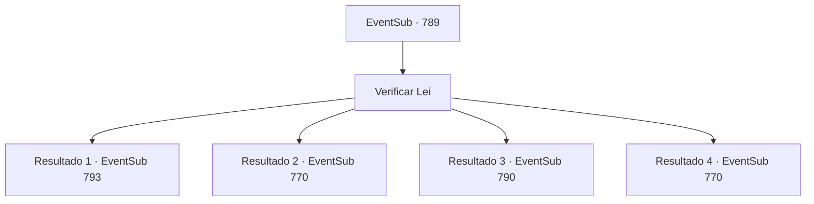

# Eventos secundários · 789

[Índice da tabela](index.md) · [Índice geral](../index.md)

ID: `pt:EventSub:789` · Fonte: `EventSub4` · Versão: 1.2.47.

Mapeamento estático dos arquivos; a disponibilidade e a execução dependem do estado da run.

## Texto do evento

*Sem texto no arquivo.*

## Dados de entrada

```json
{
  "id": 789,
  "grade": 1,
  "subEvent": "",
  "required": ""
}
```

## Mapa das escolhas



## Escolhas e resultados

### Escolha 1

Verificar Lei

Requisitos e outros campos da escolha:

```json
{
  "required": ""
}
```

#### Resultado 1.1

Você segue Lei para fora da arena. Ele está olhando para o céu, suspirando. 

 "Bem... Eu perdi. Justo e quadrado. Ainda sou grato por tudo que você fez, Sohyeop. Agora eu vou..."

 Então, Shao aparece, com seus habituais guarda-costas Red Drake ao redor dela. Seu rosto exala confiança. 

 "Até mesmo o filhote sabe alguns truques, aparentemente. Eu nunca esperava encontrá-lo na partida final. Claro, minha vitória estava destinada desde o início."

 Shao fala de forma condescendente, como se quisesse provocar Lei deliberadamente. 

 "Você nunca mais aparecerá diante dos meus olhos. Se ousar sequer se aproximar das terras do meu clã, não hesitarei em matá-lo."

 Shao sorri friamente e se afasta. Lei coloca um sorriso amargo e diz. 

 "O Oriente é um lugar enorme. Certamente, há alguns lugares onde posso pisar."


Continuação registrada: [Evento 793](0793.md) na mesma tabela.

```json
{
  "required": "5_757_1|18_749_1",
  "chance": "1",
  "nextEvent": 793,
  "type": 2,
  "reward": ""
}
```

#### Resultado 1.2

Você segue Lei para fora da arena. Ele suspira enquanto olha para o céu. 

 "Bem… eu perdi. De forma justa. Ainda assim, sou grato por tudo o que você fez, Sohyeop. Agora eu vou…"

 Então, Shao aparece, cercada por seus habituais guarda-costas do Dragão Vermelho. Seu rosto transborda confiança. 

 "Desta vez, eu venci. Da última vez, eu apenas fui descuidada… Era natural que eu ganhasse."

 Apesar de suas palavras, sua voz treme — diferente de antes. 

 "B-Bem… mesmo assim, suas habilidades foram bastante impressionantes. Se quiser vir conosco… faça como quiser."

 Após jogar essas palavras ao ar, Shao se vira, tentando esconder o rosto corado. Quando Lei fica olhando para ela, atônito, Shao explode de repente contra ele e a unidade do Dragão Vermelho. 

 "O-O que vocês estão fazendo aí parados?! Andem logo e me sigam!"

 Você e Lei seguem Shao e participam do banquete oferecido pelos organizadores do torneio. Lá, vocês cumprimentam os patrocinadores e são servidos com um jantar. Somente quando a refeição está quase no fim é que você finalmente consegue um momento a sós. Com o estômago cheio, você sai para as ruas. Embora o torneio tenha terminado e a noite tenha caído, a animação do festival não diminui. Por ser o último dia, a cidade inteira parece arder ainda mais intensamente em celebração. Nesse momento, Lei se aproxima de você. 

 "Sohyeop, um instante. Por aqui."

 Você segue Lei. Ele para em uma colina de onde se pode ver a cidade lá embaixo. Depois de contemplar a lua branca e pálida, Lei se vira para encará-lo. 

 "Sohyeop… acho que chegou a hora de eu voltar. Shao estendeu a mão para mim, e pretendo aceitá-la. Obrigado, de coração, por tudo o que você fez para me ajudar."


Continuação registrada: [Evento 770](0770.md) na mesma tabela.

```json
{
  "required": "5_757_1|5_749_1",
  "chance": "1",
  "nextEvent": 770,
  "type": 2,
  "reward": "0_0_1|0_1_1"
}
```

#### Resultado 1.3

Você segue Lei para fora da arena. Ele te dá um sorriso caloroso. 

 "Tudo isso é graças a você, Sohyeop. Você tem minha gratidão. Os anfitriões do torneio nos convidaram para o banquete deles. Quer se juntar a mim?"

 Você se mistura com outros competidores e os patronos do torneio. Poucos momentos depois, após o banquete estar quase no fim, você finalmente consegue a tão esperada solidão. Você sai para a rua com a barriga cheia. Embora o torneio em si tenha acabado, o clima festivo ainda não morreu. Provavelmente porque é o último dia. Esta seria uma noite longa e animada para a cidade. Então, você vê Lei vindo em sua direção. 

 "Sohyeop. Um momento, por favor."

 Lei te leva a uma colina, com uma ótima vista de toda a cidade. Lei olha para a lua brilhante por um momento, depois se vira para você. 

 "Estou pensando em voltar, Sohyeop. Voltar para minha casa no Oriente. Lá, restaurarei a honra e a glória do meu grande clã e serei reconhecido como um guerreiro oficial. Não posso te agradecer o suficiente por toda a ajuda que você me deu até agora."


Continuação registrada: [Evento 790](0790.md) na mesma tabela.

```json
{
  "required": "5_724_1|18_749_1",
  "chance": "1",
  "nextEvent": 790,
  "type": 2,
  "reward": "0_0_1|0_1_1"
}
```

#### Resultado 1.4

Você segue Lei para fora da arena. Ele te dá um sorriso caloroso. 

 "Tudo isso é graças a você, Sohyeop. Você tem minha gratidão. Os anfitriões do torneio nos convidaram para o banquete deles. Quer se juntar a mim?"

 Você se mistura com outros competidores e os patronos do torneio. Poucos momentos depois, após o banquete estar quase no fim, você finalmente consegue a tão esperada solidão. Você sai para a rua com a barriga cheia. Embora o torneio em si tenha acabado, o clima festivo ainda não morreu. Provavelmente porque é o último dia. Esta seria uma noite longa e animada para a cidade. Então, você vê Lei vindo em sua direção. 

 "Sohyeop. Um momento, por favor."

 Lei te leva a uma colina, com uma ótima vista de toda a cidade. Lei olha para a lua brilhante por um momento, depois se vira para você. 

 "Estou pensando em voltar, Sohyeop. Voltar para minha casa no Oriente. Lá, restaurarei a honra e a glória do meu grande clã e serei reconhecido como um guerreiro oficial. Não posso te agradecer o suficiente por toda a ajuda que você me deu até agora."


Continuação registrada: [Evento 770](0770.md) na mesma tabela.

```json
{
  "required": "5_724_1|5_749_1",
  "chance": "1",
  "nextEvent": 770,
  "type": 2,
  "reward": "0_0_1|0_1_1"
}
```

## Referências que chegam a este evento

- [Evento 782 · escolha 1 · resultado 2](0782.md#escolha-1)
- [Evento 782 · escolha 2 · resultado 1](0782.md#escolha-2)
- [Evento 788 · escolha 1 · resultado 1](0788.md#escolha-1)
- [Evento 788 · escolha 1 · resultado 2](0788.md#escolha-1)
- [Evento 788 · escolha 1 · resultado 3](0788.md#escolha-1)
- [Evento 788 · escolha 2 · resultado 1](0788.md#escolha-2)
- [Evento 788 · escolha 2 · resultado 2](0788.md#escolha-2)
