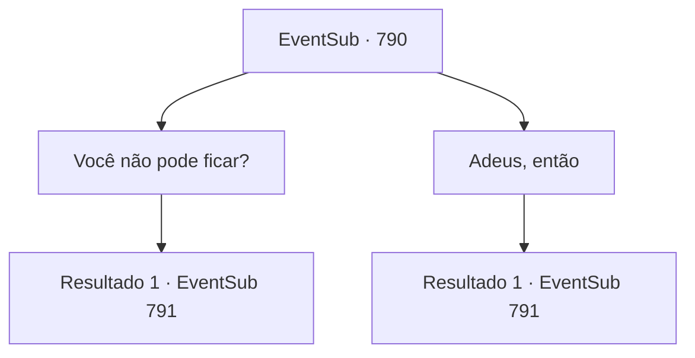

# Eventos secundários · 790

[Índice da tabela](index.md) · [Índice geral](../index.md)

ID: `pt:EventSub:790` · Fonte: `EventSub4` · Versão: 1.2.47.

Mapeamento estático dos arquivos; a disponibilidade e a execução dependem do estado da run.

## Texto do evento

*Sem texto no arquivo.*

## Dados de entrada

```json
{
  "id": 790,
  "grade": 1,
  "subEvent": "",
  "required": ""
}
```

## Mapa das escolhas



## Escolhas e resultados

### Escolha 1

Você não pode ficar?

Requisitos e outros campos da escolha:

```json
{
  "required": ""
}
```

#### Resultado 1.1

Você sugere que Lei fique neste lugar em vez de voltar para sua cidade natal. Lei balança a cabeça e responde. 

 "Agradeço a oferta, mas não posso fazer isso. Tenho coisas a fazer, depois que voltar para o meu clã. Ah - e este é um símbolo de gratidão, por tudo. Quero que você o tenha."

 É uma vestimenta oriental luxuosa. Uma imagem de um dragão está lindamente bordada na seda alabastrina, como se estivesse nadando em um mar de nuvens. Então, Shao aparece do nada e interrompe Lei. Os Dragões Vermelhos que Shao trouxe com ela estão olhando para você e Lei também. 

 "Você? Voltar para o clã? Ha! Não vai acontecer. Você e o bárbaro vão morrer, aqui e agora."

 Mesmo antes que você possa falar, todos eles avançam contra você com suas armas erguidas.

Continuação registrada: [Evento 791](0791.md) na mesma tabela.

```json
{
  "required": "",
  "chance": "1",
  "nextEvent": 791,
  "type": 2,
  "reward": "3_324_1|6_2_179",
  "place": 4
}
```

### Escolha 2

Adeus, então

Requisitos e outros campos da escolha:

```json
{
  "required": ""
}
```

#### Resultado 2.1

Você dá uma palavra de encorajamento para Lei. Ele te agradece, então te entrega um vestido de seda cuidadosamente dobrado. 

 "Este é um símbolo de gratidão, por tudo. Quero que você o tenha."

 É uma vestimenta oriental luxuosa. Uma imagem de um dragão está lindamente bordada na seda alabastrina, como se estivesse nadando em um mar de nuvens. 

 "É chamado de Manto do Dragão. Eu o recebi como um presente do Chefe do Clã, mas... quero dar a você, Sohyeop."

 Então, Shao aparece do nada e interrompe Lei. Os Dragões Vermelhos que Shao trouxe com ela estão olhando para você e Lei também. 

 "Você? Voltar para o clã? Ha! Não vai acontecer. Você e o bárbaro vão morrer, aqui e agora."

 Mesmo antes que você possa falar, todos eles avançam contra você com suas armas erguidas.

Continuação registrada: [Evento 791](0791.md) na mesma tabela.

```json
{
  "required": "",
  "chance": "1",
  "nextEvent": 791,
  "type": 2,
  "reward": "3_324_1|6_2_179",
  "place": 4
}
```

## Referências que chegam a este evento

- [Evento 769 · escolha 1 · resultado 2](0769.md#escolha-1)
- [Evento 769 · escolha 1 · resultado 3](0769.md#escolha-1)
- [Evento 789 · escolha 1 · resultado 3](0789.md#escolha-1)
