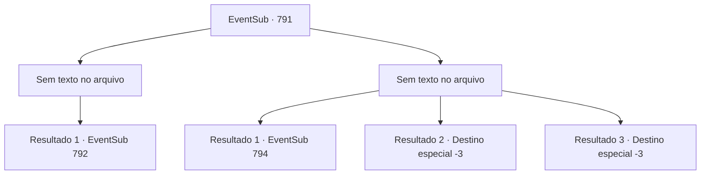

# Eventos secundários · 791

[Índice da tabela](index.md) · [Índice geral](../index.md)

ID: `pt:EventSub:791` · Fonte: `EventSub4` · Versão: 1.2.47.

Mapeamento estático dos arquivos; a disponibilidade e a execução dependem do estado da run.

## Texto do evento

*Sem texto no arquivo.*

## Dados de entrada

```json
{
  "id": 791,
  "grade": 1,
  "subEvent": "",
  "required": ""
}
```

## Mapa das escolhas



## Escolhas e resultados

### Escolha 1

*Sem texto no arquivo; o papel dessa opção depende da interface do jogo.*

Requisitos e outros campos da escolha:

```json
{
  "required": ""
}
```

#### Resultado 1.1

Você luta contra os Dracos Vermelhos, mas de alguma forma sente que eles não estão lutando com toda a força. Você espera que eles ainda tenham alguma energia para lutar, mas uma vez no chão, eles não mostram intenção de se levantar. Enquanto isso, o duelo feroz de Lei e Shao também chega ao fim. O golpe de Lei quebra a espada de Shao ao meio e a joga no chão. 

 "*ofegante*... *ofegante*... EU... EU VOU TE MATAR..!!"

 Cega de raiva, Shao pega sua espada quebrada e avança contra Lei novamente. Mas é inútil. Lei calmamente a derrota novamente e a imobiliza no chão.

Continuação registrada: [Evento 792](0792.md) na mesma tabela.

```json
{
  "required": "",
  "chance": "1",
  "nextEvent": 792,
  "type": 2,
  "reward": ""
}
```

### Escolha 2

*Sem texto no arquivo; o papel dessa opção depende da interface do jogo.*

Requisitos e outros campos da escolha:

```json
{
  "required": ""
}
```

#### Resultado 2.1

Os ataques dos Dracos Vermelhos te jogam no chão. 

 "SOHYEOP! Ack...!"

 Lei tenta revidar e te proteger ao mesmo tempo, balançando sua espada ferozmente. A última coisa que você vê é Lei defendendo-se sozinho dos ataques de Shao e dos Dracos Vermelhos. Infelizmente, você tenta se levantar, mas eventualmente sente a energia esvair-se do seu corpo e desmaia. 

 Algo frio atinge suas bochechas, te acordando. O som de pingos de chuva fica mais alto. Uma chuva pesada cai do céu. Você mal consegue abrir os olhos e se levantar. Seu corpo inteiro dói e estala. Quando você olha ao redor, percebe que todos se foram. Exceto Lei. |drawing_kneelingLei| Na sua frente está Lei, de joelhos no chão e de costas para você. Seu corpo, olhando vazio para as nuvens com os braços caídos no chão, está coberto de cortes. A área ao redor dele está coberta de sangue negro. Seus olhos ainda estão fixos no céu, como se ele ainda guardasse rancores deste mundo. Gotas de chuva caem em seu rosto e escorrem por seus olhos como um fluxo de lágrimas.

Continuação registrada: [Evento 794](0794.md) na mesma tabela.

```json
{
  "required": "1_0_2|1_1_2",
  "chance": "1",
  "nextEvent": 794,
  "type": 2,
  "reward": "0_0_-1|0_1_-1"
}
```

#### Resultado 2.2

Os ataques dos Dracos Vermelhos te jogam no chão. 

 "SOHYEOP! Ack...!"

 Lei tenta revidar e te proteger ao mesmo tempo, balançando sua espada ferozmente. A última coisa que você vê é Lei defendendo-se dos ataques de Shao e dos Dracos Vermelhos sozinho. Infelizmente, você tenta se levantar, mas eventualmente sente a energia esvair-se do seu corpo e desmaia.

Continuação registrada: [Destino especial `-3`](../destinos-especiais.md).

```json
{
  "required": "2_0_2",
  "chance": "1",
  "nextEvent": -3,
  "type": 2,
  "reward": "0_0_-1|0_1_-1"
}
```

#### Resultado 2.3

Os ataques dos Dracos Vermelhos te jogam no chão. 

 "SOHYEOP! Ack...!"

 Lei tenta revidar e te proteger ao mesmo tempo, balançando sua espada ferozmente. A última coisa que você vê é Lei defendendo-se dos ataques de Shao e dos Dracos Vermelhos sozinho. Infelizmente, você tenta se levantar, mas eventualmente sente a energia esvair-se do seu corpo e desmaia.

Continuação registrada: [Destino especial `-3`](../destinos-especiais.md).

```json
{
  "required": "2_1_2",
  "chance": "1",
  "nextEvent": -3,
  "type": 2,
  "reward": "0_0_-1|0_1_-1"
}
```

## Referências que chegam a este evento

- [Evento 790 · escolha 1 · resultado 1](0790.md#escolha-1)
- [Evento 790 · escolha 2 · resultado 1](0790.md#escolha-2)
