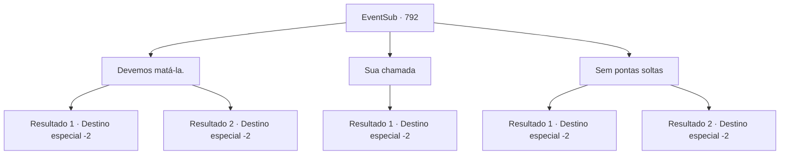

# Eventos secundários · 792

[Índice da tabela](index.md) · [Índice geral](../index.md)

ID: `pt:EventSub:792` · Fonte: `EventSub4` · Versão: 1.2.47.

Mapeamento estático dos arquivos; a disponibilidade e a execução dependem do estado da run.

## Texto do evento

*Sem texto no arquivo.*

## Dados de entrada

```json
{
  "id": 792,
  "grade": 1,
  "subEvent": "",
  "required": ""
}
```

## Mapa das escolhas



## Escolhas e resultados

### Escolha 1

Devemos matá-la.

Requisitos e outros campos da escolha:

```json
{
  "required": ""
}
```

#### Resultado 1.1

Você aconselha Lei que já está mais do que na hora de acabar com Shao. A expressão de Lei grita hesitação, mas depois de ouvir suas palavras, ele parece ter tomado uma decisão. 

 "Shao... É hora de terminar com isso. Com tudo isso."

 Com um golpe final de Lei, o corpo de Shao desmorona com um grito. De alguma forma, parece que os Dragões Vermelhos estavam esperando que algo assim acontecesse. Eles imediatamente começam a levar o corpo de Shao. Lei solta um longo suspiro. 

 "*suspiro*... O que vou dizer ao Chefe do Clã...?"

 Ele coloca a mão no rosto e continua. 

 "Eu... Eu devo voltar para minha cidade natal, antes de qualquer outra coisa. O Chefe do Clã e os anciãos decidirão o que fazer comigo. Agradeço por tudo até agora, Sohyeop. Adeus..."

 Lei se despede respeitosamente de você e se afasta.

Continuação registrada: [Destino especial `-2`](../destinos-especiais.md).

```json
{
  "required": "",
  "chance": "1|0_12_1",
  "nextEvent": -2,
  "type": 0,
  "reward": "12_11_-1|14_11_17"
}
```

#### Resultado 1.2

Você sugere que Lei acabe com Shao. Mas a expressão de Lei grita hesitação. No entanto, ele embainha sua espada. Shao explode em risadas e começa a provocá-lo. 

 "HA! Fingindo ser o bonzinho até o fim... FAÇA ISSO! ME MATE! Você nem tem CORAGEM! Você é tão fraco quanto sua mãe! Mais adequado para bajular homens e..."

 Shao não consegue terminar. Lei dá um soco, acertando Shao no rosto. Shao é imediatamente nocauteado. Os Dragões Vermelhos a ajudam ansiosamente a se levantar. Ignorando seus movimentos, Lei se curva para você e se despede. 

 "Agradeço por tudo até agora, Sohyeop. Adeus..."


Continuação registrada: [Destino especial `-2`](../destinos-especiais.md).

```json
{
  "required": "",
  "chance": "20",
  "nextEvent": -2,
  "type": 1,
  "reward": "12_11_-1|14_11_8"
}
```

### Escolha 2

Sua chamada

Requisitos e outros campos da escolha:

```json
{
  "required": ""
}
```

#### Resultado 2.1

Lei embainha sua espada. Shao cai na gargalhada e começa a zombar dele. 

 "HA! Fingindo ser o bonzinho até o fim... FAÇA! ME MATE! Você nem tem CORAGEM! Você é tão fraco quanto sua mãe! Mais adequado para bajular homens e..."

 Shao não consegue terminar. Lei dá um soco, acertando Shao no rosto. Shao é nocauteado imediatamente. Os Red Drakes a ajudam ansiosamente. Sem se importar com seus movimentos, Lei se inclina para você e se despede. 

 "Agradeço por tudo até agora, Sohyeop. Adeus..."


Continuação registrada: [Destino especial `-2`](../destinos-especiais.md).

```json
{
  "required": "",
  "chance": "1",
  "nextEvent": -2,
  "type": 2,
  "reward": "12_11_-1|14_11_8"
}
```

### Escolha 3

Sem pontas soltas

Requisitos e outros campos da escolha:

```json
{
  "required": ""
}
```

#### Resultado 3.1

Lei cerra o punho com tanta força que sua mão fica vermelha. Então, ele caminha em direção a Shao com passos pesados. Shao se arrasta para longe de Lei, gritando. 

 "R- Red Drakes! O QUE VOCÊS ESTÃO FAZENDO?! MATEM A LOUCA JÁ!"

 Mas os Red Drakes não fazem nada. Finalmente, Lei alcança Shao. 

 "Vamos acabar com isso, Shao. Você ainda pode viver sua vida como a filha do Chefe do Clã."

 Uma aura azul começa a se formar ao redor do punho de Lei. Então, ele enfia o punho na barriga de Shao. 

 "ACK...!!"

 Com um som alto, Shao vomita sangue. A aura azul sai de seu corpo e se dissipa no ar. 

 "N- não....."

 Com isso, Shao cai inconsciente. Lei olha para os Red Drakes, dizendo-lhes para levá-la. Todos fazem a saudação oriental, pegam o corpo de Shao e descem a colina. Lei se curva para você e se despede. 

 "Agradeço por tudo até agora, Sohyeop. Adeus..."


Continuação registrada: [Destino especial `-2`](../destinos-especiais.md).

```json
{
  "required": "",
  "chance": "1|0_12_1",
  "nextEvent": -2,
  "type": 0,
  "reward": "12_11_-1|14_11_7|14_11_17"
}
```

#### Resultado 3.2

Você aconselha fortemente Lei a punir Shao para que ela nunca mais pense em ir atrás dele novamente. Mas a expressão de Lei grita hesitação. Infelizmente, ele embainha sua espada. Shao explode em risadas e começa a provocá-lo. 

 "HA! Fingindo ser o bonzinho até o fim... FAÇA! ME MATE! Você nem tem CORAGEM! Você é tão fraco quanto sua mãe! Mais adequado para bajular homens e..."

 Shao não consegue terminar. Lei dá um soco, acertando Shao no rosto. Shao é imediatamente nocauteada. Os Red Drakes prontamente a ajudam a se levantar. Ignorando seus movimentos, Lei se inclina para você e se despede. 

 "Agradeço por tudo até agora, Sohyeop. Adeus..."


Continuação registrada: [Destino especial `-2`](../destinos-especiais.md).

```json
{
  "required": "",
  "chance": "16",
  "nextEvent": -2,
  "type": 1,
  "reward": "12_11_-1|14_11_8"
}
```

## Referências que chegam a este evento

- [Evento 791 · escolha 1 · resultado 1](0791.md#escolha-1)
