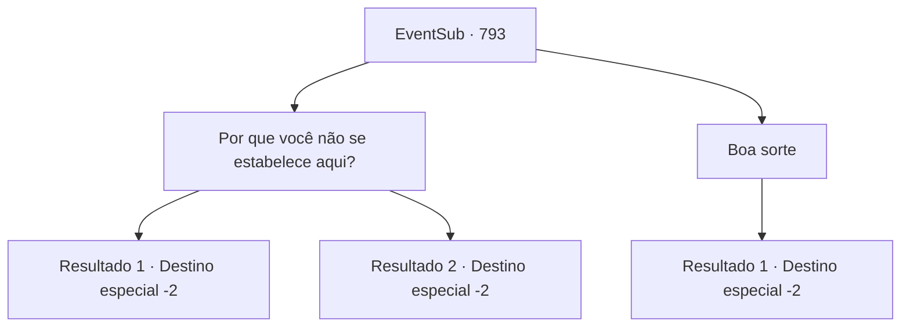

# Eventos secundários · 793

[Índice da tabela](index.md) · [Índice geral](../index.md)

ID: `pt:EventSub:793` · Fonte: `EventSub4` · Versão: 1.2.47.

Mapeamento estático dos arquivos; a disponibilidade e a execução dependem do estado da run.

## Texto do evento

*Sem texto no arquivo.*

## Dados de entrada

```json
{
  "id": 793,
  "grade": 1,
  "subEvent": "",
  "required": ""
}
```

## Mapa das escolhas



## Escolhas e resultados

### Escolha 1

Por que você não se estabelece aqui?

Requisitos e outros campos da escolha:

```json
{
  "required": ""
}
```

#### Resultado 1.1

Você sugere que Lei fique neste lugar em vez de voltar para sua cidade natal. Seu discurso impecável é suficiente para persuadir Lei. Ele acena com a cabeça em concordância. 

 "...Suas palavras são verdadeiras, Sohyeop. Cada uma delas."

 Lei murmura para si mesmo por alguns segundos, olha de volta para você e fala. 

 "Devo procurar trabalho por aqui. Eu... preciso trazer minha mãe para cá também. Ela não está segura se ficar no Leste. Obrigado pelo conselho, Sohyeop. Ah - e este é um símbolo de gratidão, por tudo. Quero que você o tenha."

 É uma vestimenta oriental luxuosa. Uma imagem de um dragão está lindamente bordada na seda alabastrina, como se estivesse nadando em um mar de nuvens. 

 "É chamada de Túnica do Dragão. Eu a recebi como um presente do Chefe do Clã, mas... quero dá-la a você, Sohyeop."

 Lei faz a saudação oriental como um sinal de despedida, prometendo se encontrar novamente no futuro, caso os caminhos se cruzem.

Continuação registrada: [Destino especial `-2`](../destinos-especiais.md).

```json
{
  "required": "",
  "chance": "1|0_7_1",
  "nextEvent": -2,
  "type": 2,
  "reward": "3_324_1|12_11_-1|14_11_6|14_11_13"
}
```

#### Resultado 1.2

Você sugere que Lei fique neste lugar em vez de voltar para sua cidade natal. Mas Lei balança a cabeça em desacordo. 

 "Eu... eu não tenho certeza. Eu não sei."

 Então, Lei abre a boca novamente, como se tivesse se lembrado de algo. 

 "Ah - e este é um símbolo de gratidão, por tudo. Eu quero que você o tenha."

 É uma vestimenta oriental luxuosa. Uma imagem de um dragão está lindamente bordada na seda alabastro, como se estivesse nadando em um mar de nuvens. 

 "É chamada de Túnica do Dragão. Eu a recebi como um presente do Chefe do Clã, mas... eu quero dar a você, Sohyeop."

 Lei faz a saudação oriental como um sinal de despedida, prometendo se encontrar novamente no futuro, caso os caminhos se cruzem.

Continuação registrada: [Destino especial `-2`](../destinos-especiais.md).

```json
{
  "required": "",
  "chance": "16",
  "nextEvent": -2,
  "type": 2,
  "reward": "3_324_1|12_11_-1|14_11_2|14_11_6"
}
```

### Escolha 2

Boa sorte

Requisitos e outros campos da escolha:

```json
{
  "required": ""
}
```

#### Resultado 2.1

Você dá uma palavra de encorajamento para Lei. Ele faz a saudação oriental em resposta, agradecendo você. Ele então lhe entrega um vestido de seda cuidadosamente dobrado. 

 "Este é um símbolo de gratidão, por tudo. Quero que você o tenha."

 É uma vestimenta oriental luxuosa. Uma imagem de um dragão está lindamente bordada na seda alabastrina, como se estivesse nadando em um mar de nuvens. 

 "É chamado de Manto do Dragão. Eu o recebi como um presente do Chefe do Clã, mas... quero dar a você, Sohyeop."

 Lei faz a saudação oriental como um sinal de despedida, prometendo se encontrar novamente no futuro, caso os caminhos se cruzem.

Continuação registrada: [Destino especial `-2`](../destinos-especiais.md).

```json
{
  "required": "",
  "chance": "1",
  "nextEvent": -2,
  "type": 2,
  "reward": "3_324_1|12_11_-1|14_11_2|14_11_6"
}
```

## Referências que chegam a este evento

- [Evento 789 · escolha 1 · resultado 1](0789.md#escolha-1)
