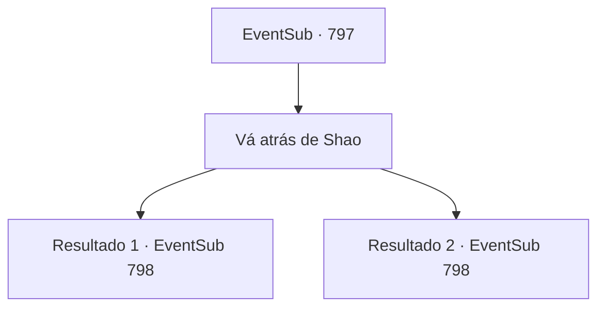

# Eventos secundários · 797

[Índice da tabela](index.md) · [Índice geral](../index.md)

ID: `pt:EventSub:797` · Fonte: `EventSub4` · Versão: 1.2.47.

Mapeamento estático dos arquivos; a disponibilidade e a execução dependem do estado da run.

## Texto do evento

*Sem texto no arquivo.*

## Dados de entrada

```json
{
  "id": 797,
  "grade": 1,
  "subEvent": "",
  "required": ""
}
```

## Mapa das escolhas



## Escolhas e resultados

### Escolha 1

Vá atrás de Shao

Requisitos e outros campos da escolha:

```json
{
  "required": ""
}
```

#### Resultado 1.1

Você corre atrás de Shao, questionando o que ela fez com Lei. Shao responde irritada. 

 "*suspiro*... Lei deve estar lá em cima, no tabernáculo de Veene na colina."

 Shao gesticula para você se afastar com as mãos, depois leva os Dragões Vermelhos em direção ao porto. Você se apressa para o tabernáculo na colina. No caminho, o céu escurece e começa a chover. Assim que você chega ao topo da colina, finalmente encontra Lei. |drawing_kneelingLei| À sua frente está Lei, de joelhos no chão e de costas para você. Seu corpo, olhando vazio para as nuvens com os braços caídos no chão, está coberto de cortes. A área ao redor dele está coberta de sangue negro. Seus olhos ainda estão fixos no céu, como se ele ainda guardasse rancores deste mundo. Gotas de chuva caem em seu rosto e escorrem por seus olhos como um fluxo de lágrimas.

Continuação registrada: [Evento 798](0798.md) na mesma tabela.

```json
{
  "required": "5_755_1",
  "chance": "1",
  "nextEvent": 798,
  "type": 2,
  "reward": "14_11_10|12_11_-1"
}
```

#### Resultado 1.2

Você corre atrás de Shao, questionando o que ela fez com Lei. Shao responde com um sorriso sinistro. 

 "Gosta tanto assim de Lei, hein? Lei deve estar lá em cima, no tabernáculo de Veene na colina."

 Shao gesticula para você se afastar com as mãos, depois leva os Dragões Vermelhos em direção ao porto. Você se apressa para o tabernáculo na colina. No caminho, o céu escurece e começa a chover. Assim que você chega ao topo da colina, finalmente encontra Lei. |drawing_kneelingLei| Na sua frente está Lei, de joelhos no chão e de costas para você. Seu corpo, olhando vazio para as nuvens com os braços caídos sem vida no chão, está coberto de cortes. A área ao redor dele está coberta de sangue negro. Seus olhos ainda estão fixos no céu, como se ele ainda guardasse rancores deste mundo. Gotas de chuva caem em seu rosto e escorrem por seus olhos como um fluxo de lágrimas.

Continuação registrada: [Evento 798](0798.md) na mesma tabela.

```json
{
  "required": "5_757_1",
  "chance": "1",
  "nextEvent": 798,
  "type": 2,
  "reward": "14_11_0|14_11_6|12_11_-1"
}
```

## Referências que chegam a este evento

- [Evento 756 · escolha 2 · resultado 4](0756.md#escolha-2)
- [Evento 783 · escolha 2 · resultado 1](0783.md#escolha-2)
- [Evento 787 · escolha 1 · resultado 1](0787.md#escolha-1)
- [Evento 787 · escolha 2 · resultado 1](0787.md#escolha-2)
