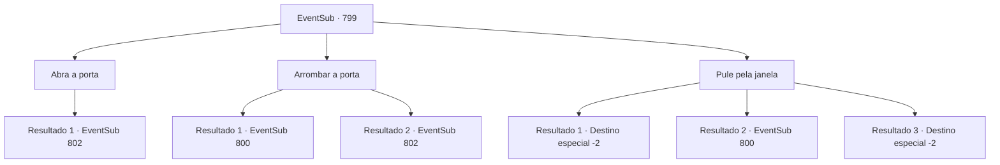

# Eventos secundários · 799

[Índice da tabela](index.md) · [Índice geral](../index.md)

ID: `pt:EventSub:799` · Fonte: `EventSub4` · Versão: 1.2.47.

Mapeamento estático dos arquivos; a disponibilidade e a execução dependem do estado da run.

## Texto do evento

Você está dando um tempo de suas aventuras em uma pousada local. Já está escuro como breu lá fora. Mas algo parece estranho. Então, você sente movimento lá fora - parece que várias pessoas. Um grito agudo de uma espada sendo desembainhada atinge seu ouvido.

## Dados de entrada

```json
{
  "id": 799,
  "grade": 1,
  "subEvent": "",
  "required": "12_11_5"
}
```

## Mapa das escolhas



## Escolhas e resultados

### Escolha 1

Abra a porta

Requisitos e outros campos da escolha:

```json
{
  "required": ""
}
```

#### Resultado 1.1

Você abre a porta para verificar.   Na sua frente está um grupo de guerreiros orientais.   Os três já sacaram suas espadas.   Eles parecem surpresos ao descobrir que você mesmo abriu a porta.   Mas imediatamente voltam a ficar sérios, declarando seu propósito.   

 "Você é {1} o aventureiro, certo? Alguém deseja vê-lo.   Você vai cooperar?"

   Sua maneira de falar é educada e respeitosa, mas há algo estranhamente ameaçador em sua atitude.

Continuação registrada: [Evento 802](0802.md) na mesma tabela.

```json
{
  "required": "",
  "chance": "1",
  "nextEvent": 802,
  "type": 2,
  "reward": ""
}
```

### Escolha 2

Arrombar a porta

Requisitos e outros campos da escolha:

```json
{
  "required": ""
}
```

#### Resultado 2.1

Você chuta a porta com toda a sua força. Com um estrondo alto, a porta é arrancada e derruba uma das pessoas que estavam do lado de fora. Na sua frente está um grupo de guerreiros orientais. Os três já sacaram suas espadas. A abertura repentina da porta deve tê-los pego de surpresa - eles parecem visivelmente surpresos. Você aproveita a oportunidade e ataca primeiro.

Continuação registrada: [Evento 800](0800.md) na mesma tabela.

```json
{
  "required": "",
  "chance": "1|0_5_1",
  "nextEvent": 800,
  "type": 0,
  "reward": "6_2_179",
  "place": 10
}
```

#### Resultado 2.2

Você tenta arrombar a porta com toda a sua força. Mas a porta é mais pesada do que você pensava. Ela se abre lentamente. Na sua frente está um grupo de guerreiros orientais. Os três já sacaram suas espadas. Eles olham para você com desdém e declaram seu propósito. 

 "Você é {1} o aventureiro, certo? Alguém deseja vê-lo. Seria sábio de sua parte cooperar."

 Sua maneira de falar é educada e respeitosa, mas há algo estranhamente ameaçador em sua atitude.

Continuação registrada: [Evento 802](0802.md) na mesma tabela.

```json
{
  "required": "",
  "chance": "8",
  "nextEvent": 802,
  "type": 1,
  "reward": ""
}
```

### Escolha 3

Pule pela janela

Requisitos e outros campos da escolha:

```json
{
  "required": ""
}
```

#### Resultado 3.1

Você abre as janelas e escapa por elas. 

 "Ali! Pelas janelas!"

 Você ouve a porta se abrir junto com a voz apressada de alguém. Mas é tarde demais para eles te alcançarem.

Continuação registrada: [Destino especial `-2`](../destinos-especiais.md).

```json
{
  "required": "21_5_2",
  "chance": "1|0_6_1",
  "nextEvent": -2,
  "type": 0,
  "reward": "12_11_-1"
}
```

#### Resultado 3.2

Você tenta escapar pelas janelas. Mas a porta se abre, e os intrusos invadem. 

 "Ali! Pelas janelas!"

 "Você não vai escapar!"

 Algo afiado é jogado em você. Ao desviar, você perde a chance perfeita de pular pelas janelas. Na sua frente está um grupo de guerreiros orientais. Eles examinam brevemente seu quarto antes de avançarem contra você. Você não está em posição de fazer perguntas ou escapar. Mantendo a posição para não ser cercado, você se prepara para lutar.

Continuação registrada: [Evento 800](0800.md) na mesma tabela.

```json
{
  "required": "21_5_2",
  "chance": "14",
  "nextEvent": 800,
  "type": 1,
  "reward": "6_0_179",
  "place": 10
}
```

#### Resultado 3.3

Você abre as janelas e escapa por elas. Você ouve a porta se abrir junto com a voz apressada de alguém. Mas é tarde demais para eles te alcançarem.

Continuação registrada: [Destino especial `-2`](../destinos-especiais.md).

```json
{
  "required": "20_5_2",
  "chance": "1",
  "nextEvent": -2,
  "type": 2,
  "reward": "12_11_-1"
}
```

## Referências que chegam a este evento

Nenhum `nextEvent` positivo da mesma tabela aponta para este nó. Isso não prova que seja inacessível: sorteio e estado de história podem selecioná-lo.

