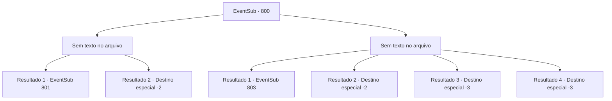

# Eventos secundários · 800

[Índice da tabela](index.md) · [Índice geral](../index.md)

ID: `pt:EventSub:800` · Fonte: `EventSub4` · Versão: 1.2.47.

Mapeamento estático dos arquivos; a disponibilidade e a execução dependem do estado da run.

## Texto do evento

*Sem texto no arquivo.*

## Dados de entrada

```json
{
  "id": 800,
  "grade": 1,
  "subEvent": "",
  "required": ""
}
```

## Mapa das escolhas



## Escolhas e resultados

### Escolha 1

*Sem texto no arquivo; o papel dessa opção depende da interface do jogo.*

Requisitos e outros campos da escolha:

```json
{
  "required": ""
}
```

#### Resultado 1.1

Você percebe que os orientais não são meros bandidos, mas lutadores bem treinados em artes marciais. Ainda assim, as habilidades deles não chegam nem perto das suas, endurecidas através de aventuras. Você está prestes a sair da estalagem após o incidente barulhento. Então, um dos orientais deitado no chão agarra apressadamente seu tornozelo. 

 "E- ESPERE! Pedimos desculpas por não tratá-lo com o devido respeito. Lutar com você não era nossa intenção original! Nosso senhor deseja vê-lo. Você não estaria disposto a participar de uma reunião?"


Continuação registrada: [Evento 801](0801.md) na mesma tabela.

```json
{
  "required": "18_726_1",
  "chance": "1",
  "nextEvent": 801,
  "type": 2,
  "reward": ""
}
```

#### Resultado 1.2

Um grande grupo de guerreiros orientais, ainda maior do que o que você viu na estalagem, o cerca. Claro, isso não significa que eles podem derrotá-lo. Você facilmente rompe a linha de defesa deles e escapa. 

 "O que vocês estão fazendo?! IDIOTAS! VÃO!!"

 Você ouve Shao gritando atrás de você, mas consegue escapar de suas garras.

Continuação registrada: [Destino especial `-2`](../destinos-especiais.md).

```json
{
  "required": "5_726_1",
  "chance": "1",
  "nextEvent": -2,
  "type": 2,
  "reward": "12_11_-1"
}
```

### Escolha 2

*Sem texto no arquivo; o papel dessa opção depende da interface do jogo.*

Requisitos e outros campos da escolha:

```json
{
  "required": ""
}
```

#### Resultado 2.1

O espadachim oriental atinge seu pescoço com o pomo. Você é nocauteado pelo golpe. 

 Sua visão finalmente clareia novamente. Ao olhar ao redor, você percebe que está em um quarto de hóspedes com aparência muito luxuosa. Você se acalma e olha para cima. Lá está uma mulher oriental, relaxadamente bebendo licor. 

 "Ah, você acordou. Minhas desculpas. Pedi para que eles... o escoltassem educadamente. Devem ter esquecido."

 Ela lhe entrega uma taça de licor transparente e sorri. 

 "Acho que uma apresentação é necessária. Meu nome é 'Shao', a herdeira do Clã Ryu, a famosa casa do Oriente."


Continuação registrada: [Evento 803](0803.md) na mesma tabela.

```json
{
  "required": "1_0_2|1_1_2|18_726_1",
  "chance": "1",
  "nextEvent": 803,
  "type": 2,
  "reward": "0_0_-1|0_1_-1"
}
```

#### Resultado 2.2

Você resiste, mas acaba sendo jogado no chão de joelhos, em frente a Shao. 

 "Aqui. Isso vai te deixar um pouco mais obediente."

 Shao força sua boca a se abrir e despeja um copo de licor transparente. À medida que o líquido flui para o seu corpo, sua consciência fica turva. Shao te faz algumas perguntas. Você responde de forma vaga. Isso continua por mais algumas vezes. 

 "...Entendo. Vamos. Não tenho mais negócios com você."

 Ela deixa o lugar com seus homens. Você acorda novamente apenas depois de muito tempo ter passado. Shao e seus guerreiros não estão em lugar algum.

Continuação registrada: [Destino especial `-2`](../destinos-especiais.md).

```json
{
  "required": "1_0_2|1_1_2|5_726_1",
  "chance": "1",
  "nextEvent": -2,
  "type": 2,
  "reward": "12_11_-1"
}
```

#### Resultado 2.3

No meio da feroz luta, um golpe decisivo te pega de surpresa. Um estalo horrível ressoa da sua cabeça, enquanto uma fonte de sangue jorra da ferida. 

 "Droga! Não era para MATAR!"

 "I- isso não é...! Eu..."

 Em meio à consciência se esvaindo, você ouve algumas vozes assustadas. Logo, a escuridão preenche sua visão.

Continuação registrada: [Destino especial `-3`](../destinos-especiais.md).

```json
{
  "required": "2_0_2",
  "chance": "1",
  "nextEvent": -3,
  "type": 2,
  "reward": "0_0_-1|0_1_-1"
}
```

#### Resultado 2.4

No meio da feroz luta, um golpe decisivo te pega de surpresa. Um estalo horrível ressoa da sua cabeça, enquanto uma fonte de sangue jorra da ferida. 

 "Droga! Não era para MATAR!"

 "I- isso não é...! Eu..."

 Em meio à consciência que se esvai, você ouve algumas vozes assustadas. Logo, a escuridão preenche sua visão.

Continuação registrada: [Destino especial `-3`](../destinos-especiais.md).

```json
{
  "required": "2_1_2",
  "chance": "1",
  "nextEvent": -3,
  "type": 2,
  "reward": "0_0_-1|0_1_-1"
}
```

## Referências que chegam a este evento

- [Evento 799 · escolha 2 · resultado 1](0799.md#escolha-2)
- [Evento 799 · escolha 3 · resultado 2](0799.md#escolha-3)
- [Evento 802 · escolha 2 · resultado 1](0802.md#escolha-2)
- [Evento 804 · escolha 2 · resultado 1](0804.md#escolha-2)
