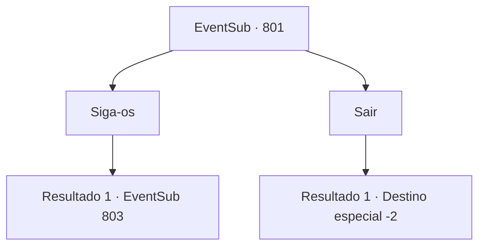

# Eventos secundários · 801

[Índice da tabela](index.md) · [Índice geral](../index.md)

ID: `pt:EventSub:801` · Fonte: `EventSub4` · Versão: 1.2.47.

Mapeamento estático dos arquivos; a disponibilidade e a execução dependem do estado da run.

## Texto do evento

*Sem texto no arquivo.*

## Dados de entrada

```json
{
  "id": 801,
  "grade": 1,
  "subEvent": "",
  "required": ""
}
```

## Mapa das escolhas



## Escolhas e resultados

### Escolha 1

Siga-os

Requisitos e outros campos da escolha:

```json
{
  "required": ""
}
```

#### Resultado 1.1

Com sua aprovação, ele acorda seus companheiros e concorda em escoltá-lo. Você os segue para fora da estalagem. 

 Após alguns minutos de caminhada, você chega a uma estalagem de aparência luxuosa. Você segue os homens escada acima, até o quarto de hóspedes no segundo andar. Lá está sentada uma mulher oriental, relaxadamente bebendo licor. 

 "Ah, você está aqui."

 Ela lhe entrega uma taça de licor transparente e sorri. 

 "Acho que uma apresentação é necessária. Meu nome é 'Shao', a herdeira do Clã Ryu, a famosa casa do Oriente."


Continuação registrada: [Evento 803](0803.md) na mesma tabela.

```json
{
  "required": "",
  "chance": "1",
  "nextEvent": 803,
  "type": 2,
  "reward": ""
}
```

### Escolha 2

Sair

Requisitos e outros campos da escolha:

```json
{
  "required": ""
}
```

#### Resultado 2.1

Você ignora o pedido dele e vai embora. Com a energia esgotada, a única coisa que ele pode fazer é olhar para você enquanto se afasta.

Continuação registrada: [Destino especial `-2`](../destinos-especiais.md).

```json
{
  "required": "",
  "chance": "1",
  "nextEvent": -2,
  "type": 2,
  "reward": "12_11_-1"
}
```

## Referências que chegam a este evento

- [Evento 800 · escolha 1 · resultado 1](0800.md#escolha-1)
