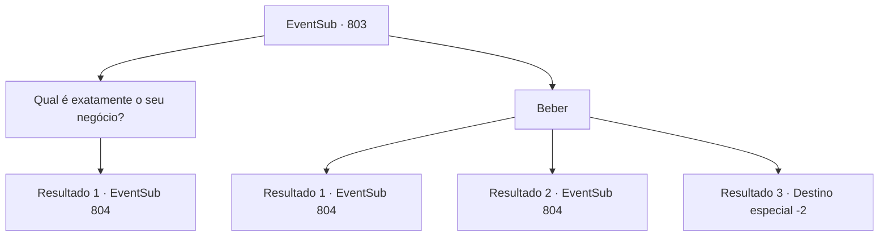

# Eventos secundários · 803

[Índice da tabela](index.md) · [Índice geral](../index.md)

ID: `pt:EventSub:803` · Fonte: `EventSub4` · Versão: 1.2.47.

Mapeamento estático dos arquivos; a disponibilidade e a execução dependem do estado da run.

## Texto do evento

*Sem texto no arquivo.*

## Dados de entrada

```json
{
  "id": 803,
  "grade": 1,
  "subEvent": "",
  "required": ""
}
```

## Mapa das escolhas



## Escolhas e resultados

### Escolha 1

Qual é exatamente o seu negócio?

Requisitos e outros campos da escolha:

```json
{
  "required": ""
}
```

#### Resultado 1.1

Respondendo à sua pergunta, Shao vai direto ao ponto. 

 "Estou ciente de que você se encontrou com outro oriental com uma aparência semelhante à minha? O nome é 'Lei Ryu'... Deve estar óbvio para você agora que estou procurando por essa pessoa. Quero que me diga tudo o que sabe sobre Lei. Prometo-lhe uma recompensa generosa. Pense nisso - você tem muito a ganhar aqui."

 Shao estala os dedos com um sorriso relaxado. Um dos homens que o escoltou até a pousada traz um enorme lingote de ouro. 

 "Isso deve valer 100 moedas de ouro, pelo menos. O que vai ser?"


Continuação registrada: [Evento 804](0804.md) na mesma tabela.

```json
{
  "required": "",
  "chance": "1",
  "nextEvent": 804,
  "type": 2,
  "reward": ""
}
```

### Escolha 2

Beber

Requisitos e outros campos da escolha:

```json
{
  "required": ""
}
```

#### Resultado 2.1

Você esvazia o copo à sua frente. Shao te encara animadamente. 

 "Hoho... Ousado. Eu gosto disso."

 O licor é novo para você. Ele emite uma fragrância que você nunca conheceu antes. Shao verifica sua expressão e fala. 

 "Acho que a bebida combina com seu gosto. Ahem - vamos direto ao ponto, agora. Estou ciente de que você se encontrou com outro oriental com uma aparência semelhante à minha? O nome é 'Lei Ryu'... Deve estar óbvio para você agora que estou procurando por essa pessoa. Quero que me diga tudo o que sabe sobre Lei. Prometo uma recompensa generosa. Pense nisso - você tem muito a ganhar aqui."

 Shao estala os dedos com um sorriso relaxado. Um dos homens que te escoltou até a pousada traz um enorme lingote de ouro. 

 "Isso deve valer pelo menos 100 moedas de ouro. O que vai ser?"


Continuação registrada: [Evento 804](0804.md) na mesma tabela.

```json
{
  "required": "21_15_1",
  "chance": "1|0_13_1",
  "nextEvent": 804,
  "type": 0,
  "reward": ""
}
```

#### Resultado 2.2

Você esvazia o copo à sua frente. Shao te encara animadamente. 

 "Hoho... Ousado. Eu gosto disso."

 O licor é novo para você. Ele emite uma fragrância que você nunca conheceu antes. Shao verifica sua expressão e fala. 

 "Acho que a bebida combina com seu gosto. Ahem - vamos direto ao ponto, agora. Estou ciente de que você se encontrou com outro oriental com uma aparência semelhante à minha? O nome é 'Lei Ryu'... Deve estar óbvio para você agora que estou procurando por essa pessoa. Quero que me diga tudo o que sabe sobre Lei. Prometo uma recompensa generosa. Pense nisso - você tem muito a ganhar aqui."

 Shao estala os dedos com um sorriso relaxado. Um dos homens que te escoltou até a pousada traz um enorme lingote de ouro. 

 "Isso deve valer pelo menos 100 moedas de ouro. O que vai ser?"


Continuação registrada: [Evento 804](0804.md) na mesma tabela.

```json
{
  "required": "20_15_1",
  "chance": "1",
  "nextEvent": 804,
  "type": 2,
  "reward": ""
}
```

#### Resultado 2.3

Você esvazia o copo à sua frente. Shao te encara animadamente. 

 "Hoho... Ousado. Eu gosto disso."

 À medida que o líquido flui para o seu corpo, sua consciência fica turva. Shao te faz uma pergunta. Você responde vagamente. Isso continua por mais algumas vezes. 

 "...Entendo. Vamos. Não tenho mais negócios com você."

 Você acorda novamente apenas depois de muito tempo ter passado. Shao e seus guerreiros não estão em lugar algum.

Continuação registrada: [Destino especial `-2`](../destinos-especiais.md).

```json
{
  "required": "21_15_1",
  "chance": "20",
  "nextEvent": -2,
  "type": 1,
  "reward": "12_11_-1"
}
```

## Referências que chegam a este evento

- [Evento 800 · escolha 2 · resultado 1](0800.md#escolha-2)
- [Evento 801 · escolha 1 · resultado 1](0801.md#escolha-1)
- [Evento 802 · escolha 1 · resultado 1](0802.md#escolha-1)
