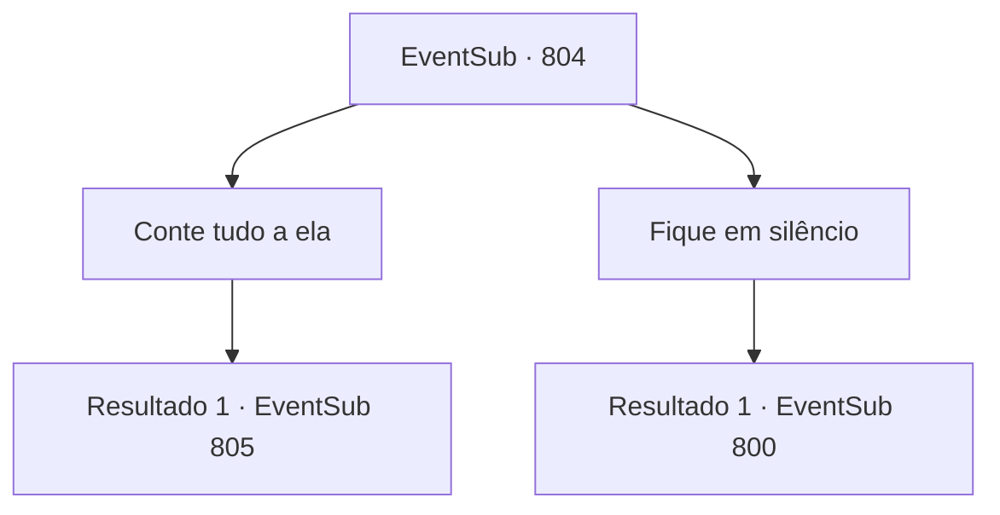

# Eventos secundários · 804

[Índice da tabela](index.md) · [Índice geral](../index.md)

ID: `pt:EventSub:804` · Fonte: `EventSub4` · Versão: 1.2.47.

Mapeamento estático dos arquivos; a disponibilidade e a execução dependem do estado da run.

## Texto do evento

*Sem texto no arquivo.*

## Dados de entrada

```json
{
  "id": 804,
  "grade": 1,
  "subEvent": "",
  "required": ""
}
```

## Mapa das escolhas



## Escolhas e resultados

### Escolha 1

Conte tudo a ela

Requisitos e outros campos da escolha:

```json
{
  "required": ""
}
```

#### Resultado 1.1

Você conta a ela tudo o que sabe sobre Lei. Tudo, desde que o conheceu pela primeira vez em Heta, e seu destino. Enquanto te ouve em silêncio, o olhar de Shao se conecta com o seu. Ela sorri e fala. 

 "Obrigada. Eu... tenho mais um pedido para você. Você me ajudaria?"

 O pedido dela era para você ajudá-la a procurar Lei no Monte Trigia.

Continuação registrada: [Evento 805](0805.md) na mesma tabela.

```json
{
  "required": "",
  "chance": "1",
  "nextEvent": 805,
  "type": 2,
  "reward": ""
}
```

### Escolha 2

Fique em silêncio

Requisitos e outros campos da escolha:

```json
{
  "required": ""
}
```

#### Resultado 2.1

Você recusa a oferta de Shao. Ela imediatamente muda de atitude e te encara friamente. 

 "Ah, bem... Faça este falar. Não. Mate."

 Assim que ela ordena, seus guerreiros sacam suas espadas. A saída já foi bloqueada. Escapar não é mais uma opção aqui. Você observa cuidadosamente os guerreiros um por um e rapidamente desfere o primeiro ataque.

Continuação registrada: [Evento 800](0800.md) na mesma tabela.

```json
{
  "required": "",
  "chance": "1",
  "nextEvent": 800,
  "type": 2,
  "reward": "5_726_1|6_3_179",
  "place": 10
}
```

## Referências que chegam a este evento

- [Evento 803 · escolha 1 · resultado 1](0803.md#escolha-1)
- [Evento 803 · escolha 2 · resultado 1](0803.md#escolha-2)
- [Evento 803 · escolha 2 · resultado 2](0803.md#escolha-2)
