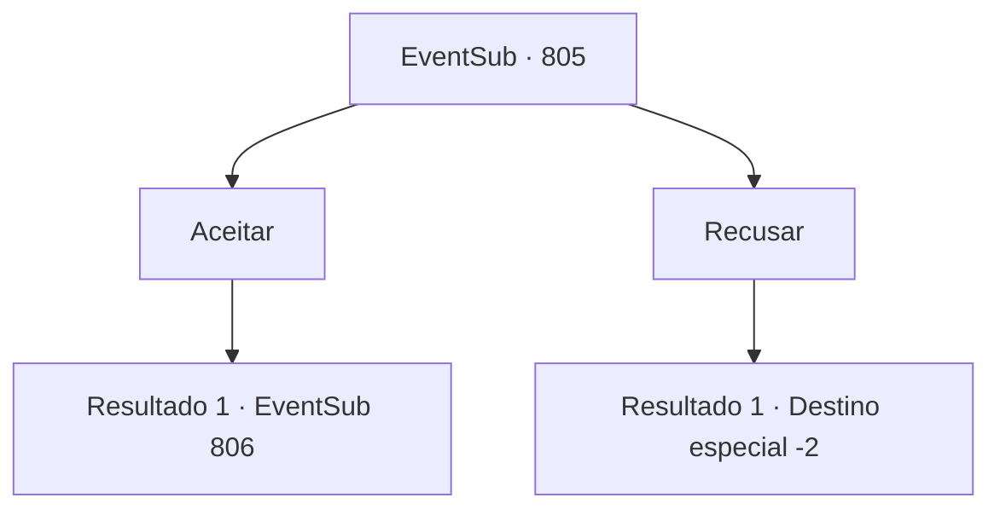

# Eventos secundários · 805

[Índice da tabela](index.md) · [Índice geral](../index.md)

ID: `pt:EventSub:805` · Fonte: `EventSub4` · Versão: 1.2.47.

Mapeamento estático dos arquivos; a disponibilidade e a execução dependem do estado da run.

## Texto do evento

*Sem texto no arquivo.*

## Dados de entrada

```json
{
  "id": 805,
  "grade": 1,
  "subEvent": "",
  "required": ""
}
```

## Mapa das escolhas



## Escolhas e resultados

### Escolha 1

Aceitar

Requisitos e outros campos da escolha:

```json
{
  "required": ""
}
```

#### Resultado 1.1

Shao ordena que seus homens lhe entreguem o lingote de ouro. Você acompanha Shao até o Monte Trigia. Os ventos frios da Cordilheira da Lâmina, onde o Monte Trigia está localizado, o saúdam. 

 "Dois de vocês - comigo. Os outros, separem-se e procurem por Lei. Não se aproximem de Lei sozinhos. Enviem-me um falcão mensageiro imediatamente."

 Os Dracos Vermelhos se separam imediatamente. Você, Shao e os dois guerreiros começam a subir o Monte Trigia.

Continuação registrada: [Evento 806](0806.md) na mesma tabela.

```json
{
  "required": "",
  "chance": "1",
  "nextEvent": 806,
  "type": 2,
  "reward": "0_4_100"
}
```

### Escolha 2

Recusar

Requisitos e outros campos da escolha:

```json
{
  "required": ""
}
```

#### Resultado 2.1

Você balança a cabeça e recusa educadamente. Shao parece desapontada, mas não insiste. Ela manda seus homens lhe entregarem o lingote de ouro e o acompanha pessoalmente até a saída. Você verifica a autenticidade do lingote de ouro e vai embora.

Continuação registrada: [Destino especial `-2`](../destinos-especiais.md).

```json
{
  "required": "",
  "chance": "1",
  "nextEvent": -2,
  "type": 2,
  "reward": "12_11_8|0_4_100"
}
```

## Referências que chegam a este evento

- [Evento 804 · escolha 1 · resultado 1](0804.md#escolha-1)
