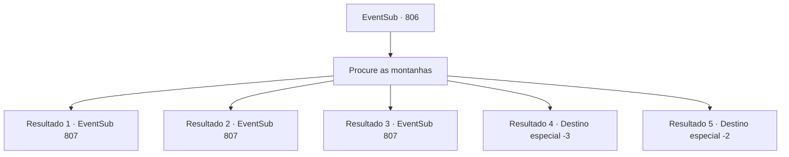

# Eventos secundários · 806

[Índice da tabela](index.md) · [Índice geral](../index.md)

ID: `pt:EventSub:806` · Fonte: `EventSub4` · Versão: 1.2.47.

Mapeamento estático dos arquivos; a disponibilidade e a execução dependem do estado da run.

## Texto do evento

*Sem texto no arquivo.*

## Dados de entrada

```json
{
  "id": 806,
  "grade": 1,
  "subEvent": "",
  "required": ""
}
```

## Mapa das escolhas



## Escolhas e resultados

### Escolha 1

Procure as montanhas

Requisitos e outros campos da escolha:

```json
{
  "required": ""
}
```

#### Resultado 1.1

Quanto mais alto você vai, mais frios os ventos ficam. Mas você é forte o suficiente para suportar o frio. Você e Shao apertam suas roupas e procuram pela montanha. A busca continua por três ou quatro horas. Finalmente, você encontra seu alvo no topo de um penhasco. 

 "...SOHYEOP! E... Shao...?"

 Lei se aproxima feliz de você, mas para ao notar Shao ao seu lado. Shao sorri friamente. 

 "Há quanto tempo, Lei. O que você está fazendo aqui? É essa a vida que você escolheu, depois de fugir do clã?"

 Após uma breve troca de cumprimentos, Shao se volta para você. 

 "Meu pedido final. Mate Lei. Acabe com essa... desgraça do meu clã. O pagamento é o dobro do valor do último."


Continuação registrada: [Evento 807](0807.md) na mesma tabela.

```json
{
  "required": "21_8_1|21_0_1",
  "chance": "1|0_13_1",
  "nextEvent": 807,
  "type": 0,
  "reward": ""
}
```

#### Resultado 1.2

Quanto mais alto você vai, mais frios os ventos ficam. Mas isso não te incomoda nem um pouco. A busca continua por três ou quatro horas. Finalmente, você encontra seu alvo no topo de um penhasco. 

 "...SOHYEOP! E... Shao...?"

 Lei se aproxima feliz de você, então para ao notar Shao ao seu lado. Shao sorri friamente. 

 "Há quanto tempo, Lei. O que você está fazendo aqui? É essa a vida que você escolheu, depois de fugir do clã?"

 Após uma breve troca de cumprimentos, Shao se volta para você. 

 "Meu pedido final. Mate Lei. Acabe com essa... desgraça do meu clã. O pagamento é o dobro do valor do último."


Continuação registrada: [Evento 807](0807.md) na mesma tabela.

```json
{
  "required": "20_8_1",
  "chance": "1",
  "nextEvent": 807,
  "type": 2,
  "reward": ""
}
```

#### Resultado 1.3

Quanto mais alto você vai, mais frios os ventos ficam. Você conjura uma barreira mágica para proteger seu grupo dos ventos frios. A busca continua por três ou quatro horas. Finalmente, você encontra seu alvo no topo de um penhasco. 

 "...SOHYEOP! E... Shao...?"

 Lei se aproxima feliz de você, mas para ao notar Shao ao seu lado. Shao sorri friamente. 

 "Há quanto tempo, Lei. O que você está fazendo aqui? É essa a vida que você escolheu, depois de fugir do clã?"

 Após uma breve troca de cumprimentos, Shao se volta para você. 

 "Meu pedido final. Mate Lei. Acabe com essa... desgraça do meu clã. O pagamento é o dobro do valor do último."


Continuação registrada: [Evento 807](0807.md) na mesma tabela.

```json
{
  "required": "20_0_1",
  "chance": "1",
  "nextEvent": 807,
  "type": 2,
  "reward": ""
}
```

#### Resultado 1.4

Quanto mais alto você vai, mais frios os ventos ficam. Ao passar pela metade do caminho, o frio se torna tão severo que parece que seu rosto está sendo constantemente açoitado. Sua respiração se torna mais superficial. Uma sonolência avassaladora toma conta. Infelizmente, você adormece em um sono eterno, no abraço nevado da montanha.

Continuação registrada: [Destino especial `-3`](../destinos-especiais.md).

```json
{
  "required": "2_0_2|21_8_1|21_0_1",
  "chance": "15",
  "nextEvent": -3,
  "type": 1,
  "reward": "0_0_-1"
}
```

#### Resultado 1.5

Quanto mais alto você vai, mais frios ficam os ventos. Ao passar pela metade do caminho, o frio se torna tão severo que parece que seu rosto está sendo constantemente chicoteado. Sua respiração se torna mais superficial. Uma sonolência avassaladora toma conta. Infelizmente, você adormece em um sono eterno, no abraço nevado da montanha. 

 Você acorda sob um teto desconhecido. Olhando pela janela, você supõe que está na pequena vila localizada abaixo do Monte Trigia. À medida que seu corpo descongela, uma dor coçante é sentida nas pontas das mãos e dos pés. 

 "Você está acordado. Aqui, isso vai ajudar."

 Um homem de meia-idade e peludo lhe oferece uma xícara de licor fumegante. Ele diz que é um licor tradicional por essas bandas. Ele também acrescenta que a área ao redor da vila é muito fria, avisando para ter cuidado. 

 "Um grupo de orientais trouxe você e simplesmente... foi embora. Eles também pareciam estar levemente vestidos... Isso meio que me preocupa, pensando bem. Ah, e não se preocupe com o dinheiro. Eles já pagaram tudo."

 Você aquece seu corpo, agradece a ele e se despede.

Continuação registrada: [Destino especial `-2`](../destinos-especiais.md).

```json
{
  "required": "1_0_2|21_8_1|21_0_1",
  "chance": "15",
  "nextEvent": -2,
  "type": 1,
  "reward": "0_0_-1|12_11_-1"
}
```

## Referências que chegam a este evento

- [Evento 805 · escolha 1 · resultado 1](0805.md#escolha-1)
