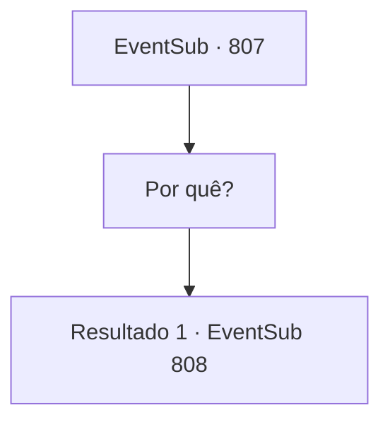

# Eventos secundários · 807

[Índice da tabela](index.md) · [Índice geral](../index.md)

ID: `pt:EventSub:807` · Fonte: `EventSub4` · Versão: 1.2.47.

Mapeamento estático dos arquivos; a disponibilidade e a execução dependem do estado da run.

## Texto do evento

*Sem texto no arquivo.*

## Dados de entrada

```json
{
  "id": 807,
  "grade": 1,
  "subEvent": "",
  "required": ""
}
```

## Mapa das escolhas



## Escolhas e resultados

### Escolha 1

Por quê?

Requisitos e outros campos da escolha:

```json
{
  "required": ""
}
```

#### Resultado 1.1

Você pergunta a Shao por que ela está pedindo para você fazer tal coisa. 

 "Assuntos do clã. Você não precisa saber de nada."

 Lei te encara, preocupada e ansiosa.

Continuação registrada: [Evento 808](0808.md) na mesma tabela.

```json
{
  "required": "",
  "chance": "1",
  "nextEvent": 808,
  "type": 2,
  "reward": ""
}
```

## Referências que chegam a este evento

- [Evento 806 · escolha 1 · resultado 1](0806.md#escolha-1)
- [Evento 806 · escolha 1 · resultado 2](0806.md#escolha-1)
- [Evento 806 · escolha 1 · resultado 3](0806.md#escolha-1)
