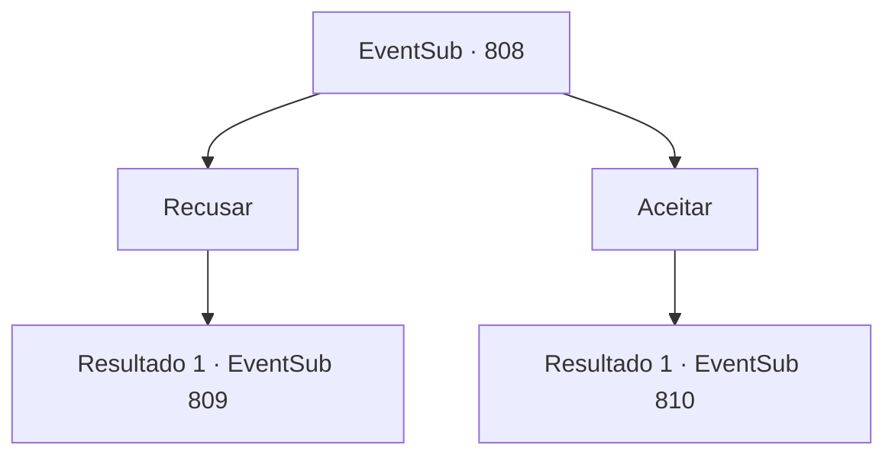

# Eventos secundários · 808

[Índice da tabela](index.md) · [Índice geral](../index.md)

ID: `pt:EventSub:808` · Fonte: `EventSub4` · Versão: 1.2.47.

Mapeamento estático dos arquivos; a disponibilidade e a execução dependem do estado da run.

## Texto do evento

*Sem texto no arquivo.*

## Dados de entrada

```json
{
  "id": 808,
  "grade": 1,
  "subEvent": "",
  "required": ""
}
```

## Mapa das escolhas



## Escolhas e resultados

### Escolha 1

Recusar

Requisitos e outros campos da escolha:

```json
{
  "required": ""
}
```

#### Resultado 1.1

Você recusa o último pedido de Shao. Shao responde sacando sua espada. Dragões Vermelhos próximos se preparam para lutar também. 

 "Que inesperado de sua parte escolher punição em vez de uma boa bebida. Infelizmente - matem todos eles."

 Você se prepara para lutar - Lei faz o mesmo. A luta começa logo depois.

Continuação registrada: [Evento 809](0809.md) na mesma tabela.

```json
{
  "required": "",
  "chance": "1",
  "nextEvent": 809,
  "type": 2,
  "reward": "6_0_178",
  "place": 9
}
```

### Escolha 2

Aceitar

Requisitos e outros campos da escolha:

```json
{
  "required": ""
}
```

#### Resultado 2.1

Você decide aceitar o último pedido de Shao. 

 "S- Sohyeop...!"

 Shao sorri arrogantemente, enquanto o rosto de Lei fica sombrio de espanto. Lei tenta dizer algo, mas então engole suas palavras. Ele então puxa sua espada. 

 "...Não era assim que eu esperava que nossa revanche acontecesse, Sohyeop."


Continuação registrada: [Evento 810](0810.md) na mesma tabela.

```json
{
  "required": "",
  "chance": "1",
  "nextEvent": 810,
  "type": 2,
  "reward": "6_0_177",
  "place": 9
}
```

## Referências que chegam a este evento

- [Evento 807 · escolha 1 · resultado 1](0807.md#escolha-1)
