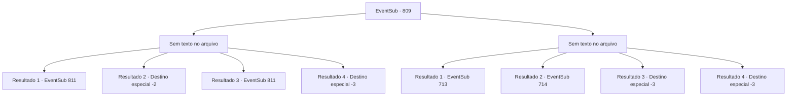

# Eventos secundários · 809

[Índice da tabela](index.md) · [Índice geral](../index.md)

ID: `pt:EventSub:809` · Fonte: `EventSub4` · Versão: 1.2.47.

Mapeamento estático dos arquivos; a disponibilidade e a execução dependem do estado da run.

## Texto do evento

*Sem texto no arquivo.*

## Dados de entrada

```json
{
  "id": 809,
  "grade": 1,
  "subEvent": "",
  "required": ""
}
```

## Mapa das escolhas



## Escolhas e resultados

### Escolha 1

*Sem texto no arquivo; o papel dessa opção depende da interface do jogo.*

Requisitos e outros campos da escolha:

```json
{
  "required": ""
}
```

#### Resultado 1.1

Você pressiona o ataque em Shao, encurralando-a na beira de um penhasco. Então, o chão começa a tremer. O penhasco começa a desmoronar. É tudo muito repentino - você não tem tempo para reagir. Você e Shao são jogados do penhasco e engolidos pela correnteza do riacho. Apesar da correnteza rápida, você começa a nadar com todas as suas forças. Então, algo entra em sua visão. 

 "*ofega*...! Argh...!"

 É Shao. Ela está sendo levada pela água, seu rosto pálido de medo.

Continuação registrada: [Evento 811](0811.md) na mesma tabela.

```json
{
  "required": "21_31_1|1_0_2",
  "chance": "1|0_5_1",
  "nextEvent": 811,
  "type": 0,
  "reward": ""
}
```

#### Resultado 1.2

Você pressiona o ataque em Shao, encurralando-a na beira de um penhasco. Então, o chão começa a tremer. O penhasco começa a desmoronar. É tudo muito repentino - você não tem tempo para reagir. Você e Shao são jogados do penhasco e engolidos pela correnteza do riacho. 

 Você acorda da inconsciência e olha ao redor. Você está deitado em um campo de cascalho, onde a corrente é mais lenta. Nenhum sinal de vida humana está por perto. Sentindo o frio ficando mais intenso, você começa a descer a montanha.

Continuação registrada: [Destino especial `-2`](../destinos-especiais.md).

```json
{
  "required": "21_31_1|1_0_2",
  "chance": "16",
  "nextEvent": -2,
  "type": 1,
  "reward": "0_0_-1|12_11_6"
}
```

#### Resultado 1.3

Você pressiona o ataque em Shao, encurralando-a na beira de um penhasco. Então, o chão começa a tremer. O penhasco começa a desmoronar. É tudo muito repentino - você não tem tempo para reagir. Você e Shao são jogados do penhasco e engolidos pela correnteza do riacho. Apesar da correnteza rápida, você começa a nadar com todas as suas forças. Então, algo entra em sua visão. 

 "*ofega*...! Argh...!"

 É Shao. Ela está sendo levada pela água, seu rosto pálido de medo.

Continuação registrada: [Evento 811](0811.md) na mesma tabela.

```json
{
  "required": "20_31_1",
  "chance": "1",
  "nextEvent": 811,
  "type": 2,
  "reward": ""
}
```

#### Resultado 1.4

Você pressiona o ataque em Shao, encurralando-a na beira de um penhasco. Então, o chão começa a tremer. O penhasco começa a desmoronar. É tudo muito repentino - você não tem tempo para reagir. Você e Shao são jogados do penhasco e engolidos pela correnteza do riacho.

Continuação registrada: [Destino especial `-3`](../destinos-especiais.md).

```json
{
  "required": "21_31_1|2_0_2",
  "chance": "1",
  "nextEvent": -3,
  "type": 1,
  "reward": "0_0_-1"
}
```

### Escolha 2

*Sem texto no arquivo; o papel dessa opção depende da interface do jogo.*

Requisitos e outros campos da escolha:

```json
{
  "required": ""
}
```

#### Resultado 2.1

Você instintivamente percebe que está prestes a ser derrotado. Você sinaliza para Lei e se prepara para pular do penhasco. Lei a princípio pareceu surpreso, mas eventualmente acena em concordância. 

 "Parem eles! Estão fugindo!"

 "Esperem! Estão pulando!"

 Vocês dois rompem a linha de espadachins e sem hesitação se jogam do penhasco. A corrente feroz do riacho engole vocês dois em um instante. 

 Você finalmente abre os olhos e se senta. Parece que você está em algum tipo de caverna. Ao seu lado está uma pequena fogueira, onde Lei está secando suas roupas molhadas. 

 "Ah... Sohyeop! Finalmente! Bom ver você de volta à ação."

 Lei disse, esboçando um sorriso constrangido.

Continuação registrada: [Evento 713](0713.md) na mesma tabela.

```json
{
  "required": "1_0_2|1_1_2|21_31_1",
  "chance": "1",
  "nextEvent": 713,
  "type": 2,
  "reward": "0_0_-1|0_1_-1"
}
```

#### Resultado 2.2

Você instintivamente percebe que está prestes a ser derrotado. Você sinaliza para Lei e se prepara para pular do penhasco. Lei a princípio pareceu surpreso, mas eventualmente acena em concordância. 

 "Parem eles! Estão fugindo!"

 "Esperem! Estão pulando!"

 Vocês dois rompem a linha de espadachins e sem hesitação se jogam do penhasco. A corrente feroz do riacho engole vocês dois em um instante. 

 "...Sohyeop!!"

 Você usa sua habilidade de respirar debaixo d'água e salva Lei de se afogar. Lei tosse a água da boca e olha ao redor. Lei avista uma caverna próxima e fala. 

 "...Ali! Uma caverna. Vamos nos esconder lá por enquanto."

 Você segue Lei para dentro da caverna.

Continuação registrada: [Evento 714](0714.md) na mesma tabela.

```json
{
  "required": "1_0_2|1_1_2|20_31_1",
  "chance": "1",
  "nextEvent": 714,
  "type": 2,
  "reward": "0_0_-1|0_1_-1"
}
```

#### Resultado 2.3

A espada de Shao perfura seu coração. Você cospe sangue, mas ela não dá atenção. Ela pressiona a espada ainda mais, saboreando cada momento de sua morte. 

 "Tsk, tsk... Que tolice."

 Você é levado aos joelhos, olhar fixo nos olhos frios de Shao. Shao agarra o punho de sua espada com a mão direita e te chuta para longe com o pé esquerdo. Quando a espada é violentamente arrancada do seu corpo, seu corpo cai para trás. A ferida quente esfria rapidamente. Agora só parece frio. Infelizmente, sua consciência logo se desvanece.

Continuação registrada: [Destino especial `-3`](../destinos-especiais.md).

```json
{
  "required": "2_0_2",
  "chance": "1",
  "nextEvent": -3,
  "type": 2,
  "reward": "0_0_-1|0_1_-1"
}
```

#### Resultado 2.4

A espada de Shao perfura seu coração. Você tosse sangue, mas ela não presta atenção. Ela pressiona a espada ainda mais, saboreando cada momento de sua morte. 

 "Tsk, tsk... Que tolice."

 Você é levado aos joelhos, olhar fixo nos olhos frios de Shao. Shao agarra o punho de sua espada com a mão direita e te chuta com o pé esquerdo. Quando a espada é violentamente arrancada do seu corpo, seu corpo cai para trás. A ferida quente esfria rapidamente. Agora só parece frio. Infelizmente, sua consciência logo se desvanece.

Continuação registrada: [Destino especial `-3`](../destinos-especiais.md).

```json
{
  "required": "2_1_2",
  "chance": "1",
  "nextEvent": -3,
  "type": 2,
  "reward": "0_0_-1|0_1_-1"
}
```

## Referências que chegam a este evento

- [Evento 808 · escolha 1 · resultado 1](0808.md#escolha-1)
