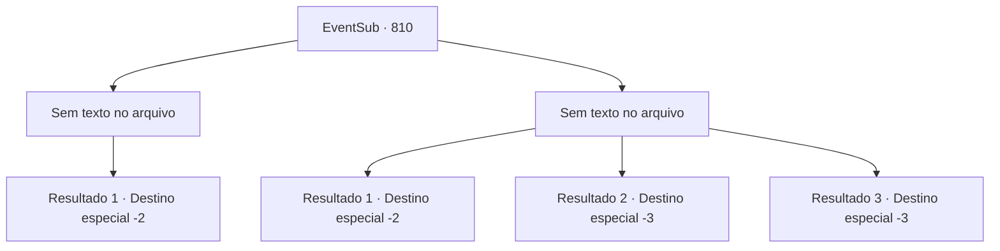

# Eventos secundários · 810

[Índice da tabela](index.md) · [Índice geral](../index.md)

ID: `pt:EventSub:810` · Fonte: `EventSub4` · Versão: 1.2.47.

Mapeamento estático dos arquivos; a disponibilidade e a execução dependem do estado da run.

## Texto do evento

*Sem texto no arquivo.*

## Dados de entrada

```json
{
  "id": 810,
  "grade": 1,
  "subEvent": "",
  "required": ""
}
```

## Mapa das escolhas



## Escolhas e resultados

### Escolha 1

*Sem texto no arquivo; o papel dessa opção depende da interface do jogo.*

Requisitos e outros campos da escolha:

```json
{
  "required": ""
}
```

#### Resultado 1.1

Seu golpe decisivo faz Lei tossir sangue de dor. Ele se afasta, cambaleando. Então, o penhasco em que Lei está começa a desmoronar. Lei perde o equilíbrio - ele estende as mãos desesperadamente em busca de ajuda, mas não há ninguém para segurá-lo. Infelizmente, ele cai do penhasco e é engolido pela correnteza do riacho. 

 "Muito bem. Mas receio que não posso pagar você agora. Gostaria de verificar o corpo eu mesmo primeiro."

 Shao disse calmamente, olhando para o penhasco desmoronado. Abaixo flui uma correnteza forte, agora uma mistura de água e lama. 

 "Há uma cidade chamada 'Tunaas', perto do Grande Deserto. Espere por mim lá."

 Ela então parte com seus homens.

Continuação registrada: [Destino especial `-2`](../destinos-especiais.md).

```json
{
  "required": "",
  "chance": "1",
  "nextEvent": -2,
  "type": 2,
  "reward": "12_11_14"
}
```

### Escolha 2

*Sem texto no arquivo; o papel dessa opção depende da interface do jogo.*

Requisitos e outros campos da escolha:

```json
{
  "required": ""
}
```

#### Resultado 2.1

Lei lentamente começa a te dominar com seus ataques. Percebendo isso, os Drakes Vermelhos intervêm para enfrentar Lei. Lei é jogado do penhasco. Ele desesperadamente estende as mãos em busca de ajuda, mas não há ninguém para segurá-lo. Infelizmente, ele cai do penhasco e é engolido pela correnteza do riacho. 

 "Muito bem. Mas receio que não posso te pagar agora. Gostaria de verificar o corpo eu mesmo primeiro."

 Shao disse calmamente, olhando para o penhasco desmoronado. Abaixo flui uma correnteza forte, agora uma mistura de água e lama. 

 "Há uma cidade chamada 'Tunaas', perto do Grande Deserto. Espere por mim lá."

 Ela então parte com seus homens.

Continuação registrada: [Destino especial `-2`](../destinos-especiais.md).

```json
{
  "required": "1_0_2|1_1_2",
  "chance": "1",
  "nextEvent": -2,
  "type": 2,
  "reward": "0_0_-1|0_1_-1|12_11_14"
}
```

#### Resultado 2.2

A habilidade de Lei com a espada melhorou dramaticamente. Não é apenas que seus ataques estão mais afiados ou rápidos. Ele mira seus pontos fracos sem hesitação, até mesmo indo para ataques possivelmente letais várias vezes. Você é forçado a se ajoelhar por seus ataques ferozes. Então, com um rápido movimento de sua espada, Lei separa seu pescoço do corpo.

Continuação registrada: [Destino especial `-3`](../destinos-especiais.md).

```json
{
  "required": "2_0_2",
  "chance": "1",
  "nextEvent": -3,
  "type": 2,
  "reward": "0_0_-1|0_1_-1"
}
```

#### Resultado 2.3

A habilidade de Lei com a espada melhorou dramaticamente. Não é apenas que seus ataques estão mais afiados ou rápidos. Ele mira seus pontos fracos sem hesitação, até mesmo indo para ataques possivelmente letais várias vezes. Você é forçado a se ajoelhar por seus ataques ferozes. Então, com um rápido movimento de sua espada, Lei separa seu pescoço do corpo.

Continuação registrada: [Destino especial `-3`](../destinos-especiais.md).

```json
{
  "required": "2_1_2",
  "chance": "1",
  "nextEvent": -3,
  "type": 2,
  "reward": "0_0_-1|0_1_-1"
}
```

## Referências que chegam a este evento

- [Evento 808 · escolha 2 · resultado 1](0808.md#escolha-2)
