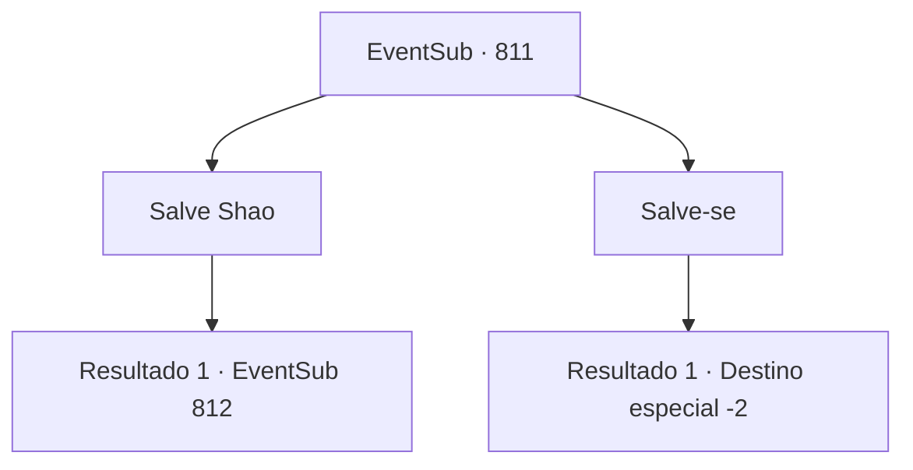

# Eventos secundários · 811

[Índice da tabela](index.md) · [Índice geral](../index.md)

ID: `pt:EventSub:811` · Fonte: `EventSub4` · Versão: 1.2.47.

Mapeamento estático dos arquivos; a disponibilidade e a execução dependem do estado da run.

## Texto do evento

*Sem texto no arquivo.*

## Dados de entrada

```json
{
  "id": 811,
  "grade": 1,
  "subEvent": "",
  "required": ""
}
```

## Mapa das escolhas



## Escolhas e resultados

### Escolha 1

Salve Shao

Requisitos e outros campos da escolha:

```json
{
  "required": "1_3_0"
}
```

#### Resultado 1.1

Você nada com todas as suas forças, levando Shao com você enquanto se afasta da correnteza. Então, você coloca Shao no campo de cascalho. Depois de tossir toda a água que engoliu, Shao finalmente acorda. Você olha para ela, secando suas roupas. Ela está olhando para o riacho sem expressão. Um silêncio constrangedor preenche o ar. 

 "...Por que você me salvou?"


Continuação registrada: [Evento 812](0812.md) na mesma tabela.

```json
{
  "required": "",
  "chance": "1",
  "nextEvent": 812,
  "type": 2,
  "reward": "0_3_1"
}
```

### Escolha 2

Salve-se

Requisitos e outros campos da escolha:

```json
{
  "required": ""
}
```

#### Resultado 2.1

Você nada com todas as suas forças, afastando-se da corrente. Então, você chega ao campo de cascalho próximo. Shao não consegue. Logo depois, ela afunda na água. A forte corrente silencia seus gritos finais. Você espreme suas roupas para secá-las, verifica se há ferimentos e decide descansar. Após um breve descanso, você decide que é hora de deixar o Monte Tragia.

Continuação registrada: [Destino especial `-2`](../destinos-especiais.md).

```json
{
  "required": "",
  "chance": "1",
  "nextEvent": -2,
  "type": 2,
  "reward": "12_11_6"
}
```

## Referências que chegam a este evento

- [Evento 809 · escolha 1 · resultado 1](0809.md#escolha-1)
- [Evento 809 · escolha 1 · resultado 3](0809.md#escolha-1)
