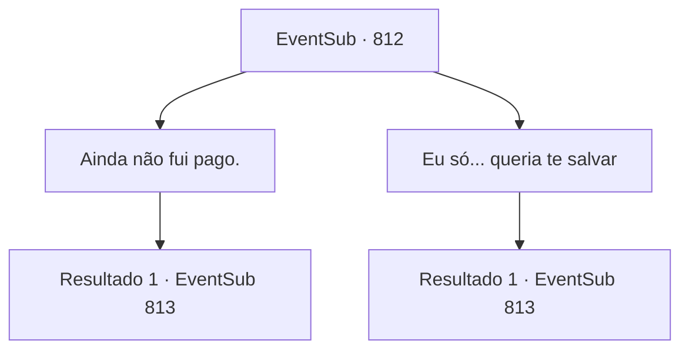

# Eventos secundários · 812

[Índice da tabela](index.md) · [Índice geral](../index.md)

ID: `pt:EventSub:812` · Fonte: `EventSub4` · Versão: 1.2.47.

Mapeamento estático dos arquivos; a disponibilidade e a execução dependem do estado da run.

## Texto do evento

*Sem texto no arquivo.*

## Dados de entrada

```json
{
  "id": 812,
  "grade": 1,
  "subEvent": "",
  "required": ""
}
```

## Mapa das escolhas



## Escolhas e resultados

### Escolha 1

Ainda não fui pago.

Requisitos e outros campos da escolha:

```json
{
  "required": ""
}
```

#### Resultado 1.1

Você diz a ela que ela ainda te deve um pagamento. Shao te dá uma risada seca em resposta. Ela então começa a vasculhar seus bolsos. 

 "Ah... droga, a corrente deve ter levado embora. Poxa, eu sei que provavelmente não será suficiente, mas vou te contar a resposta do que você me perguntou antes."

 Shao começa a te contar sua história, sobre o verdadeiro motivo pelo qual ela queria Lei morto. 

 "...Lei e eu realmente compartilhamos o mesmo pai. Mas esse não é o caso de nossas mães. Lei foi gerado por uma prostituta."

 Ela olha fixamente para a água enquanto continua. 

 "Eu não gostei disso desde o começo. Ter o filho de uma plebeia imunda - filho de uma maldita PROSTITUTA - aceito no meu clã honrado? Ainda pior, meu pai sempre favorecia aquele pirralho em vez de mim! Ele me tratava friamente, dizendo que eu deveria ser uma herdeira adequada para o Chefe do Clã Ryu. E ainda assim... ela era sempre tão generosa e gentil com Lei."


Continuação registrada: [Evento 813](0813.md) na mesma tabela.

```json
{
  "required": "",
  "chance": "1",
  "nextEvent": 813,
  "type": 2,
  "reward": ""
}
```

### Escolha 2

Eu só... queria te salvar

Requisitos e outros campos da escolha:

```json
{
  "required": ""
}
```

#### Resultado 2.1

Shao te dá uma risada seca em resposta. 

 "Huh... Você realmente não pensa no futuro, não é? Poxa, eu sei que provavelmente não será suficiente, mas vou te contar a resposta para o que você me perguntou antes."

 Shao começa a te contar sua história, sobre o verdadeiro motivo pelo qual ela queria Lei morto. 

 "...Lei e eu realmente compartilhamos o mesmo pai. Mas esse não é o caso de nossas mães. Lei foi gerado por uma prostituta."

 Ela olha fixamente para a água enquanto continua. 

 "Eu não gostei disso desde o início. Ter o filho de uma plebeia imunda - filho de uma maldita PROSTITUTA - aceito no meu clã honrado? Ainda pior, meu pai sempre favorecia aquele pirralho em vez de mim! Ele me tratava friamente, dizendo que eu deveria ser uma herdeira adequada para o Chefe do Clã Ryu. E ainda assim... ele era sempre tão generoso e gentil com Lei."


Continuação registrada: [Evento 813](0813.md) na mesma tabela.

```json
{
  "required": "",
  "chance": "1",
  "nextEvent": 813,
  "type": 2,
  "reward": ""
}
```

## Referências que chegam a este evento

- [Evento 811 · escolha 1 · resultado 1](0811.md#escolha-1)
