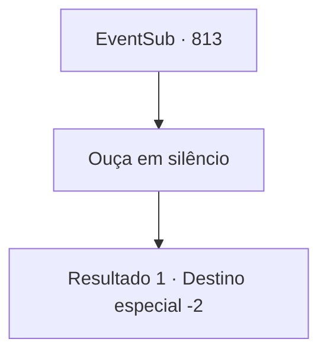

# Eventos secundários · 813

[Índice da tabela](index.md) · [Índice geral](../index.md)

ID: `pt:EventSub:813` · Fonte: `EventSub4` · Versão: 1.2.47.

Mapeamento estático dos arquivos; a disponibilidade e a execução dependem do estado da run.

## Texto do evento

*Sem texto no arquivo.*

## Dados de entrada

```json
{
  "id": 813,
  "grade": 1,
  "subEvent": "",
  "required": ""
}
```

## Mapa das escolhas



## Escolhas e resultados

### Escolha 1

Ouça em silêncio

Requisitos e outros campos da escolha:

```json
{
  "required": ""
}
```

#### Resultado 1.1


 "Lei... Todo dia, aquele pirralho sentava no colo do Chefe do Clã e ria enquanto ele a alimentava com iguarias! E o que eu ganhei? Eu treinei e treinei e treinei, só para que ele me olhasse uma vez! Eu sempre me perguntava quando eu veria ele sorrir para mim. Quando - se é que algum dia - ele me daria um tapinha na cabeça e me alimentaria com petiscos."

 De acordo com ela, seu pai favorecia muito Lei. Muito. Mas Shao diz que há mais na história. 

 "Eu me odeio por admitir isso, mas Lei era de fato melhor com espadas do que eu. Ha! Um plebeu, com tais habilidades... Acontece que é o sangue do Chefe do Clã naquela criança, afinal. Então, a crise veio para o nosso clã. Algumas pessoas começaram a afirmar que Lei deveria se tornar o Chefe do Clã, em vez de mim, dizendo que a posição de herdeiro deveria ir para aquele com a maior destreza. E então aquele idiota imediatamente anuncia que vai competir no Torneio Battra, para 'provar a si mesmo'!"

 Shao acrescenta com ressentimento. 

 "Obviamente, isso é um complô para tomar a posição de Chefe do Clã! E ainda assim Lei age como se fosse a vítima aqui, fingindo ser inocente! Eu não posso ficar parada enquanto isso acontece. Eu sou a legítima herdeira do Clã Ryu!"

 Ela respira fundo, tentando se acalmar. 

 "Ufa... De qualquer forma, obrigado por salvar minha vida. Agora, se me der licença."

 Com isso, Shao se afasta, deixando você para trás.

Continuação registrada: [Destino especial `-2`](../destinos-especiais.md).

```json
{
  "required": "",
  "chance": "1",
  "nextEvent": -2,
  "type": 2,
  "reward": "12_11_11"
}
```

## Referências que chegam a este evento

- [Evento 812 · escolha 1 · resultado 1](0812.md#escolha-1)
- [Evento 812 · escolha 2 · resultado 1](0812.md#escolha-2)
