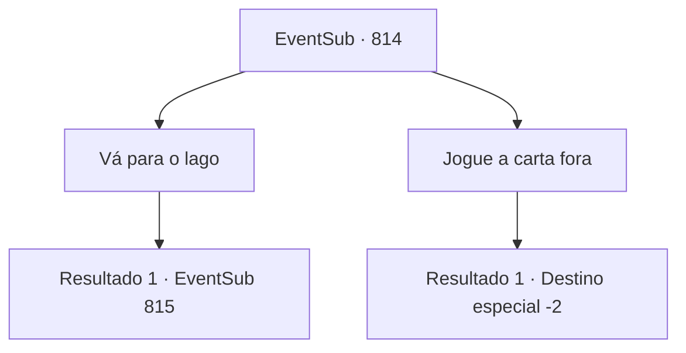

# Eventos secundários · 814

[Índice da tabela](index.md) · [Índice geral](../index.md)

ID: `pt:EventSub:814` · Fonte: `EventSub4` · Versão: 1.2.47.

Mapeamento estático dos arquivos; a disponibilidade e a execução dependem do estado da run.

## Texto do evento

Um falcão voa do céu em sua direção e pousa em seu braço. É uma raça exótica, vista apenas no Oriente. Tem uma carta amarrada na perna. Você pega a carta e manda o falcão voando para longe. Você abre a carta e descobre que quem a escreveu tem uma caligrafia elegante. 

 'Há quanto tempo, {1}. Por favor, venha me ver no Lago Tunaas. Tenho um assunto importante para discutir com você. Lei do Clã Ryu.'

## Dados de entrada

```json
{
  "id": 814,
  "grade": 1,
  "subEvent": "",
  "required": "12_11_6"
}
```

## Mapa das escolhas



## Escolhas e resultados

### Escolha 1

Vá para o lago

Requisitos e outros campos da escolha:

```json
{
  "required": ""
}
```

#### Resultado 1.1

Você leva o cabeçalho da carta para o Lago Tunaas. 

 O Lago Tunaas não fica muito longe da cidade que leva seu nome. O lugar não tem nada de especial. É uma planície rochosa, com campos de cascalho. Você olha para o céu e percebe que o sol está se pondo. Então, de longe, você ouve o som de aço se chocando. O som fica mais alto à medida que você se aproxima do lago.

Continuação registrada: [Evento 815](0815.md) na mesma tabela.

```json
{
  "required": "",
  "chance": "1",
  "nextEvent": 815,
  "type": 2,
  "reward": ""
}
```

### Escolha 2

Jogue a carta fora

Requisitos e outros campos da escolha:

```json
{
  "required": ""
}
```

#### Resultado 2.1

Você joga fora a carta e volta para suas aventuras.

Continuação registrada: [Destino especial `-2`](../destinos-especiais.md).

```json
{
  "required": "",
  "chance": "1",
  "nextEvent": -2,
  "type": 2,
  "reward": "12_11_-1"
}
```

## Referências que chegam a este evento

Nenhum `nextEvent` positivo da mesma tabela aponta para este nó. Isso não prova que seja inacessível: sorteio e estado de história podem selecioná-lo.

