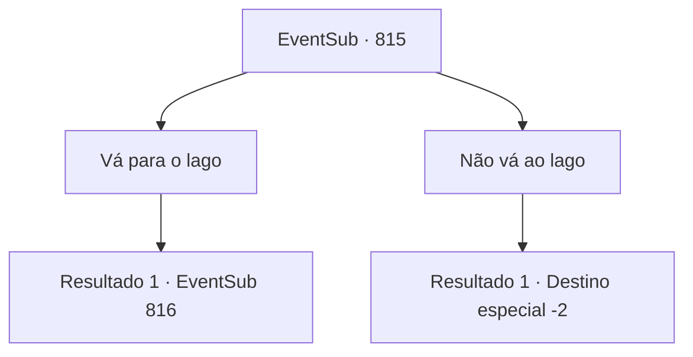

# Eventos secundários · 815

[Índice da tabela](index.md) · [Índice geral](../index.md)

ID: `pt:EventSub:815` · Fonte: `EventSub4` · Versão: 1.2.47.

Mapeamento estático dos arquivos; a disponibilidade e a execução dependem do estado da run.

## Texto do evento

*Sem texto no arquivo.*

## Dados de entrada

```json
{
  "id": 815,
  "grade": 1,
  "subEvent": "",
  "required": ""
}
```

## Mapa das escolhas



## Escolhas e resultados

### Escolha 1

Vá para o lago

Requisitos e outros campos da escolha:

```json
{
  "required": ""
}
```

#### Resultado 1.1

Você segue em direção ao lago seguindo o som. Lá, você se depara com um duelo acontecendo. |drawing_duelLake| São Lei e Shao. As roupas de Lei já estão cobertas de sangue. Shao está sorrindo, como se a condição ensanguentada de Lei lhe trouxesse alegria. 

 "Vamos lá! Não consegue fazer melhor que isso, Lei?!"

 Shao desencadeia uma feroz rajada de ataques. Lei mal consegue manter o equilíbrio. Apenas bloquear os golpes de Shao o empurra para trás. Então, os olhos de Shao encontram você. 

 "Ah. O bárbaro está aqui."

 Lei também vira a cabeça e percebe você. Seu rosto está coberto de suor. É óbvio que ele está exausto. 

 "*ofegante*... Sohyeop...!"

 Vendo que a atenção de Lei está desviada para você, Shao avança para o ataque.

Continuação registrada: [Evento 816](0816.md) na mesma tabela.

```json
{
  "required": "",
  "chance": "1",
  "nextEvent": 816,
  "type": 2,
  "reward": ""
}
```

### Escolha 2

Não vá ao lago

Requisitos e outros campos da escolha:

```json
{
  "required": ""
}
```

#### Resultado 2.1

Você decide não visitar o lago e se afasta.

Continuação registrada: [Destino especial `-2`](../destinos-especiais.md).

```json
{
  "required": "",
  "chance": "1",
  "nextEvent": -2,
  "type": 2,
  "reward": "12_11_-1"
}
```

## Referências que chegam a este evento

- [Evento 814 · escolha 1 · resultado 1](0814.md#escolha-1)
