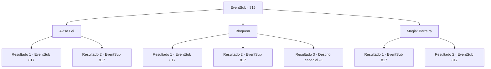

# Eventos secundários · 816

[Índice da tabela](index.md) · [Índice geral](../index.md)

ID: `pt:EventSub:816` · Fonte: `EventSub4` · Versão: 1.2.47.

Mapeamento estático dos arquivos; a disponibilidade e a execução dependem do estado da run.

## Texto do evento

*Sem texto no arquivo.*

## Dados de entrada

```json
{
  "id": 816,
  "grade": 1,
  "subEvent": "",
  "required": ""
}
```

## Mapa das escolhas



## Escolhas e resultados

### Escolha 1

Avisa Lei

Requisitos e outros campos da escolha:

```json
{
  "required": ""
}
```

#### Resultado 1.1

Você grita para Lei para avisá-lo sobre Shao. Lei consegue rapidamente sacar sua espada e se defender. 

 "...É realmente você, Shao?"

 Fazendo o melhor para esconder sua voz trêmula, Lei pergunta a Shao. Shao responde com um sorriso maligno. 

 "Por quê? Não pode acreditar? Que você está sendo dominado por alguém que sempre desprezou?"

 Uma força sobrenatural começa a fluir do corpo de Shao. É como se sua aura estivesse ampliando a gravidade ao redor de Shao.

Continuação registrada: [Evento 817](0817.md) na mesma tabela.

```json
{
  "required": "",
  "chance": "1|0_12_1",
  "nextEvent": 817,
  "type": 0,
  "reward": ""
}
```

#### Resultado 1.2

Você tenta avisar Lei sobre Shao, mas a imensa pressão dela te silencia. Felizmente, Lei consegue desviar do ataque, evitando ferimentos fatais. 

 "Você é como um ratinho, Lei. Pelo menos você consegue desviar bem."

 Shao sorri amargamente, ao que Lei responde com uma voz trêmula. 

 "...É realmente você, Shao?"

 Shao responde com um sorriso maligno. 

 "Por quê? Não consegue acreditar? Que você está sendo dominado por alguém que sempre desprezou?"

 Uma força sobrenatural começa a fluir do corpo de Shao. É como se sua aura estivesse aumentando a gravidade ao redor de Shao.

Continuação registrada: [Evento 817](0817.md) na mesma tabela.

```json
{
  "required": "",
  "chance": "16",
  "nextEvent": 817,
  "type": 1,
  "reward": "5_728_1"
}
```

### Escolha 2

Bloquear

Requisitos e outros campos da escolha:

```json
{
  "required": "20_9_1"
}
```

#### Resultado 2.1

Você intervém, bloqueando o ataque de Shao você mesmo. Shao te encara, dando um passo para trás por enquanto. 

 "...É realmente você, Shao?"

 Fazendo o melhor para esconder sua voz trêmula, Lei pergunta a Shao. Shao responde com um sorriso maligno. 

 "Por quê? Não consegue acreditar? Que você está sendo dominado por alguém que sempre desprezou?"

 Uma força sobrenatural começa a fluir do corpo de Shao. É como se sua aura estivesse ampliando a gravidade ao redor de Shao.

Continuação registrada: [Evento 817](0817.md) na mesma tabela.

```json
{
  "required": "",
  "chance": "1|0_13_1",
  "nextEvent": 817,
  "type": 0,
  "reward": ""
}
```

#### Resultado 2.2

Você intervém, bloqueando o ataque de Shao você mesmo. Mas você falha em bloqueá-lo completamente, e como resultado a espada de Shao te fere. 

 "...É realmente você, Shao?"

 Fazendo o melhor para esconder sua voz trêmula, Lei pergunta a Shao. Shao responde com um sorriso maligno. 

 "Por quê? Não pode acreditar? Que você está sendo dominado por alguém que sempre desprezou?"

 Uma força não natural começa a fluir do corpo de Shao. É como se sua aura estivesse ampliando a gravidade ao redor de Shao.

Continuação registrada: [Evento 817](0817.md) na mesma tabela.

```json
{
  "required": "1_0_2",
  "chance": "16",
  "nextEvent": 817,
  "type": 1,
  "reward": "0_0_-1"
}
```

#### Resultado 2.3

Você tenta proteger Lei do ataque de Shao, mas o resultado é simplesmente desastroso. A espada afiada de Shao perfurou você em vez disso. A ponta irrompe do seu peito, perfurando seu coração. Uma dor excruciante se espalha pelo seu corpo. 

 "SOHYEOP!!"

 Lei grita desesperadamente, mas é tarde demais. Seus olhos escurecem e sua consciência se esvai.

Continuação registrada: [Destino especial `-3`](../destinos-especiais.md).

```json
{
  "required": "2_0_2",
  "chance": "16",
  "nextEvent": -3,
  "type": 1,
  "reward": "0_0_-1"
}
```

### Escolha 3

Magia: Barreira

Requisitos e outros campos da escolha:

```json
{
  "required": "20_0_1|1_1_2"
}
```

#### Resultado 3.1

Você conjura uma barreira e bloqueia o ataque de Shao.   

 "...É realmente você, Shao?"

   Fazendo o melhor para esconder sua voz trêmula, Lei pergunta a Shao.   Shao responde com um sorriso maligno.   

 "Por quê? Não consegue acreditar? Que você está sendo dominado por alguém que sempre desprezou?"

   Uma força não natural começa a fluir do corpo de Shao.   É como se sua aura estivesse ampliando a gravidade ao redor de Shao.

Continuação registrada: [Evento 817](0817.md) na mesma tabela.

```json
{
  "required": "",
  "chance": "1|0_14_1",
  "nextEvent": 817,
  "type": 0,
  "reward": "0_1_-1"
}
```

#### Resultado 3.2

Você tenta conjurar uma barreira e bloquear o ataque de Shao. Mas você está ansioso demais para lançar a magia corretamente. Seu feitiço falha. Felizmente, Lei consegue desviar o ataque dela, evitando ferimentos fatais. 

 "Você é como um ratinho, Lei. Pelo menos você consegue desviar bem."

 Shao sorri amargamente, ao que Lei responde com uma voz trêmula. 

 "...É realmente você, Shao?"

 Shao responde com um sorriso maligno. 

 "Por quê? Não consegue acreditar? Que você está sendo dominado por alguém que sempre desprezou?"

 Uma força não natural começa a fluir do corpo de Shao. É como se sua aura estivesse ampliando a gravidade ao redor de Shao.

Continuação registrada: [Evento 817](0817.md) na mesma tabela.

```json
{
  "required": "",
  "chance": "16",
  "nextEvent": 817,
  "type": 1,
  "reward": "5_728_1"
}
```

## Referências que chegam a este evento

- [Evento 815 · escolha 1 · resultado 1](0815.md#escolha-1)
