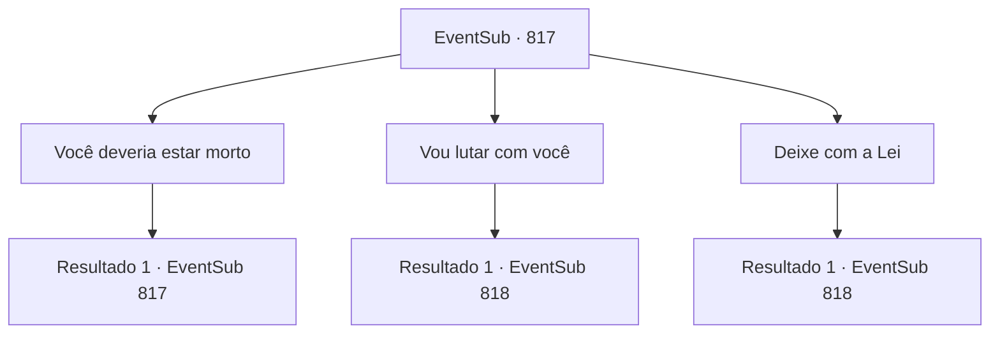

# Eventos secundários · 817

[Índice da tabela](index.md) · [Índice geral](../index.md)

ID: `pt:EventSub:817` · Fonte: `EventSub4` · Versão: 1.2.47.

Mapeamento estático dos arquivos; a disponibilidade e a execução dependem do estado da run.

## Texto do evento

*Sem texto no arquivo.*

## Dados de entrada

```json
{
  "id": 817,
  "grade": 1,
  "subEvent": "",
  "required": ""
}
```

## Mapa das escolhas



## Escolhas e resultados

### Escolha 1

Você deveria estar morto

Requisitos e outros campos da escolha:

```json
{
  "required": "5_718_0"
}
```

#### Resultado 1.1

Shao ri e responde. 

 "Heehee... Veja... Foi o que eu pensei também. Mas, aparentemente, o destino tem mais planos para mim."

 Shao limpa o sangue de sua espada, então aponta na sua direção. 

 "Ah, mas não se preocupe. Vou tentar fazer sem dor. Prometo."


Continuação registrada: [Evento 817](0817.md) na mesma tabela.

```json
{
  "required": "",
  "chance": "1",
  "nextEvent": 817,
  "type": 2,
  "reward": "5_718_1"
}
```

### Escolha 2

Vou lutar com você

Requisitos e outros campos da escolha:

```json
{
  "required": "5_728_1"
}
```

#### Resultado 2.1

Você olha para o braço direito de Lei. As mangas dele já estão pintadas de vermelho. Correntes de sangue já escorrem do seu pulso. Você decide lutar contra Shao você mesmo. Lei morde os lábios, mas eventualmente acena com a cabeça e recua. 

 "Não importa. Vou matar vocês dois."

 Shao ri para você e Lei, levantando sua espada bem alto. Então, ela avança como um raio, começando o ataque.

Continuação registrada: [Evento 818](0818.md) na mesma tabela.

```json
{
  "required": "",
  "chance": "1",
  "nextEvent": 818,
  "type": 2,
  "reward": "6_0_183",
  "place": 12
}
```

### Escolha 3

Deixe com a Lei

Requisitos e outros campos da escolha:

```json
{
  "required": "18_728_1"
}
```

#### Resultado 3.1

Você deixa a batalha para Lei. Ele se curva em gratidão e avança novamente para Shao. Shao exibe um sorriso maligno. 

 "Não importa. Vou matar vocês dois."

 Shao ri de você e de Lei, levantando sua espada bem alto. Então, ela avança como um raio, começando o ataque. 

 Logo, o golpe decisivo de Shao sinaliza o fim da luta. A espada de Lei é arremessada de suas mãos. Aproveitando a oportunidade, Shao dá um chute poderoso bem no peito de Lei. Lei é lançado para longe. Seu corpo atinge uma árvore próxima, depois fica imóvel no chão. 

 "Ufa... Agora é a sua vez!"

 Shao ri de Lei e então se vira para você. Ela está visivelmente cansada de derrotar Lei, mas simplesmente sorri, tentando parecer relaxada. Então, ela imediatamente avança em sua direção.

Continuação registrada: [Evento 818](0818.md) na mesma tabela.

```json
{
  "required": "",
  "chance": "1",
  "nextEvent": 818,
  "type": 2,
  "reward": "6_2_183",
  "place": 12
}
```

## Referências que chegam a este evento

- [Evento 816 · escolha 1 · resultado 1](0816.md#escolha-1)
- [Evento 816 · escolha 1 · resultado 2](0816.md#escolha-1)
- [Evento 816 · escolha 2 · resultado 1](0816.md#escolha-2)
- [Evento 816 · escolha 2 · resultado 2](0816.md#escolha-2)
- [Evento 816 · escolha 3 · resultado 1](0816.md#escolha-3)
- [Evento 816 · escolha 3 · resultado 2](0816.md#escolha-3)
- [Evento 817 · escolha 1 · resultado 1](0817.md#escolha-1)
