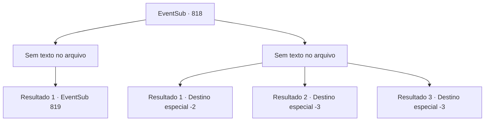

# Eventos secundários · 818

[Índice da tabela](index.md) · [Índice geral](../index.md)

ID: `pt:EventSub:818` · Fonte: `EventSub4` · Versão: 1.2.47.

Mapeamento estático dos arquivos; a disponibilidade e a execução dependem do estado da run.

## Texto do evento

*Sem texto no arquivo.*

## Dados de entrada

```json
{
  "id": 818,
  "grade": 1,
  "subEvent": "",
  "required": ""
}
```

## Mapa das escolhas



## Escolhas e resultados

### Escolha 1

*Sem texto no arquivo; o papel dessa opção depende da interface do jogo.*

Requisitos e outros campos da escolha:

```json
{
  "required": ""
}
```

#### Resultado 1.1

Infelizmente, Shao é espancada e jogada no chão. Ela range os dentes e tenta se levantar, mas suas pernas falham. Shao encara você, ainda deitada no chão, seus olhos cheios de raiva. Seus dentes cravam em seus lábios com tanta força que começam a sangrar. 

 "...SEU MALDITO BRUTO...! Tudo bem, eu perdi. Faça isso."

 Então, uma voz desesperada chama você. 

 "...E-ESPERA! SOHYEOP! Argh...! Por favor - um momento!"

 Você olha para trás e percebe que Lei se levantou e está caminhando em sua direção. Ele faz uma pergunta a Shao. 

 "...Sempre soube que você me odiava, Shao. Mas... chegar a esse ponto de querer se matar?! Por quê? Por que você está tentando me matar?"

 Shao se recusa a responder à pergunta dele. 

 "Heh. Pare de fingir ser inocente, verme. Ridículo, agindo como se fosse algum tipo de santo... Apenas me mate logo."


Continuação registrada: [Evento 819](0819.md) na mesma tabela.

```json
{
  "required": "",
  "chance": "1",
  "nextEvent": 819,
  "type": 2,
  "reward": ""
}
```

### Escolha 2

*Sem texto no arquivo; o papel dessa opção depende da interface do jogo.*

Requisitos e outros campos da escolha:

```json
{
  "required": ""
}
```

#### Resultado 2.1

Antes que você perceba, a espada de Shao perfura seu estômago. 

 "Não se preocupe. Vou garantir que você não fique sozinho... fazendo com que Lei o siga em breve."

 Sua consciência se desvanece e você sente a energia esvair-se do seu corpo. Suas pernas cedem. A água fria do lago te engole. 

 Você finalmente recobra a consciência e olha ao redor para descobrir onde está. É uma casa humilde. Você nota um anão peludo preparando uma refeição de peixe. 

 "Ah. Você está acordado. Me dê um momento."

 Ele explica que te encontrou no lago enquanto estava pescando. Ele acrescenta que sua vida não deveria terminar ali nas águas. Trazendo-lhe um prato de peixe cozido, o anão fala. 

 "Você vai se recuperar mais rápido com a barriga cheia. Coma."

 Você se serve da refeição e agradece a ele. O prato tem um gosto um pouco de terra, mas te dá a energia tão necessária. 

 "Tenha cuidado. É um mundo louco lá fora. Adeus."

 Você o agradece, diz um breve adeus e parte. Você procura por Lei em todos os lugares, mas não consegue encontrar nada de valor.

Continuação registrada: [Destino especial `-2`](../destinos-especiais.md).

```json
{
  "required": "1_0_2|1_1_2",
  "chance": "1",
  "nextEvent": -2,
  "type": 2,
  "reward": "0_0_-1|0_1_-1|12_11_-1"
}
```

#### Resultado 2.2

Antes que você perceba, a espada de Shao perfura seu peito. Seu olhar fantasmagórico afunda profundamente em seus olhos. 

 "Não se preocupe. Vou garantir que você não fique sozinho... fazendo com que Lei o siga em breve."

 Ela torce a espada e a puxa para fora. Sangue carmesim jorra do seu peito. O sangue brilha sob a luz do luar. Com outro movimento de sua espada, Shao corta seu pescoço.

Continuação registrada: [Destino especial `-3`](../destinos-especiais.md).

```json
{
  "required": "2_0_2",
  "chance": "1",
  "nextEvent": -3,
  "type": 2,
  "reward": "0_0_-1|0_1_-1"
}
```

#### Resultado 2.3

Antes que você perceba, a espada de Shao perfura seu peito. Seu olhar fantasmagórico afunda profundamente em seus olhos. 

 "Não se preocupe. Vou garantir que você não fique sozinho... fazendo com que Lei o siga em breve."

 Ela torce a espada e a puxa para fora. Sangue carmesim jorra do seu peito. O sangue brilha sob a luz do luar. Com outro movimento de sua espada, Shao corta seu pescoço.

Continuação registrada: [Destino especial `-3`](../destinos-especiais.md).

```json
{
  "required": "2_1_2",
  "chance": "1",
  "nextEvent": -3,
  "type": 2,
  "reward": "0_0_-1|0_1_-1"
}
```

## Referências que chegam a este evento

- [Evento 817 · escolha 2 · resultado 1](0817.md#escolha-2)
- [Evento 817 · escolha 3 · resultado 1](0817.md#escolha-3)
