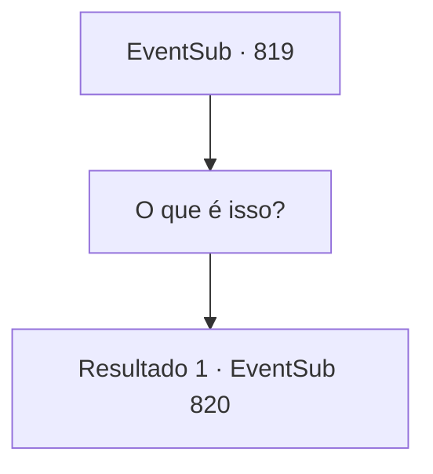

# Eventos secundários · 819

[Índice da tabela](index.md) · [Índice geral](../index.md)

ID: `pt:EventSub:819` · Fonte: `EventSub4` · Versão: 1.2.47.

Mapeamento estático dos arquivos; a disponibilidade e a execução dependem do estado da run.

## Texto do evento

*Sem texto no arquivo.*

## Dados de entrada

```json
{
  "id": 819,
  "grade": 1,
  "subEvent": "",
  "required": ""
}
```

## Mapa das escolhas



## Escolhas e resultados

### Escolha 1

O que é isso?

Requisitos e outros campos da escolha:

```json
{
  "required": ""
}
```

#### Resultado 1.1

Lei hesita um pouco antes de falar. 

 "*suspiro*... Meu pai é o Chefe do Clã Ryu. Mas minha mãe era uma prostituta. O clã nem sequer a reconheceu como concubina."

 Ou seja, Shao e Lei eram meias-irmãs. Lei sorri amargamente. 

 "Meu pai me aceitou como filha legítima, cuidou e me amou, apesar do meu status social. Ele nunca me obrigou a treinar com uma espada, mas fiz o meu melhor para retribuir sua bondade. Felizmente, eu tinha um talento humilde. Consegui possuir habilidades que poderiam ser úteis para meu pai e o clã."

 Lei olha silenciosamente para suas mãos, cobertas de calos. 

 "Nem todos gostavam de mim, no entanto. Especialmente Shao. Ela me odiava, mesmo durante a infância. Depois que nosso Chefe do Clã ficou acamado, o desprezo de Shao e de seu povo por mim se tornou cada vez mais óbvio. É por isso que quero me provar. Ganhar a aprovação dos membros do clã."

 Lei olha em seus olhos e continua. 

 "Quando Shao desapareceu... Eu me arrependi de tudo. Como eu deveria ter tentado mais me dar bem com ela. Como o Chefe do Clã ficaria triste ao ouvir a notícia, e coisas do tipo. Parte de mim ainda está feliz por poder finalmente ver Shao novamente, mesmo em circunstâncias como estas. Sei que não estou em posição de dizer isso, mas por favor, Sohyeop. Perdoe Shao."


Continuação registrada: [Evento 820](0820.md) na mesma tabela.

```json
{
  "required": "",
  "chance": "1",
  "nextEvent": 820,
  "type": 2,
  "reward": ""
}
```

## Referências que chegam a este evento

- [Evento 818 · escolha 1 · resultado 1](0818.md#escolha-1)
