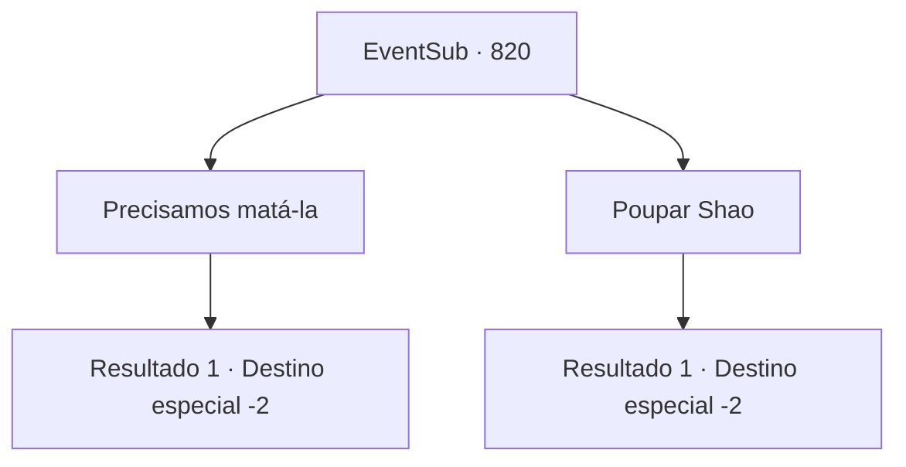

# Eventos secundários · 820

[Índice da tabela](index.md) · [Índice geral](../index.md)

ID: `pt:EventSub:820` · Fonte: `EventSub4` · Versão: 1.2.47.

Mapeamento estático dos arquivos; a disponibilidade e a execução dependem do estado da run.

## Texto do evento

*Sem texto no arquivo.*

## Dados de entrada

```json
{
  "id": 820,
  "grade": 1,
  "subEvent": "",
  "required": ""
}
```

## Mapa das escolhas



## Escolhas e resultados

### Escolha 1

Precisamos matá-la

Requisitos e outros campos da escolha:

```json
{
  "required": ""
}
```

#### Resultado 1.1

Você diz a Lei que a única maneira de ela realmente viver é eliminar Shao agora mesmo. Ela dá um passo para trás enquanto você tira a vida de Shao. Lei fecha os olhos para evitar ver a morte acontecer. 

 "Ack...! *gorgolejo*"

 Sangue espirra por todo o lago enquanto o corpo sem vida de Shao desmorona. O sangue do corpo pinta o solo de vermelho. Lei encara a cena sombria por mais alguns segundos antes de se afastar. De alguma forma, mesmo com sua vingança completa, Lei não parece nada feliz. Lei olha para o cadáver de Shao uma última vez antes de partir com uma expressão triste.

Continuação registrada: [Destino especial `-2`](../destinos-especiais.md).

```json
{
  "required": "",
  "chance": "1",
  "nextEvent": -2,
  "type": 2,
  "reward": "12_11_7"
}
```

### Escolha 2

Poupar Shao

Requisitos e outros campos da escolha:

```json
{
  "required": ""
}
```

#### Resultado 2.1

Você decide poupar Shao. Shao franze a testa em resposta, gritando. 

 "Você espera que eu peça desculpas ou algo assim? Não se arrependa depois e termine o trabalho!"

 Shao quase soa desesperada agora. Lei responde. 

 "O Chefe do Clã sempre teve grandes esperanças para você. Você deveria ser sua herdeira! E você está aqui, tentando acabar com sua vida aqui?"

 Shao fica em silêncio. Lei embainha sua espada e acrescenta. 

 "A razão pela qual estou competindo no Torneio Battra é... porque quero que meu clã e o Chefe do Clã me reconheçam oficialmente como um 'guerreiro'. Shao? Ao contrário de mim, você tem o apoio e a expectativa de todos atrás de você. Você tem tanto o direito quanto as capacidades necessárias para se tornar Chefe do Clã. Eu realmente penso assim."

 Quando Lei termina de falar, Shao começa a balançar a cabeça, como se seu mundo tivesse sido destruído. Lei a ignora e continua. 

 "Se você ainda guarda rancor contra mim, vamos resolver isso no Torneio Battra. Eu estarei lá, sem dúvida. Estou cansado de fugir."

 Esse é o fim da conversa. Shao olha silenciosamente para Lei se afastando.

Continuação registrada: [Destino especial `-2`](../destinos-especiais.md).

```json
{
  "required": "",
  "chance": "1",
  "nextEvent": -2,
  "type": 2,
  "reward": "12_11_4|5_749_1"
}
```

## Referências que chegam a este evento

- [Evento 819 · escolha 1 · resultado 1](0819.md#escolha-1)
