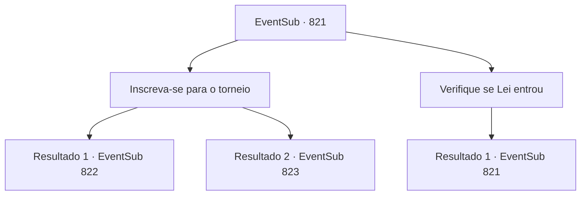

# Eventos secundários · 821

[Índice da tabela](index.md) · [Índice geral](../index.md)

ID: `pt:EventSub:821` · Fonte: `EventSub4` · Versão: 1.2.47.

Mapeamento estático dos arquivos; a disponibilidade e a execução dependem do estado da run.

## Texto do evento

|drawing_Gladio| Você finalmente chega a Gladio, a cidade localizada no extremo sul do Grande Deserto. O lugar já está em clima festivo, provavelmente por causa do torneio que está prestes a acontecer. Os comerciantes de caravanas montaram barracas temporárias como lojas. Os cidadãos locais já estão aproveitando as festividades, se deliciando com bebidas e música. Pousadas e tavernas estão ocupadas atraindo novos clientes. Mas não importa o quanto você procure, Lei não está em lugar nenhum. Você vai até a arena para verificar se Lei já se inscreveu para o torneio. O coliseu circular já está cheio de sons de batalha. Quem parece ser a recepcionista se aproxima de você e fala. 

 "Olá! Você está aqui para se inscrever para o torneio?"


## Dados de entrada

```json
{
  "id": 821,
  "grade": 1,
  "subEvent": "",
  "required": "12_11_7"
}
```

## Mapa das escolhas



## Escolhas e resultados

### Escolha 1

Inscreva-se para o torneio

Requisitos e outros campos da escolha:

```json
{
  "required": "5_764_1"
}
```

#### Resultado 1.1

Você responde sim. Então, a recepcionista olha mais de perto para o seu rosto e sorri. 

 "Ah. Você deve ser {1}. Ouvimos muito sobre você. Para você, já fizemos os arranjos necessários! Você passa automaticamente na seleção."

 Como ainda há algum tempo antes das partidas começarem, você sai da arena.

Continuação registrada: [Evento 822](0822.md) na mesma tabela.

```json
{
  "required": "1_2_60",
  "chance": "1",
  "nextEvent": 822,
  "type": 2,
  "reward": ""
}
```

#### Resultado 1.2

Você responde sim. A recepcionista te leva ao palco. 

 "O infame Golem Battra. Derrote-o, e você estará qualificado para as partidas reais. Agora, boa sorte. Você vai precisar."

 Muitos outros aventureiros estão fazendo o seu melhor para mostrar que são capazes, enquanto o público os observa com olhos curiosos. Os olhos do golem brilham, e logo ele começa a se mover.

Continuação registrada: [Evento 823](0823.md) na mesma tabela.

```json
{
  "required": "2_2_60",
  "chance": "1",
  "nextEvent": 823,
  "type": 2,
  "reward": "6_0_15",
  "place": 11
}
```

### Escolha 2

Verifique se Lei entrou

Requisitos e outros campos da escolha:

```json
{
  "required": "5_764_0"
}
```

#### Resultado 2.1

Você pergunta à recepcionista se um guerreiro chamado Lei Ryu entrou no torneio. Ela verifica a lista de competidores por um segundo e lhe diz que não há ninguém com esse nome.

Continuação registrada: [Evento 821](0821.md) na mesma tabela.

```json
{
  "required": "",
  "chance": "1",
  "nextEvent": 821,
  "type": 2,
  "reward": "5_764_1"
}
```

## Referências que chegam a este evento

- [Evento 821 · escolha 2 · resultado 1](0821.md#escolha-2)
- [Evento 822 · escolha 1 · resultado 2](0822.md#escolha-1)
