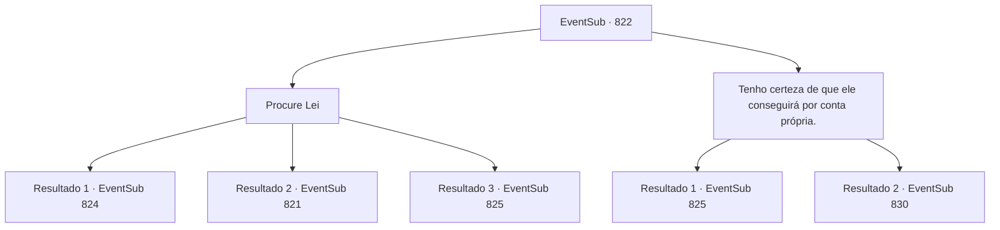

# Eventos secundários · 822

[Índice da tabela](index.md) · [Índice geral](../index.md)

ID: `pt:EventSub:822` · Fonte: `EventSub4` · Versão: 1.2.47.

Mapeamento estático dos arquivos; a disponibilidade e a execução dependem do estado da run.

## Texto do evento

*Sem texto no arquivo.*

## Dados de entrada

```json
{
  "id": 822,
  "grade": 1,
  "subEvent": "",
  "required": ""
}
```

## Mapa das escolhas



## Escolhas e resultados

### Escolha 1

Procure Lei

Requisitos e outros campos da escolha:

```json
{
  "required": "5_764_1"
}
```

#### Resultado 1.1

Você vasculha a cidade, questionando os locais sobre o paradeiro de Lei. Então, você ouve informações valiosas de outro aventureiro. 

 "Hum... Eu me lembro de ter visto um espadachim de aparência semelhante. Está vendo aquela colina ali? O tabernáculo de Veene. Ele deve estar lá."


Continuação registrada: [Evento 824](0824.md) na mesma tabela.

```json
{
  "required": "",
  "chance": "1|0_12_1",
  "nextEvent": 824,
  "type": 0,
  "reward": ""
}
```

#### Resultado 1.2

Você vasculha a cidade, questionando os locais sobre o paradeiro de Lei. Mas mesmo após um dia inteiro de investigação, você não encontra nada de valor. Ainda há algum tempo até o torneio. Você deve conseguir se dar ao luxo de mais um dia.

Continuação registrada: [Evento 821](0821.md) na mesma tabela.

```json
{
  "required": "18_729_10",
  "chance": "15",
  "nextEvent": 821,
  "type": 1,
  "reward": "5_729_10"
}
```

#### Resultado 1.3

Você passa mais tempo procurando por Lei, mas sem sucesso. Infelizmente, você decide desistir de encontrá-lo e descansar. 

 Logo, as principais lutas começam. Depois de descansar completamente, você entra na arena do torneio. Apesar de ser a primeira luta, os assentos estão cheios. Você ouve a multidão torcendo e se prepara para lutar. Seu primeiro oponente é um espadachim oriental. Ele não é nem Lei nem Shao. Ele também não parece ser do Clã Ryu. 

 "Uma honra."

 Ele faz a saudação oriental e puxa sua espada.

Continuação registrada: [Evento 825](0825.md) na mesma tabela.

```json
{
  "required": "5_729_10",
  "chance": "15",
  "nextEvent": 825,
  "type": 1,
  "reward": "0_0_1|0_1_1|6_0_181",
  "place": 11
}
```

### Escolha 2

Tenho certeza de que ele conseguirá por conta própria.

Requisitos e outros campos da escolha:

```json
{
  "required": ""
}
```

#### Resultado 2.1

Você passa mais tempo procurando por Lei, mas sem sucesso. 

 Logo, as principais lutas começam. Depois de descansar completamente, você entra na arena do torneio. Apesar de ser a primeira luta, os assentos estão cheios. Você ouve a multidão torcendo e se prepara para lutar. Seu primeiro oponente é um espadachim oriental. Ele não é nem Lei nem Shao. Ele também não parece ser do Clã Ryu. 

 "Uma honra."

 Ele faz a saudação oriental e puxa sua espada.

Continuação registrada: [Evento 825](0825.md) na mesma tabela.

```json
{
  "required": "18_763_1",
  "chance": "1",
  "nextEvent": 825,
  "type": 2,
  "reward": "0_0_1|0_1_1|6_0_181",
  "place": 11
}
```

#### Resultado 2.2

Você passa mais tempo procurando por Lei, mas sem sucesso. 

 Logo, as principais lutas começam. A arena está cheia de lutas estilosas. Um matador de trolls, um espadachim sem nome do Oriente, e um ex-Capitão dos Cavaleiros, etc. Uma lista variada de competidores vem e vai. Mas Lei não aparece de jeito nenhum. 

 O feroz torneio continua durante todo o dia. Finalmente, o vencedor é decidido. É um cavaleiro chamado 'Sir Sparkles', do Reino de Lothar. Após o término do torneio, você sai da arena. As pessoas ainda estão aproveitando as festividades. Ia ser uma longa noite.

Continuação registrada: [Evento 830](0830.md) na mesma tabela.

```json
{
  "required": "5_763_1",
  "chance": "1",
  "nextEvent": 830,
  "type": 2,
  "reward": "0_0_1|0_1_1"
}
```

## Referências que chegam a este evento

- [Evento 821 · escolha 1 · resultado 1](0821.md#escolha-1)
