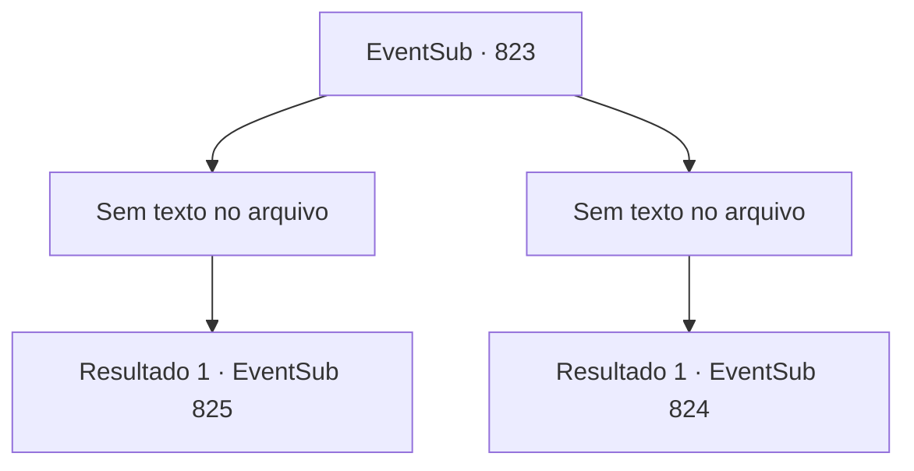

# Eventos secundários · 823

[Índice da tabela](index.md) · [Índice geral](../index.md)

ID: `pt:EventSub:823` · Fonte: `EventSub4` · Versão: 1.2.47.

Mapeamento estático dos arquivos; a disponibilidade e a execução dependem do estado da run.

## Texto do evento

*Sem texto no arquivo.*

## Dados de entrada

```json
{
  "id": 823,
  "grade": 1,
  "subEvent": "",
  "required": ""
}
```

## Mapa das escolhas



## Escolhas e resultados

### Escolha 1

*Sem texto no arquivo; o papel dessa opção depende da interface do jogo.*

Requisitos e outros campos da escolha:

```json
{
  "required": ""
}
```

#### Resultado 1.1

Você prova que é capaz de competir no torneio. Em breve, as principais lutas começam. 

 Após descansar completamente, você entra na arena do torneio. Você ouve a multidão torcendo e se prepara para lutar. Seu primeiro oponente é um espadachim oriental. Ele não é nem Lei nem Shao. Ele também não parece ser do Clã Ryu. 

 "Uma honra."

 Ele faz a saudação oriental e puxa sua espada.

Continuação registrada: [Evento 825](0825.md) na mesma tabela.

```json
{
  "required": "",
  "chance": "1",
  "nextEvent": 825,
  "type": 2,
  "reward": "6_0_181",
  "place": 11
}
```

### Escolha 2

*Sem texto no arquivo; o papel dessa opção depende da interface do jogo.*

Requisitos e outros campos da escolha:

```json
{
  "required": ""
}
```

#### Resultado 2.1

O punho do golem voa em sua direção e te joga para fora do palco. A recepcionista te ajuda a se levantar. 

 "Que pena. Melhor sorte na próxima vez."

 Sem a qualificação, você está proibido de entrar nas partidas principais do torneio, então você apenas volta para a cidade. Você anda pela cidade, questionando os locais sobre o paradeiro de Lei. Então, você ouve informações valiosas de outro aventureiro. 

 "Hum... Eu me lembro de ter visto um espadachim de aparência semelhante. Está vendo aquela colina ali? Tabernáculo de Veene. Ele deve estar lá."


Continuação registrada: [Evento 824](0824.md) na mesma tabela.

```json
{
  "required": "",
  "chance": "1",
  "nextEvent": 824,
  "type": 2,
  "reward": "5_763_1"
}
```

## Referências que chegam a este evento

- [Evento 821 · escolha 1 · resultado 2](0821.md#escolha-1)
