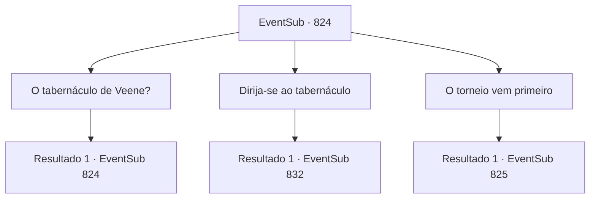

# Eventos secundários · 824

[Índice da tabela](index.md) · [Índice geral](../index.md)

ID: `pt:EventSub:824` · Fonte: `EventSub4` · Versão: 1.2.47.

Mapeamento estático dos arquivos; a disponibilidade e a execução dependem do estado da run.

## Texto do evento

*Sem texto no arquivo.*

## Dados de entrada

```json
{
  "id": 824,
  "grade": 1,
  "subEvent": "",
  "required": ""
}
```

## Mapa das escolhas



## Escolhas e resultados

### Escolha 1

O tabernáculo de Veene?

Requisitos e outros campos da escolha:

```json
{
  "required": "5_730_0"
}
```

#### Resultado 1.1

O aventureiro responde acenando lentamente com a cabeça. 

 "Sim. Veene, a deusa do amor e da misericórdia. O templo de Batt está localizado dentro da cidade. Mas não o de Veene. Saia pelos portões orientais da cidade e suba a colina rochosa. Lá, no local com uma bela vista da cidade, você encontrará o tabernáculo de Veene."

 Ele acrescenta que pessoas de diversas religiões visitam Gladio. Aparentemente, santuários e templos de outras divindades também são construídos aqui.

Continuação registrada: [Evento 824](0824.md) na mesma tabela.

```json
{
  "required": "",
  "chance": "1",
  "nextEvent": 824,
  "type": 2,
  "reward": "5_730_1"
}
```

### Escolha 2

Dirija-se ao tabernáculo

Requisitos e outros campos da escolha:

```json
{
  "required": "5_730_1"
}
```

#### Resultado 2.1

Você sobe a colina mencionada, levando ao tabernáculo de Veene. O lugar é bastante pequeno para um edifício religioso e parece bastante antigo. Mas parece bem conservado e limpo por dentro. Você se aproxima de uma sacerdotisa responsável pelo tabernáculo e pergunta sobre Lei. 

 "Ah. Por favor, siga-me."

 Você a segue para dentro, bem no interior do tabernáculo. Lá, você encontra Lei deitado em uma cama. Ele parece estar em um sono profundo. A sacerdotisa fala, olhando para Lei. 

 "Ele veio para este lugar há cerca de uma semana. Queria um lugar para meditar e treinar em solidão, para se preparar para o Torneio de Lutadores Battra."

 O problema começou cerca de três dias depois. De repente, durante o treinamento, Lei vomitou sangue e desmaiou. 

 "Fiz algumas pesquisas. Eles chamam de 'Desvio de Ki' no Oriente. Honestamente, eu pessoalmente não classificaria isso como uma doença, porque as causas e sintomas variam muito... Mas de qualquer forma, uh... muitas vezes resulta na perda de consciência, como no caso deste."


Continuação registrada: [Evento 832](0832.md) na mesma tabela.

```json
{
  "required": "",
  "chance": "1",
  "nextEvent": 832,
  "type": 2,
  "reward": ""
}
```

### Escolha 3

O torneio vem primeiro

Requisitos e outros campos da escolha:

```json
{
  "required": "5_730_1|18_763_1"
}
```

#### Resultado 3.1

Você decide priorizar o torneio. Por dias, você mantém seu equipamento, treina e descansa. Alguns dias depois, o dia do torneio finalmente chega. 

 Após descansar completamente, você entra na arena do torneio. Você ouve a multidão aplaudindo e se prepara para lutar. Seu primeiro oponente é um espadachim oriental. Ele não é nem Lei nem Shao. Ele também não parece ser do Clã Ryu. 

 "Uma honra."

 Ele faz a saudação oriental e puxa sua espada.

Continuação registrada: [Evento 825](0825.md) na mesma tabela.

```json
{
  "required": "",
  "chance": "1",
  "nextEvent": 825,
  "type": 2,
  "reward": "6_0_181",
  "place": 11
}
```

## Referências que chegam a este evento

- [Evento 822 · escolha 1 · resultado 1](0822.md#escolha-1)
- [Evento 823 · escolha 2 · resultado 1](0823.md#escolha-2)
- [Evento 824 · escolha 1 · resultado 1](0824.md#escolha-1)
