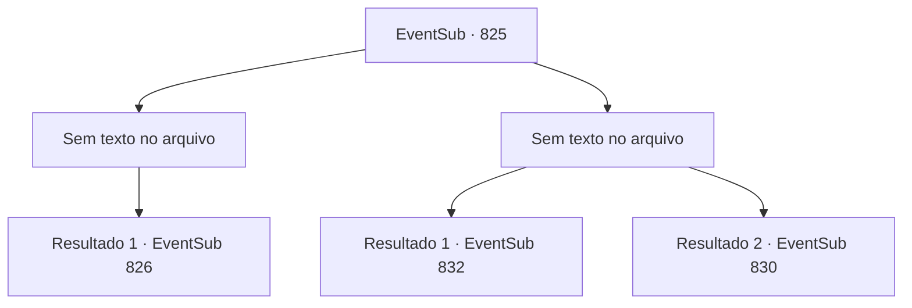

# Eventos secundários · 825

[Índice da tabela](index.md) · [Índice geral](../index.md)

ID: `pt:EventSub:825` · Fonte: `EventSub4` · Versão: 1.2.47.

Mapeamento estático dos arquivos; a disponibilidade e a execução dependem do estado da run.

## Texto do evento

*Sem texto no arquivo.*

## Dados de entrada

```json
{
  "id": 825,
  "grade": 1,
  "subEvent": "",
  "required": ""
}
```

## Mapa das escolhas



## Escolhas e resultados

### Escolha 1

*Sem texto no arquivo; o papel dessa opção depende da interface do jogo.*

Requisitos e outros campos da escolha:

```json
{
  "required": ""
}
```

#### Resultado 1.1

<link=shake>

 "WOOOOOOOOO!!!"

</link> Aplausos enchem a arena enquanto a luta termina. Nessa batalha feroz, você sai vitorioso, mas tem que admitir que foi por pouco. Você levanta o punho no ar para responder aos aplausos enquanto desce do palco. 

 As lutas continuam. Você assiste aos outros competidores lutarem, verificando seu próximo oponente. Na sua segunda luta, você está contra um aventureiro chamado 'Haren'. Ele parece ser um homem bastante famoso por essas bandas.

Continuação registrada: [Evento 826](0826.md) na mesma tabela.

```json
{
  "required": "",
  "chance": "1",
  "nextEvent": 826,
  "type": 2,
  "reward": ""
}
```

### Escolha 2

*Sem texto no arquivo; o papel dessa opção depende da interface do jogo.*

Requisitos e outros campos da escolha:

```json
{
  "required": ""
}
```

#### Resultado 2.1

<link=shake>

 "WOOOOOOOOO!!!"

</link> Aplausos preenchem a arena enquanto a luta termina. O espadachim oriental sai vitorioso. Ele bate no próprio peito com as mãos em resposta aos aplausos. Você o observa por alguns minutos antes de sair do palco. 

 Com as lutas terminando mais cedo do que o esperado, você segue para o tabernáculo de Veene, onde Lei se presume estar. O lugar é bastante pequeno para um edifício religioso e parece ser bem antigo. Mas, por dentro, está bem cuidado e limpo. Você se aproxima de uma sacerdotisa responsável pelo tabernáculo e pergunta sobre Lei. 

 "Ah. Por favor, siga-me."

 Você a segue para dentro, bem no fundo do tabernáculo. Lá, encontra Lei deitado em uma cama. Ele parece estar em um sono profundo. A sacerdotisa fala, olhando para Lei. 

 "Ele veio a este lugar cerca de uma semana atrás. Desejava um lugar para meditar e treinar em solidão, para se preparar para o Torneio de Lutadores Battra."

 O problema começou cerca de três dias depois. De repente, durante o treinamento, Lei vomitou sangue e desmaiou. 

 "Eu fiz uma pesquisa. Chamam isso de 'Desvio de Ki' no Oriente. Honestamente, eu pessoalmente não consideraria isso uma doença, porque as causas e os sintomas variam muito... Mas, de qualquer forma, uh... isso geralmente resulta em perda de consciência, como aconteceu com este aqui."


Continuação registrada: [Evento 832](0832.md) na mesma tabela.

```json
{
  "required": "5_730_1",
  "chance": "1",
  "nextEvent": 832,
  "type": 2,
  "reward": ""
}
```

#### Resultado 2.2

<link=shake>

 "WOOOOOOOOO!!!"

</link> Aplausos enchem a arena quando a luta termina. O espadachim oriental emerge vitorioso. Ele bate no próprio peito com as mãos para responder aos aplausos. Você o observa por mais alguns minutos antes de sair do palco. 

 O feroz torneio continua durante todo o dia. Finalmente, o vencedor é decidido. É um cavaleiro chamado 'Sir Sparkles', do Reino de Lothar. Após o término do torneio, você sai da arena. As pessoas ainda estão aproveitando as festividades. Ia ser uma longa noite.

Continuação registrada: [Evento 830](0830.md) na mesma tabela.

```json
{
  "required": "18_730_1",
  "chance": "1",
  "nextEvent": 830,
  "type": 2,
  "reward": ""
}
```

## Referências que chegam a este evento

- [Evento 822 · escolha 1 · resultado 3](0822.md#escolha-1)
- [Evento 822 · escolha 2 · resultado 1](0822.md#escolha-2)
- [Evento 823 · escolha 1 · resultado 1](0823.md#escolha-1)
- [Evento 824 · escolha 3 · resultado 1](0824.md#escolha-3)
