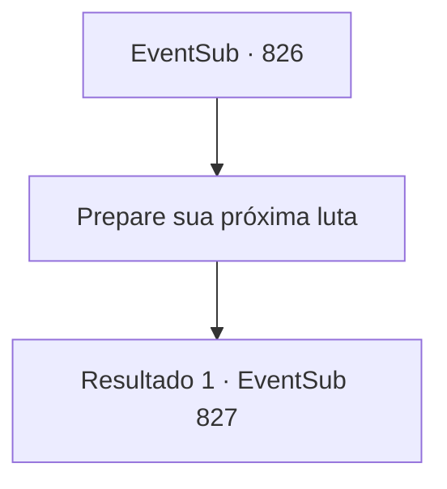

# Eventos secundários · 826

[Índice da tabela](index.md) · [Índice geral](../index.md)

ID: `pt:EventSub:826` · Fonte: `EventSub4` · Versão: 1.2.47.

Mapeamento estático dos arquivos; a disponibilidade e a execução dependem do estado da run.

## Texto do evento

*Sem texto no arquivo.*

## Dados de entrada

```json
{
  "id": 826,
  "grade": 1,
  "subEvent": "",
  "required": ""
}
```

## Mapa das escolhas



## Escolhas e resultados

### Escolha 1

Prepare sua próxima luta

Requisitos e outros campos da escolha:

```json
{
  "required": ""
}
```

#### Resultado 1.1

Haren é um lutador muito capaz, mas isso não te incomoda. Você recupera o fôlego para se preparar para a próxima luta. 

 Finalmente, você sobe ao palco. Algumas pessoas da plateia estão gritando seu nome. Você se prepara para a luta. Haren, o aventureiro, seu próximo oponente, puxa um par de espadas das costas e fala. 

 "Tenho sido um andarilho na última década. Já está na hora de pensar em aposentadoria. Só estou tentando ganhar o prêmio em dinheiro para meu fundo de aposentadoria. Então, por favor, colabore comigo, hein?"


Continuação registrada: [Evento 827](0827.md) na mesma tabela.

```json
{
  "required": "",
  "chance": "1",
  "nextEvent": 827,
  "type": 2,
  "reward": "6_0_62",
  "place": 11
}
```

## Referências que chegam a este evento

- [Evento 825 · escolha 1 · resultado 1](0825.md#escolha-1)
