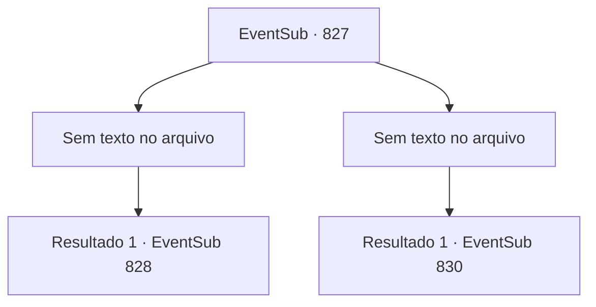

# Eventos secundários · 827

[Índice da tabela](index.md) · [Índice geral](../index.md)

ID: `pt:EventSub:827` · Fonte: `EventSub4` · Versão: 1.2.47.

Mapeamento estático dos arquivos; a disponibilidade e a execução dependem do estado da run.

## Texto do evento

*Sem texto no arquivo.*

## Dados de entrada

```json
{
  "id": 827,
  "grade": 1,
  "subEvent": "",
  "required": ""
}
```

## Mapa das escolhas



## Escolhas e resultados

### Escolha 1

*Sem texto no arquivo; o papel dessa opção depende da interface do jogo.*

Requisitos e outros campos da escolha:

```json
{
  "required": ""
}
```

#### Resultado 1.1

Após ser socado no peito, Haren é jogado para fora do palco. Ele é desclassificado imediatamente por deixar o palco, e a multidão vai à loucura. <link=shake>

 "WOOOOOOOOO!!!"

</link> Você se aproxima de Haren e estende a mão para ele. Ele solta um suspiro e a aceita. Você o puxa com toda a sua força, depois sai do palco. 

 As lutas continuam. Você observa os outros competidores lutarem, verificando seu próximo oponente. Seu oponente da luta final é um cavaleiro chamado 'Sir Sparkles'. Ele é um lutador muito habilidoso do Reino de Lothar, que já ocupou a posição de Capitão da Guarda Real.

Continuação registrada: [Evento 828](0828.md) na mesma tabela.

```json
{
  "required": "",
  "chance": "1",
  "nextEvent": 828,
  "type": 2,
  "reward": ""
}
```

### Escolha 2

*Sem texto no arquivo; o papel dessa opção depende da interface do jogo.*

Requisitos e outros campos da escolha:

```json
{
  "required": ""
}
```

#### Resultado 2.1

As lâminas gêmeas de Haren param bem antes da sua garganta. Você levanta as mãos em sinal de rendição. A multidão vai à loucura. <link=shake>

 "WOOOOOOOOO!!!"

</link> Haren faz alguns truques com suas espadas gêmeas para responder aos aplausos. Você assiste silenciosamente à performance antes de se dirigir aos assentos dos espectadores. 

 As lutas continuam. O feroz torneio dura o dia inteiro. Finalmente, o vencedor é decidido. É um cavaleiro chamado 'Sir Sparkles', do Reino de Lothar. Após o término do torneio, você sai da arena. As pessoas ainda estão aproveitando as festividades. Ia ser uma longa noite.

Continuação registrada: [Evento 830](0830.md) na mesma tabela.

```json
{
  "required": "",
  "chance": "1",
  "nextEvent": 830,
  "type": 2,
  "reward": ""
}
```

## Referências que chegam a este evento

- [Evento 826 · escolha 1 · resultado 1](0826.md#escolha-1)
